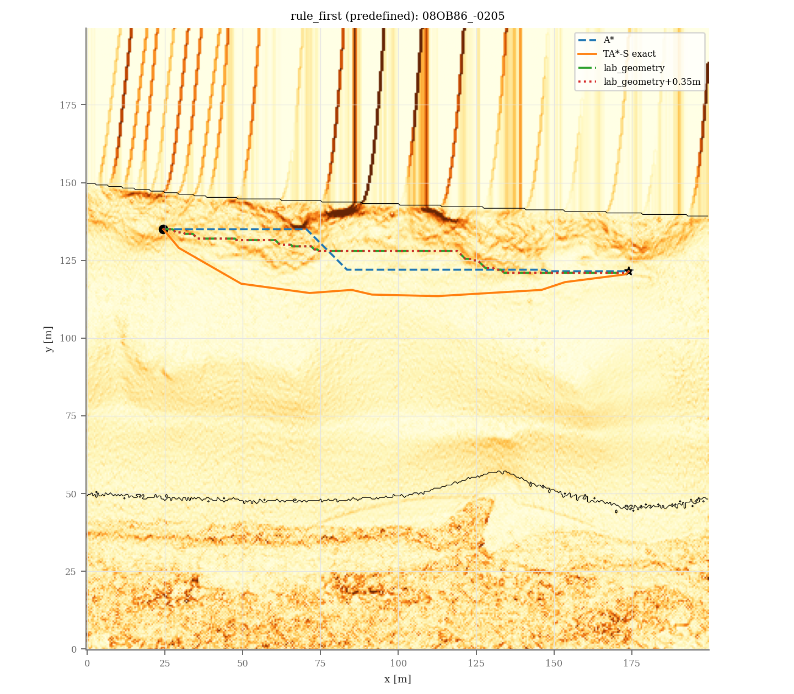
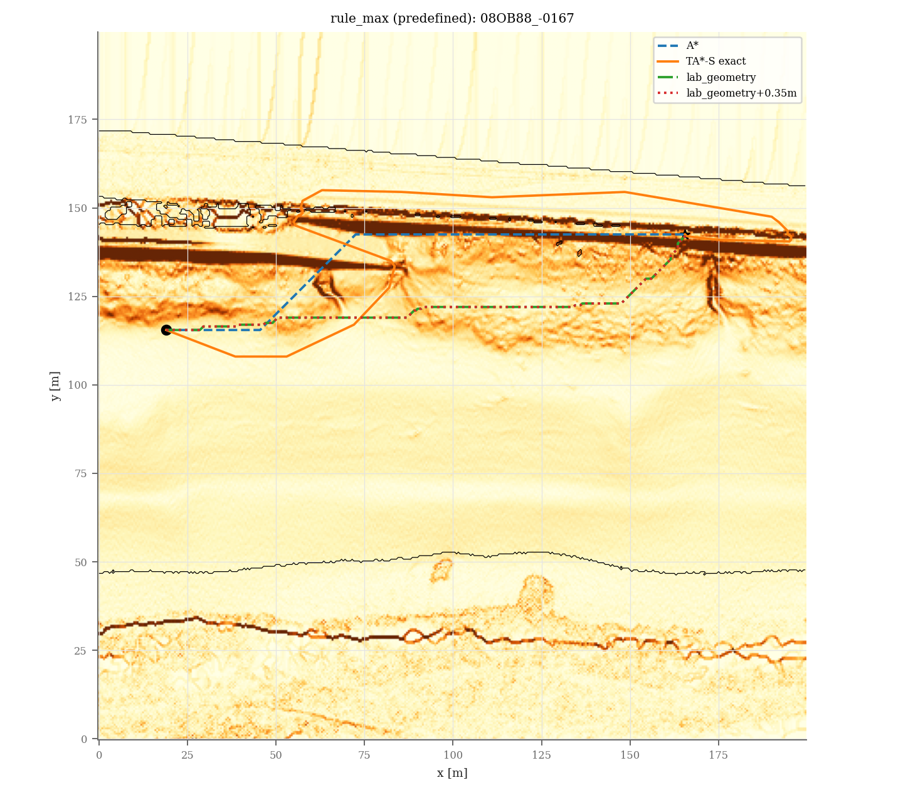

# 指示書031：研究室GeometryLayer＋NavFnコストのPython比較

ブランチ：`codex/031-lab-baseline`。土台：`6367b58f89f65d3a707e648a637614f6776d270d`。実装・実行ログのコミット：`dd2de6ffcf33b9d73d2c2e61a93fd595469f3d0c`。この報告は後続の文書コミットに保存する。マージせずpushまで。

192シナリオ×4方式を実行し、全768経路で解が得られた。A*とTA*-S exactの013との照合は7296フィールドすべて一致し、最大絶対差は0だった（時間・エネルギーを除く）。Pythonの全28テストモジュールが成功した。

## 1. 実装・実行・検証

- `tapp/lab_geometry.py`：`geometry_layer_cost`、`navfn_cell_cost`、`obstacle_mask`、`plan_lab`。8方向の高低差/距離の平均、3以下の近傍で不明、1.41と57.3、指定の段階値を固定した。研究室の非公開リポジトリにはアクセスしておらず、指示書031の転記に従った。
- `experiments/lab_baseline.py`：48か所×100/200m×漂着物なし/ありの全シナリオを再生成し、A*・TA*-S exact・lab_geometry・lab_geometry+0.35mを実行する。A*/TA*は既存関数をそのまま呼び、全非エネルギー経路指標・シナリオのシードと切出しを既存offline.csvに照合する。
- `tests/test_lab_geometry.py`：平面の独立した近傍計算、全コスト段階、不明値、NavFnの既知値変換、独立Dijkstraの最適コスト、障害物と開始点の拒否、013との照合を検証した。既存テストは変更していない。
- `README_ja.md`：式、グラフの定義、格子と後処理の違い、障害物の定義、検定ファミリー、ライセンスを記した。
- `sources/`：参照したNav2のソース全文・版・URL・SHA-256を保存した。

**既存ファイルは1つも変更していない。パラメータは調整していない。エネルギーは出力・集計しない。Gazeboは起動していない。**

実行コマンド（作業dirは `/workspace/thesis-031/conference`）：

```bash
python3 -m venv --system-site-packages /workspace/venvs/thesis-031
/workspace/venvs/thesis-031/bin/python -m tests.test_planners
OPENBLAS_NUM_THREADS=1 MPLCONFIGDIR=/tmp/thesis-031-mpl XDG_CACHE_HOME=/tmp/thesis-031-cache /workspace/venvs/thesis-031/bin/python -m tests.test_lab_geometry
OPENBLAS_NUM_THREADS=1 MPLCONFIGDIR=/tmp/thesis-031-mpl XDG_CACHE_HOME=/tmp/thesis-031-cache /workspace/venvs/thesis-031/bin/python experiments/lab_baseline.py --workers 3
/workspace/venvs/thesis-031/bin/python results/lab_baseline/verification/run_tests.py
OPENBLAS_NUM_THREADS=1 MPLCONFIGDIR=/tmp/thesis-031-mpl /workspace/venvs/thesis-031/bin/python results/lab_baseline/verification/diagnostics.py
```

専用venvから既存のインストール済みパッケージを参照した。環境は下記に保存した。
全テストのランナーは同じvenv、OPENBLAS_NUM_THREADS=1、/tmpのMatplotlib/cacheを使用する。
テスト中に図や表を再生成する既存コードも、一時領域を使っている。既存の結果の不変性は全追跡ファイルのダイジェストで確認した。

### テスト出力全文

```text
$ python3 -m tests.test_beach_terrain
beach determinism, shapes, finite values, water/wet and unchanged rolling passed
averaged sea/wet/dry/inland profiles and foreshore slopes passed (validation seeds)
scarp 45-degree coverage passed: [np.float64(0.465), np.float64(0.615), np.float64(0.0), np.float64(0.16), np.float64(0.555)]
beach scenarios, delegated planner equality and exact smoothing passed (15 scenarios)
exact beach online safety passed (9 trajectories)
all beach-terrain tests passed

exit=0

$ python3 -m tests.test_collision
segment_cells passed (2000 seeded segments vs exhaustive SAT, reversal and boundary cases)
corner-grazing reproduction and exact rejection passed
legacy online and smoothing regressions passed
exact online safety passed (41 trajectories, A* and D* Lite)
all collision tests passed

exit=0

$ python3 -m tests.test_dstar
static agreement passed (20 random grids, tolerance 1e-9)
dynamic agreement passed (5 seeds x 20 updates, tolerance 1e-9)
corner constraints, cost decreases, unreachable/reopened routes and ties passed
task 001 regression passed (ridge soft and hills hard, search omitted)
D* Lite safety passed (20 trajectories, normal and every-step replanning)
error handling and fixed/adaptive-with-map prior handling passed
all D* Lite tests passed

exit=0

$ python3 -m tests.test_endpoint_component
component topology: exact four-neighbour BFS, no free/diagonal bridges or distance cap; raw masks, costs and input arrays protected
component runtime: enclosed synthetic start escapes through search AND latest-map handoff; mapper remains immutable
3b PASS: substitute remains nearby after replanning and arrival
4 PASS: actual async runtime stops, waits 1 sim second, retries once, skips and terminates
4b PASS: stale blocked handoff stops and terminates after one timed retry
component lifecycle: unchanged nearby-target tracking, one timed retry, skip and stale-handoff stop contracts passed
legacy bytes: only two corrected start_steep labels differ in replay; all other fields and four preparation variants unchanged
028b saved replay: {'case': 'results/rtf_check/divergence/R1_05/physical_1/raw/08OB87_-0706', 'failure_class': 'start_steep', 'policy': 'escape', 'none': 'no_path', 'result': 'no_path', 'goal': [347, 145], 'outcome': 'unreachable', 'relaxed_cells': 1, 'relaxed_truth_lethal_cells': 0, 'raw_cells_cleared': 0, 'raw_path_cells': 0, 'relaxed_length_m': 0.0, 'truth_lethal_length_m': 0.0, 'cells': []}
028b saved replay: {'case': 'results/rtf_check/divergence/R1_05/physical_1/raw/08OB87_-0706', 'failure_class': 'start_steep', 'policy': 'escape_component', 'none': 'no_path', 'result': 'no_path', 'goal': [347, 145], 'outcome': 'unreachable', 'relaxed_cells': 0, 'relaxed_truth_lethal_cells': 0, 'raw_cells_cleared': 0, 'raw_path_cells': 0, 'relaxed_length_m': 0.0, 'truth_lethal_length_m': 0.0, 'cells': []}
028b saved replay: {'case': 'results/rtf_check/hayashi_first_gazebo_check/physical_3/raw/08OB87_-0706', 'failure_class': 'start_steep', 'policy': 'escape', 'none': 'no_path', 'result': 'no_path', 'goal': [347, 145], 'outcome': 'unreachable', 'relaxed_cells': 1, 'relaxed_truth_lethal_cells': 0, 'raw_cells_cleared': 0, 'raw_path_cells': 0, 'relaxed_length_m': 0.0, 'truth_lethal_length_m': 0.0, 'cells': []}
028b saved replay: {'case': 'results/rtf_check/hayashi_first_gazebo_check/physical_3/raw/08OB87_-0706', 'failure_class': 'start_steep', 'policy': 'escape_component', 'none': 'no_path', 'result': 'no_path', 'goal': [347, 145], 'outcome': 'unreachable', 'relaxed_cells': 0, 'relaxed_truth_lethal_cells': 0, 'raw_cells_cleared': 0, 'raw_path_cells': 0, 'relaxed_length_m': 0.0, 'truth_lethal_length_m': 0.0, 'cells': []}
028b saved replay: {'case': 'results/lidar_fine/physical_10/raw/08OB88_-1417', 'failure_class': 'goal_cell', 'policy': 'escape', 'none': 'no_path', 'result': 'path', 'goal': [198, 151], 'outcome': 'nearby', 'relaxed_cells': 0, 'relaxed_truth_lethal_cells': 0, 'raw_cells_cleared': 0, 'raw_path_cells': 0, 'relaxed_length_m': 0.0, 'truth_lethal_length_m': 0.0, 'cells': []}
028b saved replay: {'case': 'results/lidar_fine/physical_10/raw/08OB88_-1417', 'failure_class': 'goal_cell', 'policy': 'escape_component', 'none': 'no_path', 'result': 'path', 'goal': [198, 151], 'outcome': 'nearby', 'relaxed_cells': 0, 'relaxed_truth_lethal_cells': 0, 'raw_cells_cleared': 0, 'raw_path_cells': 0, 'relaxed_length_m': 0.0, 'truth_lethal_length_m': 0.0, 'cells': []}
saved component contract: both start_steep cases clear ZERO cells, protect all raw masks, retry once and advance to the next stop
all task028b component tests passed (Python only; Gazebo not run)

exit=0

$ python3 -m tests.test_endpoint_policy
1 PASS: default original runtime, path and CSV bytes unchanged
2 PASS: fixed 0.5m start escape; all three raw masks remain blocked
3 PASS: reachable nearest substitute <=1.0m; raw goal unreachable
3b PASS: substitute remains nearby after replanning and arrival
4 PASS: actual async runtime stops, waits 1 sim second, retries once, skips and terminates
4b PASS: stale blocked handoff stops and terminates after one timed retry
5 PASS: exact failed map, classifications, 10s snapshots/newest 3, offline exact lengths
5b PASS: time-aligned actual-travel audit; ROS callback holds zero velocity and retains run log
6 replay: {'case': 'results/rtf_check/divergence/R1_05/physical_1/raw/08OB87_-0706', 'failure_class': 'start_steep', 'none': 'no_path', 'escape': 'unreachable_after_retry_then_next_stop', 'goal': [347, 145], 'outcome': 'unreachable', 'relaxed_cells': 1, 'relaxed_truth_lethal_cells': 0, 'raw_cells_cleared': 0, 'relaxed_length_m': 0.0, 'truth_lethal_length_m': 0.0, 'cells': []}
6 replay: {'case': 'results/rtf_check/hayashi_first_gazebo_check/physical_3/raw/08OB87_-0706', 'failure_class': 'start_steep', 'none': 'no_path', 'escape': 'unreachable_after_retry_then_next_stop', 'goal': [347, 145], 'outcome': 'unreachable', 'relaxed_cells': 1, 'relaxed_truth_lethal_cells': 0, 'raw_cells_cleared': 0, 'relaxed_length_m': 0.0, 'truth_lethal_length_m': 0.0, 'cells': []}
6 replay: {'case': 'results/lidar_fine/physical_10/raw/08OB88_-1417', 'failure_class': 'goal_cell', 'none': 'no_path', 'escape': 'path', 'goal': [198, 151], 'outcome': 'nearby', 'relaxed_cells': 0, 'relaxed_truth_lethal_cells': 0, 'raw_cells_cleared': 0, 'relaxed_length_m': 0.0, 'truth_lethal_length_m': 0.0, 'cells': []}
6 PASS: three saved failures reproduced without changing fixed constants
Task028 endpoint policy tests passed; full existing suite is run separately (requirement 7).

exit=0

$ python3 -m tests.test_footprint
dilation: 0.5m circle, rocks not doubled, zero radius, immutable costs/endpoints and raster rounding passed
proximity: analytic line-circle lengths, overlapping unions and tangencies passed
requested LAS case: inflated planner reports no_path without moving endpoints
online: zero radius preserves exact task014 trajectory and planning count
rollover: strict +/-90deg threshold, first time/position and immutable fake records passed
statistics: two sizes averaged within beach, incomplete pairs excluded, one fixed Holm family passed (synthetic fixtures only)
Gazebo selection: six fixed scenarios, inflated-only selection and explicit infeasibility passed
comparison: unknown physical outcomes stay unknown; rollover pairs excluded; explicit executed denominator passed (fixtures only)
three-method reports: each contrast uses its own completion cohort; third-method failure does not drop old pairs (fixtures only)
all footprint and rollover tests passed

exit=0

$ python3 -m tests.test_geo
/opt/codex/runtimes/codex-primary-runtime/dependencies/python/lib/python3.12/site-packages/fastapi/testclient.py:1: StarletteDeprecationWarning: Using `httpx` with `starlette.testclient` is deprecated; install `httpx2` instead.
  from starlette.testclient import TestClient as TestClient  # noqa
zone VIII reference differences [latitude_deg, longitude_deg]:
-4.25145429972e-09 2.46816966865e-09
-4.06389943919e-09 -3.64556740351e-09
2.36028796508e-09 -3.05306002701e-10
2.78198797332e-10 -4.38916458734e-10
projection round-trip max error [m]: 7.10133463144e-09
geographic sidecars: 13 maps; source axes, coastline anchor, half-cell offset, round trips and NPZ hashes passed
Web APIs: geographic map conversions, unavailable-map response and unchanged legacy metadata/image passed
all geographic conversion tests passed

exit=0

$ python3 -m tests.test_ground_estimate
1 PASS: implicit/explicit all_returns match pre-change update JSON, snapshots, histories, NPZ and multi-sensor sidecar bytes
2 PASS: 0.55m box creates false steep neighbours only with all_returns; box detection/inflation and all evidence unchanged
ground_estimate x y slope_deg steep box_lethal
all_returns 9 10 28.810793742973065 True True
all_returns 11 10 28.810793742973065 True True
all_returns 10 9 28.810793742973065 True True
all_returns 10 11 28.810793742973065 True True
non_obstacle 9 10 0.0 False True
non_obstacle 11 10 0.0 False True
non_obstacle 10 9 0.0 False True
non_obstacle 10 11 0.0 False True
3 PASS: all-excluded cells retain prior height and seen status; last-64 ALL returns displace older ground, then ground observations resume
4 PASS: sub-0.3m terrain changes retained; bilinear prior and the unchanged >=0.3m obstacle boundary used
5 PASS: LiDAR+two cameras share unchanged 2+1 detection evidence, source attribution and filtering; ground-only median removes false steep cells
configuration PASS: byte-identical default manifests; opt-in factory, CLI, ROS parameter and actual node constructor propagation; invalid/coarse combinations rejected
all ground-estimate tests passed; requirement 6 is verified by running every conference/tests module separately (Python only)

exit=0

$ python3 -m tests.test_gz_compare
comparison scenarios: first six LAS test patches, clean 200m seed0; both methods match direct start/goal/path calls
unavailable-world fixture: all scenarios retained, one export attempt per beach, no invented physical measurements
worlds: all six LAS maps reconstructed from decoded PNGs within 0.1m; default exports unchanged by explicit legacy limit; invalid limits rejected
comparison report: 6x2 kinematic fixtures agree with analyze_run; paired medians, immutable raw logs and excluded columns passed
fixture values are simulated test data, not Gazebo measurements
all Gazebo comparison tests passed (ROS2/Gazebo not required)

exit=0

$ python3 -m tests.test_gz_online_batch
scenarios: first ten LAS test beaches; truth/prior arrays, seed-selected five points, task014 order and inflated plans agree with direct calls
runtime: unchanged async worker uses the predeparture order; opt-in masks and blocked endpoints verified
synthetic fixtures only: completion/stuck/rollover/timeout, five-target prefix, contact, active-path deviation, planning times and immutable originals passed
raw CSV parts: strict file limit, repeated headers, exact numeric strings and complete record order passed
unrun report: twenty scenarios retained, unknown physical outcomes stay blank, no energy/map/world artifacts and overwrite refused
synthetic paired counts: incomplete tours excluded from paired medians; each outcome retains the actual-recording denominator
all Gazebo online batch tests passed (ROS2/Gazebo not required; fixture measurements are not experimental data)

exit=0

$ python3 -m tests.test_lab_geometry
1 PASS: flat terrain and physical 5/12/22/30deg planes match independent eight-neighbour formula; all six cost stages and uint8 truncation
2 PASS: <=3 valid neighbours and absent centres stay unknown; fourth valid neighbour enables cost
3 PASS: pinned Jazzy setCostmap integer conversion, 253/254 blockage and allowed unknown=253
4 PASS: no raw obstacle contact/corner cuts; blocked starts and disconnected goals rejected; independent Dijkstra optimum; one 0.35m square-distance inflation
5 PASS: task013 A*/TA*-S all non-energy path metrics and scenario identifiers match clean/debris, 100/200m; times independently remeasured
all lab-geometry tests passed; requirement 6 is checked by the full conference/tests suite

exit=0

$ python3 -m tests.test_mapfiles_sim
/opt/codex/runtimes/codex-primary-runtime/dependencies/python/lib/python3.12/site-packages/fastapi/testclient.py:1: StarletteDeprecationWarning: Using `httpx` with `starlette.testclient` is deprecated; install `httpx2` instead.
  from starlette.testclient import TestClient as TestClient  # noqa
maps: 5 lossless scenario round trips, float32+residual, NaN, all 23 files and all 17 legacy IDs passed
straight completed True max_deviation_m 3.552713678800501e-15 elapsed_s 19.700000000000003
right_angle completed True max_deviation_m 0.20226302369017546 elapsed_s 39.650000000000006
closed completed True max_deviation_m 0.3173559828528229 elapsed_s 68.35000000000001
controller: reverse-heading spin then advance, curvature-preserving saturation, timeout passed
tour map=flat_test_100m.npz elapsed_s=248.15 deviation_mean_m=0.006614475997696592 deviation_max_m=0.33848962758007467 path_lethal_cells=0 out_of_bounds_samples=0 completed=True
contact_cells_xy_m []
tour map=beach_gentle_200m_100.npz elapsed_s=418.45000000000005 deviation_mean_m=0.01568040573287969 deviation_max_m=0.20112452978749665 path_lethal_cells=0 out_of_bounds_samples=0 completed=True
contact_cells_xy_m []
gazebo flat_test_100m.npz pixels 257 size_m 100.0 max_error_m 0.0 boxes 3
gazebo real_08OB87_-0206_200m_0.npz pixels 2049 size_m 200.0 max_error_m 0.06374200885325632 boxes 0
API: 40 maps, file metadata/PNG, five-point planning/simulation, 404/422, immediate 409 and guard recovery passed
all mapfiles/simulation tests passed

exit=0

$ python3 -m tests.test_mission
/opt/codex/runtimes/codex-primary-runtime/dependencies/python/lib/python3.12/site-packages/fastapi/testclient.py:1: StarletteDeprecationWarning: Using `httpx` with `starlette.testclient` is deprecated; install `httpx2` instead.
  from starlette.testclient import TestClient as TestClient  # noqa
maps: 5 synthetic + 12 validation, cache, PNG dimensions/orientation passed
parity: 5-point terrain order/cost/path and Euclidean order/physical legs passed
validation: outside, water, blocked, unreachable, counts, rounding, duplicate/invalid base passed
safety: synthetic/beach_gentle/200/100, 5 points, terrain/euclid contact=0
safety: synthetic/beach_steep/200/100, 5 points, terrain/euclid contact=0
safety: synthetic/beach_scarp/200/100, 5 points, terrain/euclid contact=0
safety: real/08OB87_-0206/200, 5 points, terrain/euclid contact=0
safety: real/08OB88_01332/200, 5 points, terrain/euclid contact=0
API: maps/info/PNG/plan/static, 404/422, responsive worker, immediate 409 and guard recovery passed
all mission tests passed

exit=0

$ python3 -m tests.test_natural_terrain
natural generation determinism, distinct seeds, shape and finite values passed
pre-erosion radial spectrum passed: [-3.5227452123825955, -3.4854938900090673, -3.5147015961346426, -3.469782545726739, -3.4636674128050786]
rock area law: 0.4 0.02703765778384137 0.02660688949938067
rock area law: 0.6 0.014010959187524073 0.013724330217025335
rock area law: 1.0 0.003425544099666588 0.003651617375374042
natural scenarios and exact online safety passed (15 trajectories)
experiment oracle contact audit passed (both reference planners)
all natural-terrain tests passed

exit=0

$ python3 -m tests.test_online
regression passed (ridge/100 m, seeds 0 and 7)
perfect prior passed (all terrain kinds/50 m/seed 0)
coarse prior passed (shape, no rocks, partial blocks, noise, robot/weights, edges)
prior policies passed (hard/soft/ignore, sensing overrides, cell-specific triggers)
safety passed (60 trajectories: five online variants and constrained oracle)
all online tests passed

exit=0

$ python3 -m tests.test_online_deadend
safeguards: unknown-only memory, known truth precedence, strict N_B threshold and per-leg reset passed
08OB86_00294: disabled trajectory/count parity and A/B/A+B stale five-point contacts=0
08OB86_-0205: disabled trajectory/count parity and A/B/A+B stale five-point contacts=0
08OB87_-0706: disabled trajectory/count parity and A/B/A+B stale five-point contacts=0
08OC99_01733 stale R10: validation-frozen B completed without contact
all online dead-end tests passed

exit=0

$ python3 -m tests.test_online_mission
/opt/codex/runtimes/codex-primary-runtime/dependencies/python/lib/python3.12/site-packages/fastapi/testclient.py:1: StarletteDeprecationWarning: Using `httpx` with `starlette.testclient` is deprecated; install `httpx2` instead.
  from starlette.testclient import TestClient as TestClient  # noqa
beach_gentle: no-prior/coarse exact trajectory and plan-count parity; contact=0
beach_steep: no-prior/coarse exact trajectory and plan-count parity; contact=0
08OB87_-0206: no-prior/coarse exact trajectory and plan-count parity; contact=0
08OB88_01332: no-prior/coarse exact trajectory and plan-count parity; contact=0
08OB87_-0206 stale five-point tour: online contact=0; fixed debris cells= 11
08OB88_01332 stale five-point tour: online contact=0; fixed debris cells= 18
08OB89_-1597 stale five-point tour: online contact=0; fixed debris cells= 6
async: worker blocked while simulation time advances, old path/positive commands continue; latest-pose replacement, one trajectory, plan/event logs and stale/cross-run rejection passed
follower adapter: legacy completion/telemetry unchanged; intermediate-leg CSV stays open; final completion and stationary watchdog terminate the run
maps/API: debris elevations, cost/lethal/obstacle/water/nodata match; coarse prior, legacy telemetry, live path/count validation and online=false default passed
all online-mission tests passed

exit=0

$ python3 -m tests.test_planners
all planner tests passed
roll-aware tests passed

exit=0

$ python3 -m tests.test_pointcloud_map
flat fixture: median height, zero slope/cost, exact hit-only mask, unknown cells and immutable prior passed
box fixtures: prior-relative clusters, exact TraversabilityMap features, steep inflation and bounded unknown halo passed
registration: model/sensor offset, roll/pitch/yaw convention and stamped SO(3) interpolation passed
PointCloud2 layouts: endian, point/row padding, truncation, nonfinite/range/bounds filtering passed
model: default SDF bytes unchanged; 16 x 2deg channels, 360deg/10Hz/30m and configurable assumed mount/noise passed
LiDAR runtime: worker and delayed handoff use hit-only clouds; truth maps and virtual_sense are unavailable
/workspace/thesis-031/conference/experiments/gz_lidar_report.py:159: FutureWarning: The behavior of DataFrame concatenation with empty or all-NA entries is deprecated. In a future version, this will no longer exclude empty or all-NA columns when determining the result dtypes. To retain the old behavior, exclude the relevant entries before the concat operation.
  data = pd.concat([old, pd.DataFrame(rows)], ignore_index=True)
quality fixtures: unique hit-cell errors, measured map times, unchanged task021 controls and unknown LiDAR outcomes passed
all pointcloud map tests passed (synthetic fixtures only; no Gazebo measurements)

exit=0

$ python3 -m tests.test_pointcloud_map_fine
flat: no obstacles; only hit cells become known
noisy box fixture (seed, coarse outside lethal, fine outside lethal): [(100, 12, 8), (101, 11, 8), (102, 12, 8), (103, 12, 8), (104, 12, 8)]
box retained; 0.5m heights/cost/seen bytes and steep inflation unchanged
one dilation: exhaustive centre-to-square distance, repeated/additive seeds, centre radius bound, packed save passed
centre clearance: 0.1m side spill leaves the next coarse centre free; all <=0.5m centres blocked
boundaries: all 25 subcell phases, four map corners and diagonal square-edge clearance passed
legacy: default/explicit coarse use the unchanged class; full controlled-clock update and NPZ bytes identical
selection: legacy manifest bytes identical; fine preserves exact task022 cohort, mesh/0.3x/1s protocol
Docker wrapper fixture: coarse defaults preserved; both fine flag spellings forward the fixed run settings
/workspace/thesis-031/conference/experiments/lidar_fine_report.py:168: FutureWarning: The behavior of DataFrame concatenation with empty or all-NA entries is deprecated. In a future version, this will no longer exclude empty or all-NA columns when determining the result dtypes. To retain the old behavior, exclude the relevant entries before the concat operation.
  data = pd.concat([old, pd.DataFrame(rows)], ignore_index=True)
map audit fixtures: final-lethal versus raw-detector errors distinguished; four methods retain cached values and missing fine outcomes
all fine-grid pointcloud tests passed (synthetic fixtures only, no Gazebo results)

exit=0

$ python3 -m tests.test_real_beach
all 60 patches loaded: shapes, 12/48 split, nearest-data fill passed
all 60 patches satisfy sea-to-land orientation
08OB86_00294: 100/200m crops, deterministic clean/debris scenarios, reachability and forbidden masks passed
08OB86_-0205: 100/200m crops, deterministic clean/debris scenarios, reachability and forbidden masks passed
08OB87_-0706: 100/200m crops, deterministic clean/debris scenarios, reachability and forbidden masks passed
08OB88_-1417: 100/200m crops, deterministic clean/debris scenarios, reachability and forbidden masks passed
08OB88_-0167: 100/200m crops, deterministic clean/debris scenarios, reachability and forbidden masks passed
08OB86_00294: exact offline and coarse R5 c10 online safety passed, clean/debris
08OB86_-0205: exact offline and coarse R5 c10 online safety passed, clean/debris
08OB87_-0706: exact offline and coarse R5 c10 online safety passed, clean/debris
08OB88_-1417: exact offline and coarse R5 c10 online safety passed, clean/debris
08OB88_-0167: exact offline and coarse R5 c10 online safety passed, clean/debris
real-beach test groups failed: 0
all real-beach tests passed

exit=0

$ python3 -m tests.test_real_beach_las
data: all 60 LAS patches, 12/48 split, exact names/order/origin/axes, npts and sea-to-land orientation passed
quantized_0.1m_fraction: new_max 0.0035301084084904803 old_min 0.27882342564826246
defaults: implicit/explicit shizuoka_beach are bit-identical for the first 3 test patches
08OB86_00294: LAS 100/200m clean/debris repeatability, masks and reachability passed
08OB86_-0205: LAS 100/200m clean/debris repeatability, masks and reachability passed
08OB87_-0706: LAS 100/200m clean/debris repeatability, masks and reachability passed
08OB88_-1417: LAS 100/200m clean/debris repeatability, masks and reachability passed
08OB88_-0167: LAS 100/200m clean/debris repeatability, masks and reachability passed
08OB86_00294: exact offline and coarse R5 c10 safety, clean/debris contact=0
08OB86_-0205: exact offline and coarse R5 c10 safety, clean/debris contact=0
08OB87_-0706: exact offline and coarse R5 c10 safety, clean/debris contact=0
08OB88_-1417: exact offline and coarse R5 c10 safety, clean/debris contact=0
08OB88_-0167: exact offline and coarse R5 c10 safety, clean/debris contact=0
/opt/codex/runtimes/codex-primary-runtime/dependencies/python/lib/python3.12/site-packages/fastapi/testclient.py:1: StarletteDeprecationWarning: Using `httpx` with `starlette.testclient` is deprecated; install `httpx2` instead.
  from starlette.testclient import TestClient as TestClient  # noqa
mapfiles: all 12 LAS validation files match build_real exactly and retain Ground attribution
comparison: identity joins reject missing/duplicate cases; 16-bit PNG filters preserve standard-decoded height samples
all real-beach LAS tests passed

exit=0

$ python3 -m tests.test_real_sensors
PASS legacy model SDF (with/without LiDAR) and fine-map NPZ SHA256 match pre-change bytes
PASS real preset mounts, symmetry, unchanged LiDAR spec and camera FOV/ranges without intrinsics
A2 camera1: image=214x125, horizontal_deg=87.000000000000, vertical_deg=57.999358468411, intrinsics=absent
A2 camera2: image=214x125, horizontal_deg=87.000000000000, vertical_deg=57.999358468411, intrinsics=absent
PASS A2: three camera-free SDFs byte-identical; depth SDF/spec change only prescribed resolution and intrinsics
PASS arbitrary sensor/model roll-pitch-yaw and translation match independent homogeneous transform
PASS both outward cameras: ground/box registration, shared 2+1 evidence, one inflation and saved provenance
PASS synthetic camera boxes in LiDAR blind zone at 1.5/2/3m; residual 1m blind zone disclosed
PASS per-sensor range/FOV/finite filtering and byte-identical task023 fusion/inflation for registered input
PASS manifest records all real specs/mounts; explicit fine selection; Docker wrapper forwards sensor flags
PASS A2 wrapper: unset flags preserve full legacy argv bytes; individual/both/empty supplied values forwarded (fake Docker only)
PASS analytic 4.105m LiDAR near bound, discrete-beam gap, rear blind zone and camera symmetry
PASS actual ROS adapter: bounded queues, fair sources, stamped transforms, logs and freshness (transport mocked)
all real sensor tests passed (synthetic/geometry only; Gazebo not run)

exit=0

$ python3 -m tests.test_risk_prior
coarse elevation/refactor passed (16 terrain/cell/noise combinations)
calibration passed (all-cell counts/means, deterministic pooling, JSON, test-seed rejection)
empty-bin fallback and boundary assignment passed
risk cost passed (expected means, lambda monotonicity/clipping, noise, unchanged lethal mask)
risk-prior safety passed (40 trajectories, 40 successful; 20 m cells, R=5/15 m, lambda=0/1)
all risk-prior tests passed

exit=0

$ python3 -m tests.test_ros2_gz
/opt/codex/runtimes/codex-primary-runtime/dependencies/python/lib/python3.12/site-packages/fastapi/testclient.py:1: StarletteDeprecationWarning: Using `httpx` with `starlette.testclient` is deprecated; install `httpx2` instead.
  from starlette.testclient import TestClient as TestClient  # noqa
model: 150kg box inertia, 0.699m spacing, 4 wheels/side, DiffDrive joints, IMU, world pose and opt-in external visual passed
packages: ament_python metadata, resource markers, node entry points, launch/bridge configuration and Python syntax passed
follower: bit-identical kinematic trajectory, completion, stationary watchdog and CSV fields passed
data_source synthetic_robot_sim
source completed elapsed_s deviation_mean_m deviation_max_m lethal_cells
recorded True 34.2 0.02959598405434589 0.3173397734180379 0
kinematic True 34.2 0.02959598405434589 0.3173397734180379 0
attitude actual_p95_deg map_p95_deg
roll 0.0 0.0
pitch 0.0 0.0
data_source synthetic_robot_sim
source completed elapsed_s deviation_mean_m deviation_max_m lethal_cells
recorded True 7.7 0.0 0.0 0
kinematic True 7.7 0.0 0.0 0
attitude actual_p95_deg map_p95_deg
roll 0.0 11.309932474020224
pitch 0.0 5.710593137499648
report: synthetic robot_sim CSV deviation/contact/time parity, kinematic comparison and plots passed (not Gazebo measurements)
API: send/fetch/id/204, telemetry/freshness, invalid map/path 422 and bridge map rejection passed
worlds: original PNG hashes/obstacle XML preserved, effective terrain transforms unchanged, sensors and IMU added
all ROS-free ROS2/Gazebo tests passed

exit=0

$ python3 -m tests.test_thesis_figures

T1
 debris    metric  n    A_median   TAS_median  delta_median              p         p_holm
  False mean_cost 48 0.110342949 0.0767774554 -0.0352167333 7.10542736e-15 5.68434189e-14
  False     climb 48  1.50126915  0.890802236  -0.410943017 7.10542736e-15 5.68434189e-14
  False  p95_roll 48  5.45746622     3.567633   -1.89097743 7.10542736e-15 5.68434189e-14
  False length_xy 48         NaN          NaN   -2.00026809   0.0276182014   0.0552364028
   True mean_cost 48 0.154226921 0.0855587032 -0.0582350381 7.10542736e-15 5.68434189e-14
   True     climb 48  2.07159806   1.30575231  -0.803948405 2.13162821e-14 6.39488462e-14
   True  p95_roll 48  6.86720155   3.63401103   -2.80093993 7.10542736e-15 5.68434189e-14
   True length_xy 48         NaN          NaN  -0.764154874    0.947340222    0.947340222

T2
 radius_m   mode  runs  completed  touching   dJ_median     dJ_p90  replans_median  plan_s_median  plan_s_p95  plan_s_max
        5  fixed    48         48        46   3.8297614 10.8951737               0   0.0943159025 0.513914058  1.09228056
        5 online    48         46         0   1.9542052 10.2738521             101   0.0464642375  0.28593965  1.26618145
       10  fixed    48         48        46   3.8297614 10.8951737               0   0.0960627685 0.506711613  1.25659096
       10 online    48         46         0 0.945069248  6.6029207            94.5   0.0510014495 0.292423272  1.32438343
       15  fixed    48         48        46   3.8297614 10.8951737               0    0.094235528 0.485409814  1.26557115
       15 online    48         47         0 0.688622405 5.29694595              85    0.057362561 0.305458798  1.76405173

T3
                                world         mode  completed  path_lethal_cells  elapsed_s  roll_p95_actual_deg  pitch_p95_actual_deg  roll_p95_map_deg  pitch_p95_map_deg
              file/flat_test_100m.npz offline tour       True                  0    249.412       8.05631294e-09        6.79662109e-10                 0                  0
    file/real_08OB87_-0206_200m_0.npz offline tour       True                  0      348.2           4.76005563            6.20167607        4.58473933         6.31735413
file/real_las_08OB87_-0206_200m_0.npz offline tour       True                  0    289.516           3.83941424            2.47900287        3.84957483         2.58651471
       real_las_08OB87_-0206 / debris        fixed      False                  0      96.15           4.54713144            5.69114628        5.33797683         6.55378208
       real_las_08OB87_-0206 / debris       online       True                  0     190.95           4.31378469            4.21973305        4.30333238         3.67841423
thesis: F1-F7 PDF/PNG, T1-T3 LaTeX/Markdown and numbers.tex generated
statistics: 48 paired beaches, size means, medians and archived contact counts verified
outputs: no excluded measurement columns or values; all thesis figure tests passed

exit=0

$ python3 -m tests.test_tour
kappa=0 agrees with legacy A* (20 random 25x25 grids)
directed A*/Dijkstra agree with all-simple-path exhaustive oracle (10 grids); unreachable/corners/budget passed
uphill/downhill identity, segment units and nonincreasing exact smoothing passed
Held-Karp matches all permutations (30 asymmetric matrices at each of 2..8 destinations); ties/closure passed
beach_gentle: reproducible reachable separated waypoints; all directed legs safe; matrix agrees with individual A*/Dijkstra planning (kappa=0 and physical)
beach_steep: reproducible reachable separated waypoints; all directed legs safe; matrix agrees with individual A*/Dijkstra planning (kappa=0 and physical)
beach_scarp: reproducible reachable separated waypoints; all directed legs safe; matrix agrees with individual A*/Dijkstra planning (kappa=0 and physical)
all multi-goal tour tests passed

exit=0

$ python3 -m tests.test_visibility
visibility: all cells in the physical radius visible on flat terrain, including clipped edges
visibility: front and wall top visible, cells behind the wall occluded
visibility: raising the sensor 0.5 -> 0.8 -> 1.2m never loses a visible cell
sensing: bool mask/cost/lethal tuple and explicit raw-obstacle assumed height passed
control: radial trajectory/count parity; contact diagnostics agree with exact trajectory audit
all visibility tests passed

exit=0
```

```text
test_beach_terrain exit=0
test_collision exit=0
test_dstar exit=0
test_endpoint_component exit=0
test_endpoint_policy exit=0
test_footprint exit=0
test_geo exit=0
test_ground_estimate exit=0
test_gz_compare exit=0
test_gz_online_batch exit=0
test_lab_geometry exit=0
test_mapfiles_sim exit=0
test_mission exit=0
test_natural_terrain exit=0
test_online exit=0
test_online_deadend exit=0
test_online_mission exit=0
test_planners exit=0
test_pointcloud_map exit=0
test_pointcloud_map_fine exit=0
test_real_beach exit=0
test_real_beach_las exit=0
test_real_sensors exit=0
test_risk_prior exit=0
test_ros2_gz exit=0
test_thesis_figures exit=0
test_tour exit=0
test_visibility exit=0
```

## 2. NavFnの式の出どころ

Nav2 `ros-navigation/navigation2` の **jazzyブランチ、パッケージ版1.3.14**、コミット `94d1c2a345dda6ff637e6a72c9101d927ee99f19` を取得した。版は保存したpackage.xml、定数はnavfn.hppで確認した。

- [nav2_navfn_planner/src/navfn.cpp：NavFn::setCostmap、247行目以降](https://github.com/ros-navigation/navigation2/blob/94d1c2a345dda6ff637e6a72c9101d927ee99f19/nav2_navfn_planner/src/navfn.cpp#L247)
- [nav2_navfn_planner/include/nav2_navfn_planner/navfn.hpp：定数、52行目以降](https://github.com/ros-navigation/navigation2/blob/94d1c2a345dda6ff637e6a72c9101d927ee99f19/nav2_navfn_planner/include/nav2_navfn_planner/navfn.hpp#L52)
- 同cppの `NavFn::setupNavFn(true)`、342行目以降の外周処理も適用した。
- 同じ版の `navfn_planner.cpp`、254行目でROSマップをtrueとして渡し、allow_unknown設定を使う呼出しも確認した。同ファイルもsourcesに保存した。

`isROS=true, allow_unknown=true` のとき、入力0〜252は `int(50 + 0.8*c)`、254以上になる場合は253へ制限。入力253/254は内部254で通行不可。不明の入力255は内部253で通行可能・高コストである。
入力の253と変換後の253の意味は異なる。外側1セルはsetupNavFnと同様に内部254にする。
GeometryLayerの0.1/0.2/0.5/0.8×254は、Nav2のunsigned char境界で25/50/127/203に切り捨てた。非公開のGeometryLayer自体の丸めの実装までは確認できないため、この仮定は明示する。

グラフは8近傍、辺コストは両端セルコストの平均×移動距離、角抜け禁止。Pythonの既存A*を使う。通行コストが50以上なのでEuclidのhは許容的で、このグラフのDijkstraと同じ最適解になることを独立Dijkstraのテストで確かめた。
NavFnのポテンシャル伝播・勾配追跡を再現したものではない。

以下は、仕様の物理角度の平面をコードで計算した監査である。平均8方向の勾配は平面の最大勾配より小さくなり、例えば物理30度でもこの式の角度は25度を超えない。係数を補正していない。

```text
 physical_plane_deg  geometry_angle_deg  ros_cost
                  5            3.028148         0
                 12            7.323698        25
                 22           13.728295        50
                 30           19.244067       127

{
  "scenarios": 192,
  "runs": 768,
  "parity_fields": 7296,
  "all_matched": true,
  "maximum_absolute_difference": 0.0,
  "failed_runs": 0
}
```

## 3. 集計・検定・図

中立な指標を先に表示する。steep_lenは013と同じ0.1mサンプリングによる25度超の距離、obstacle_cellsは共通の生の障害物に交差したセル数。
max_pitchは013の1m窓、max_pitch_dir/p95_pitch_dirは進行方向の勾配から算出した最大/95%値。
**mean_costとJは私たちの目的関数なので私たちに有利であり、中立な評価ではない。**
計画時間は今回のPython実装の再測定値。旧CSVの時間と一致させたり、C++の実NavFnの時間と解釈したりしない。
記述表の中央値は013と同じく100/200mを含む各条件96ケースについての値。検定表の中央値・対の差は、サイズを平均した48砂浜についての値なので、記述表の中央値の差とは一致しないことがある。

検定は、100/200mを砂浜内で平均した48か所を単位とする両側Wilcoxon＋Holm。013のCSVの各サイズを独立な砂浜として数えない。
事前のHolmファミリーはTA*-S exactを基準とした3対比×漂着物2条件×全14指標（時間を含む）の84検定。失敗があれば両サイズ・両手法が成功した砂浜だけを使い、除外数を表示する。今回の各検定は48か所すべてを含んだ。
ゼロ差の除外・rank-biserial効果量は既存paired_testと同じ。急斜面距離の中央値0だけで安全性を判断せず、steep_runsの件数も示した。

表示された表の全文：

```text
Task031: neutral metrics first; paired unit is beach, sizes averaged; no energy.
mean_cost and J use OUR terrain objective and favour our method; not neutral metrics.
 debris            planner  scheduled  solved  steep_len  max_slope  p95_slope  max_roll  p95_roll  max_pitch_dir  p95_pitch_dir  max_pitch  obstacle_cells  length_xy    climb  contact_runs  steep_runs  mean_cost          J     time
  False                 A*         96      96        0.0   8.708286   6.066910  7.541856  5.570753       6.414794       3.663500   5.677646             0.0 120.556252 1.440198             0           9   0.114426 232.710269 0.041052
  False        TA*-S exact         96      96        0.0   6.691435   4.665437  5.199285  3.529546       5.169635       2.923985   4.574864             0.0 120.845079 0.959826             0           0   0.077346 190.157858 0.238924
  False       lab_geometry         96      96        0.0   8.162904   5.938159  7.564891  5.191661       6.028917       3.690164   5.751529             0.0 120.628369 1.363369             0           2   0.107792 214.185593 0.195716
  False lab_geometry+0.35m         96      96        0.0   8.162904   5.938159  7.564891  5.191661       6.028917       3.560526   5.751529             0.0 120.626705 1.363369             0           2   0.108057 216.816883 0.184717
   True                 A*         96      96        0.0  10.843638   6.941897  9.939500  6.104602       7.738601       4.686579   7.773548             0.0 120.746068 2.228436             0           9   0.144652 243.319342 0.033316
   True        TA*-S exact         96      96        0.0   8.205284   4.946589  6.356163  3.749669       6.610297       3.390026   6.054865             0.0 121.498341 1.259931             0           0   0.088710 199.592580 0.264035
   True       lab_geometry         96      96        0.0  10.045574   6.824975  9.099776  5.839614       7.413817       4.407843   5.900700             0.0 120.503468 1.610526             0           1   0.136171 233.256811 0.195710
   True lab_geometry+0.35m         96      96        0.0   9.701211   6.824975  9.065251  5.966159       7.524853       4.423604   5.882099             0.0 120.739997 1.656718             0           1   0.136616 230.687881 0.188162

Two-sided Wilcoxon, one Holm family over all predefined contrasts/metrics/debris states:
 debris             method   reference         metric  n_beaches  excluded_beaches  method_mean_size_median  reference_mean_size_median  delta_median            p  rank_biserial       p_holm
  False                 A* TA*-S exact      steep_len         48                 0                 0.000000                    0.000000      0.000000 3.906250e-03       1.000000 1.093750e-01
  False                 A* TA*-S exact      max_slope         48                 0                10.530765                    7.507435      2.010564 1.284661e-11       0.955674 6.808705e-10
  False                 A* TA*-S exact      p95_slope         48                 0                 6.536500                    4.532945      1.485292 1.421085e-14       0.998299 9.521273e-13
  False                 A* TA*-S exact       max_roll         48                 0                 8.513333                    5.747888      2.957196 3.552714e-14       0.994898 2.202682e-12
  False                 A* TA*-S exact       p95_roll         48                 0                 5.457466                    3.567633      1.890977 7.105427e-15       1.000000 5.968559e-13
  False                 A* TA*-S exact  max_pitch_dir         48                 0                 7.730992                    6.306781      1.049898 4.979635e-04       0.561224 1.543687e-02
  False                 A* TA*-S exact  p95_pitch_dir         48                 0                 3.962602                    3.022243      0.570978 7.812767e-06       0.700680 2.812596e-04
  False                 A* TA*-S exact      max_pitch         48                 0                 6.939822                    5.937676      1.044939 1.689218e-04       0.602041 5.405496e-03
  False                 A* TA*-S exact obstacle_cells         48                 0                 0.000000                    0.000000      0.000000 1.000000e+00       0.000000 1.000000e+00
  False                 A* TA*-S exact      length_xy         48                 0               123.539376                  121.897197      2.000268 2.761820e-02       0.363946 6.450187e-01
  False                 A* TA*-S exact          climb         48                 0                 1.501269                    0.890802      0.410943 7.105427e-15       1.000000 5.968559e-13
  False                 A* TA*-S exact      mean_cost         48                 0                 0.110343                    0.076777      0.035217 7.105427e-15       1.000000 5.968559e-13
  False                 A* TA*-S exact              J         48                 0               235.624489                  194.656483     38.416141 7.105427e-15       1.000000 5.968559e-13
  False                 A* TA*-S exact           time         48                 0                 0.062120                    0.326624     -0.261791 7.105427e-15      -1.000000 5.968559e-13
  False       lab_geometry TA*-S exact      steep_len         48                 0                 0.000000                    0.000000      0.000000 5.000000e-01       1.000000 1.000000e+00
  False       lab_geometry TA*-S exact      max_slope         48                 0                 7.780363                    7.507435      0.533353 3.996788e-02       0.340136 8.792934e-01
  False       lab_geometry TA*-S exact      p95_slope         48                 0                 5.838144                    4.532945      0.883113 4.691003e-11       0.935374 2.345502e-09
  False       lab_geometry TA*-S exact       max_roll         48                 0                 7.017861                    5.747888      1.634871 3.062439e-11       0.940476 1.592468e-09
  False       lab_geometry TA*-S exact       p95_roll         48                 0                 5.222017                    3.567633      1.281396 4.973799e-14       0.993197 3.034017e-12
  False       lab_geometry TA*-S exact  max_pitch_dir         48                 0                 6.872416                    6.306781      0.211010 3.007799e-01       0.173469 1.000000e+00
  False       lab_geometry TA*-S exact  p95_pitch_dir         48                 0                 3.672466                    3.022243      0.446915 3.028894e-07       0.784014 1.150980e-05
  False       lab_geometry TA*-S exact      max_pitch         48                 0                 5.950599                    5.937676      0.335633 9.791293e-02       0.275510 1.000000e+00
  False       lab_geometry TA*-S exact obstacle_cells         48                 0                 0.000000                    0.000000      0.000000 1.000000e+00       0.000000 1.000000e+00
  False       lab_geometry TA*-S exact      length_xy         48                 0               124.190612                  121.897197      2.161133 1.023437e-02       0.421769 2.558592e-01
  False       lab_geometry TA*-S exact          climb         48                 0                 1.560107                    0.890802      0.360663 7.595702e-12       0.955782 4.101679e-10
  False       lab_geometry TA*-S exact      mean_cost         48                 0                 0.106697                    0.076777      0.027213 1.421085e-14       0.998299 9.521273e-13
  False       lab_geometry TA*-S exact              J         48                 0               223.218738                  194.656483     35.430962 1.752269e-10       0.918367 8.410893e-09
  False       lab_geometry TA*-S exact           time         48                 0                 0.293241                    0.326624     -0.056445 6.334253e-05      -0.636054 2.090304e-03
  False lab_geometry+0.35m TA*-S exact      steep_len         48                 0                 0.000000                    0.000000      0.000000 5.000000e-01       1.000000 1.000000e+00
  False lab_geometry+0.35m TA*-S exact      max_slope         48                 0                 7.780363                    7.507435      0.533353 3.996788e-02       0.340136 8.792934e-01
  False lab_geometry+0.35m TA*-S exact      p95_slope         48                 0                 5.838144                    4.532945      0.883113 4.691003e-11       0.935374 2.345502e-09
  False lab_geometry+0.35m TA*-S exact       max_roll         48                 0                 7.017861                    5.747888      1.634871 3.062439e-11       0.940476 1.592468e-09
  False lab_geometry+0.35m TA*-S exact       p95_roll         48                 0                 5.222017                    3.567633      1.281396 4.973799e-14       0.993197 3.034017e-12
  False lab_geometry+0.35m TA*-S exact  max_pitch_dir         48                 0                 6.872416                    6.306781      0.185416 4.124108e-01       0.137755 1.000000e+00
  False lab_geometry+0.35m TA*-S exact  p95_pitch_dir         48                 0                 3.672466                    3.022243      0.446915 7.707442e-07       0.761905 2.851754e-05
  False lab_geometry+0.35m TA*-S exact      max_pitch         48                 0                 5.923133                    5.937676      0.335633 1.285661e-01       0.253401 1.000000e+00
  False lab_geometry+0.35m TA*-S exact obstacle_cells         48                 0                 0.000000                    0.000000      0.000000 1.000000e+00       0.000000 1.000000e+00
  False lab_geometry+0.35m TA*-S exact      length_xy         48                 0               124.195157                  121.897197      2.348226 8.464591e-03       0.431973 2.200794e-01
  False lab_geometry+0.35m TA*-S exact          climb         48                 0                 1.556956                    0.890802      0.360663 6.423306e-12       0.957483 3.532818e-10
  False lab_geometry+0.35m TA*-S exact      mean_cost         48                 0                 0.106697                    0.076777      0.027509 1.421085e-14       0.998299 9.521273e-13
  False lab_geometry+0.35m TA*-S exact              J         48                 0               223.218738                  194.656483     35.430962 1.752269e-10       0.918367 8.410893e-09
  False lab_geometry+0.35m TA*-S exact           time         48                 0                 0.293251                    0.326624     -0.060328 7.812767e-06      -0.700680 2.812596e-04
   True                 A* TA*-S exact      steep_len         48                 0                 0.000000                    0.000000      0.000000 3.906250e-03       1.000000 1.093750e-01
   True                 A* TA*-S exact      max_slope         48                 0                12.270194                    9.253540      3.067651 7.105427e-15       1.000000 5.968559e-13
   True                 A* TA*-S exact      p95_slope         48                 0                 7.948389                    4.888920      2.469292 7.105427e-15       1.000000 5.968559e-13
   True                 A* TA*-S exact       max_roll         48                 0                10.950102                    6.815015      4.351569 1.421085e-14       0.998299 9.521273e-13
   True                 A* TA*-S exact       p95_roll         48                 0                 6.867202                    3.634011      2.800940 7.105427e-15       1.000000 5.968559e-13
   True                 A* TA*-S exact  max_pitch_dir         48                 0                 9.251117                    7.826005      1.413164 3.040409e-05       0.659864 1.033739e-03
   True                 A* TA*-S exact  p95_pitch_dir         48                 0                 4.974038                    3.587462      0.878072 6.348102e-09       0.862245 2.666203e-07
   True                 A* TA*-S exact      max_pitch         48                 0                 9.130103                    7.138818      1.447059 5.860806e-08       0.819728 2.344322e-06
   True                 A* TA*-S exact obstacle_cells         48                 0                 0.000000                    0.000000      0.000000 1.000000e+00       0.000000 1.000000e+00
   True                 A* TA*-S exact      length_xy         48                 0               123.388733                  123.717714      0.764155 9.473402e-01       0.011905 1.000000e+00
   True                 A* TA*-S exact          climb         48                 0                 2.071598                    1.305752      0.803948 2.131628e-14       0.996599 1.342926e-12
   True                 A* TA*-S exact      mean_cost         48                 0                 0.154227                    0.085559      0.058235 7.105427e-15       1.000000 5.968559e-13
   True                 A* TA*-S exact              J         48                 0               282.877996                  207.890256     60.072401 7.105427e-15       1.000000 5.968559e-13
   True                 A* TA*-S exact           time         48                 0                 0.052433                    0.293453     -0.257637 7.105427e-15      -1.000000 5.968559e-13
   True       lab_geometry TA*-S exact      steep_len         48                 0                 0.000000                    0.000000      0.000000 1.000000e+00       1.000000 1.000000e+00
   True       lab_geometry TA*-S exact      max_slope         48                 0                10.468370                    9.253540      1.290017 7.913160e-04       0.542517 2.294816e-02
   True       lab_geometry TA*-S exact      p95_slope         48                 0                 6.763279                    4.888920      1.219948 7.105427e-15       1.000000 5.968559e-13
   True       lab_geometry TA*-S exact       max_roll         48                 0                 9.565790                    6.815015      2.692926 9.734435e-13       0.974490 5.645973e-11
   True       lab_geometry TA*-S exact       p95_roll         48                 0                 5.692150                    3.634011      1.712512 7.105427e-15       1.000000 5.968559e-13
   True       lab_geometry TA*-S exact  max_pitch_dir         48                 0                 8.236843                    7.826005      0.448763 9.581572e-02       0.277211 1.000000e+00
   True       lab_geometry TA*-S exact  p95_pitch_dir         48                 0                 4.366720                    3.587462      0.606989 2.121567e-09       0.880952 9.122738e-08
   True       lab_geometry TA*-S exact      max_pitch         48                 0                 6.463586                    7.138818      0.111451 8.270449e-01       0.037415 1.000000e+00
   True       lab_geometry TA*-S exact obstacle_cells         48                 0                 0.000000                    0.000000      0.000000 1.000000e+00       0.000000 1.000000e+00
   True       lab_geometry TA*-S exact      length_xy         48                 0               123.917166                  123.717714      0.862251 8.668424e-01       0.028912 1.000000e+00
   True       lab_geometry TA*-S exact          climb         48                 0                 1.827642                    1.305752      0.427602 1.797673e-12       0.969388 1.024674e-10
   True       lab_geometry TA*-S exact      mean_cost         48                 0                 0.141244                    0.085559      0.042210 7.105427e-15       1.000000 5.968559e-13
   True       lab_geometry TA*-S exact              J         48                 0               256.629857                  207.890256     47.617949 1.752269e-10       0.918367 8.410893e-09
   True       lab_geometry TA*-S exact           time         48                 0                 0.232593                    0.293453     -0.068006 9.545256e-08      -0.809524 3.722650e-06
   True lab_geometry+0.35m TA*-S exact      steep_len         48                 0                 0.000000                    0.000000      0.000000 1.000000e+00       1.000000 1.000000e+00
   True lab_geometry+0.35m TA*-S exact      max_slope         48                 0                10.402335                    9.253540      1.112170 5.906455e-04       0.554422 1.771937e-02
   True lab_geometry+0.35m TA*-S exact      p95_slope         48                 0                 6.759001                    4.888920      1.301318 7.105427e-15       1.000000 5.968559e-13
   True lab_geometry+0.35m TA*-S exact       max_roll         48                 0                 9.188946                    6.815015      2.404667 1.350031e-13       0.988095 7.965184e-12
   True lab_geometry+0.35m TA*-S exact       p95_roll         48                 0                 5.601239                    3.634011      1.873007 7.105427e-15       1.000000 5.968559e-13
   True lab_geometry+0.35m TA*-S exact  max_pitch_dir         48                 0                 7.906316                    7.826005      0.566385 2.687578e-02       0.365646 6.450187e-01
   True lab_geometry+0.35m TA*-S exact  p95_pitch_dir         48                 0                 4.414601                    3.587462      0.606042 5.394827e-08       0.821429 2.211879e-06
   True lab_geometry+0.35m TA*-S exact      max_pitch         48                 0                 6.312860                    7.138818      0.098085 7.955129e-01       0.044218 1.000000e+00
   True lab_geometry+0.35m TA*-S exact obstacle_cells         48                 0                 0.000000                    0.000000      0.000000 1.000000e+00       0.000000 1.000000e+00
   True lab_geometry+0.35m TA*-S exact      length_xy         48                 0               124.023168                  123.717714      1.178973 8.508778e-01       0.032313 1.000000e+00
   True lab_geometry+0.35m TA*-S exact          climb         48                 0                 1.835245                    1.305752      0.428304 2.181366e-12       0.967687 1.221565e-10
   True lab_geometry+0.35m TA*-S exact      mean_cost         48                 0                 0.139298                    0.085559      0.040470 7.105427e-15       1.000000 5.968559e-13
   True lab_geometry+0.35m TA*-S exact              J         48                 0               259.065972                  207.890256     46.572777 1.752269e-10       0.918367 8.410893e-09
   True lab_geometry+0.35m TA*-S exact           time         48                 0                 0.229778                    0.293453     -0.077114 3.223306e-10      -0.909864 1.418255e-08
A*/TA*-S path metrics match task013 at rtol=atol=1e-9. Runtime is remeasured, not matched.
Figure selection: {'rule_first': '08OB86_-0205', 'rule_max': '08OB88_-0167'}
```

同じ規則で選んだ図（labの結果で選択を変えない）：





[規則1 PDF](rule_first.pdf) / [規則2 PDF](rule_max.pdf)。選択名はfigure_selection.jsonに保存した。背景は共通の傾斜（25度で色を飽和）、黒線は生の障害物境界、丸が始点・星が終点。

## 4. 研究室の実際の方法との違い

- **格子と高さ**：研究室は0.2mで点の高さの平均。今回は013の0.5m DEMをそのまま使用し、点の集約をやり直していない。既存の欠損補間と水・データなしの障害物マスクを継承するため、実機の不明セルの分布も再現していない。
- **NavFn**：setCostmapの変換・外周はソースどおりだが、実装は8近傍の最短経路グラフ。実NavFnの4方向のポテンシャル更新と勾配追跡の後処理は省略した。ROSノードのclearRobotCellによる始点のFREE_SPACE化も再現せず、共通の障害物から始点を免除しない。NavFn全体との経路一致を主張しない。
- **障害物**：全手法が共通の生の漂着物・水・データなしを除外する。lab通常版は膨張なし、参考版は0.35mの円と閉じたセル正方形との距離による1回の膨張。013のA*/TA*は既存の0.5m膨張を維持し、照合のため変更していない。0.5m格子では膨張の定義・離散化の影響がある。
- **指標**：013のlethal_cellsは私たちの急斜面も含む照合用の値で、中立なobstacle_cellsとは分ける。身体の姿勢・接触の実測ではなくDEM上の中心経路の評価である。
- **平滑化と時間**：TA*-Sの平滑化とグラフの方向制限も姿勢指標に影響するため、差をGeometryLayerのコストだけの効果と断言しない。時間は並列3ワーカーのPython測定で、実Nav2の速度比較ではない。

## 5. できなかったこと・自信がないこと

研究室の非公開コード・設定・実機での同一性は検証できていない。今回は指示書の転記した数式の再現と、許可されたNavFnコストのグラフ近似である。
丸め方・欠損点の扱い・実NavFnの勾配経路の影響は研究室側で確認が必要。実機・Gazeboの完走・転倒・安全性への結論は出していない。
パラメータ調整・エネルギー集計・既存結果の変更はしていない。私たちの指標の有利さと中立指標を分けて、研究室の手法の実装と等価だと過大に解釈しないようにする。

データ出典：静岡県「VIRTUAL SHIZUOKA 静岡県 中西部沿岸 点群データ」ALB Ground。
https://www.geospatial.jp/ckan/dataset/shizuoka-2025-pointcloud-alb （CC BY 4.0 / ODbL）。本比較と図は、その加工済みの既存shizuoka_beach_lasを使用した。

### 実行環境・原本の保全

```json
{
  "python": "3.12.14 (main, Aug 25 2026, 14:00:49) [Clang 22.1.3 ]",
  "executable": "/workspace/venvs/thesis-031/bin/python",
  "prefix": "/workspace/venvs/thesis-031",
  "base_prefix": "/opt/codex/runtimes/codex-primary-runtime/dependencies/python",
  "venv": true,
  "system_site_packages": true,
  "numpy": "2.3.5",
  "scipy": "1.17.0",
  "pandas": "2.2.3",
  "matplotlib": "3.10.8"
}
```

```json
{
  "wall_s": 130.61116437098826,
  "workers": 3,
  "python": "3.12.14 (main, Aug 25 2026, 14:00:49) [Clang 22.1.3 ]",
  "executable": "/workspace/venvs/thesis-031/bin/python",
  "prefix": "/workspace/venvs/thesis-031",
  "numpy": "2.3.5",
  "resumed": false
}
```

```json
{
  "original_files": 3958,
  "unchanged_original_files": 3958,
  "original_sha256": "b1f2a5506e46272e1f71291433a0e700688dd58eaf04661b659c0d7e637523f0",
  "new_files_only": true,
  "parity_fields": 7296,
  "max_absolute_difference": 0.0
}
```


### 変更・追加ファイル一覧（新規ファイルのみ）

- `conference/experiments/lab_baseline.py`
- `conference/results/lab_baseline/README_ja.md`
- `conference/results/lab_baseline/REPORT_ja.md`
- `conference/results/lab_baseline/changed_files.txt`
- `conference/results/lab_baseline/checkpoint.json`
- `conference/results/lab_baseline/figure_selection.json`
- `conference/results/lab_baseline/implementation_commit.txt`
- `conference/results/lab_baseline/lab_baseline_log.txt`
- `conference/results/lab_baseline/parity.csv`
- `conference/results/lab_baseline/rule_first.pdf`
- `conference/results/lab_baseline/rule_first.png`
- `conference/results/lab_baseline/rule_max.pdf`
- `conference/results/lab_baseline/rule_max.png`
- `conference/results/lab_baseline/runs.csv`
- `conference/results/lab_baseline/runtime.json`
- `conference/results/lab_baseline/sources/navfn.cpp`
- `conference/results/lab_baseline/sources/navfn.hpp`
- `conference/results/lab_baseline/sources/navfn_planner.cpp`
- `conference/results/lab_baseline/sources/package.xml`
- `conference/results/lab_baseline/sources/provenance.json`
- `conference/results/lab_baseline/summary.csv`
- `conference/results/lab_baseline/tests.csv`
- `conference/results/lab_baseline/verification/all_tests_log.txt`
- `conference/results/lab_baseline/verification/build_report.py`
- `conference/results/lab_baseline/verification/diagnostics.py`
- `conference/results/lab_baseline/verification/diagnostics_log.txt`
- `conference/results/lab_baseline/verification/environment.json`
- `conference/results/lab_baseline/verification/plane_audit.csv`
- `conference/results/lab_baseline/verification/preservation_audit.json`
- `conference/results/lab_baseline/verification/protocol.json`
- `conference/results/lab_baseline/verification/run_tests.py`
- `conference/results/lab_baseline/verification/test_beach_terrain_log.txt`
- `conference/results/lab_baseline/verification/test_collision_log.txt`
- `conference/results/lab_baseline/verification/test_dstar_log.txt`
- `conference/results/lab_baseline/verification/test_endpoint_component_log.txt`
- `conference/results/lab_baseline/verification/test_endpoint_policy_log.txt`
- `conference/results/lab_baseline/verification/test_footprint_log.txt`
- `conference/results/lab_baseline/verification/test_geo_log.txt`
- `conference/results/lab_baseline/verification/test_ground_estimate_log.txt`
- `conference/results/lab_baseline/verification/test_gz_compare_log.txt`
- `conference/results/lab_baseline/verification/test_gz_online_batch_log.txt`
- `conference/results/lab_baseline/verification/test_lab_geometry_log.txt`
- `conference/results/lab_baseline/verification/test_mapfiles_sim_log.txt`
- `conference/results/lab_baseline/verification/test_mission_log.txt`
- `conference/results/lab_baseline/verification/test_natural_terrain_log.txt`
- `conference/results/lab_baseline/verification/test_online_deadend_log.txt`
- `conference/results/lab_baseline/verification/test_online_log.txt`
- `conference/results/lab_baseline/verification/test_online_mission_log.txt`
- `conference/results/lab_baseline/verification/test_planners_log.txt`
- `conference/results/lab_baseline/verification/test_pointcloud_map_fine_log.txt`
- `conference/results/lab_baseline/verification/test_pointcloud_map_log.txt`
- `conference/results/lab_baseline/verification/test_real_beach_las_log.txt`
- `conference/results/lab_baseline/verification/test_real_beach_log.txt`
- `conference/results/lab_baseline/verification/test_real_sensors_log.txt`
- `conference/results/lab_baseline/verification/test_risk_prior_log.txt`
- `conference/results/lab_baseline/verification/test_ros2_gz_log.txt`
- `conference/results/lab_baseline/verification/test_summary.txt`
- `conference/results/lab_baseline/verification/test_thesis_figures_log.txt`
- `conference/results/lab_baseline/verification/test_tour_log.txt`
- `conference/results/lab_baseline/verification/test_visibility_log.txt`
- `conference/tapp/lab_geometry.py`
- `conference/tests/test_lab_geometry.py`
