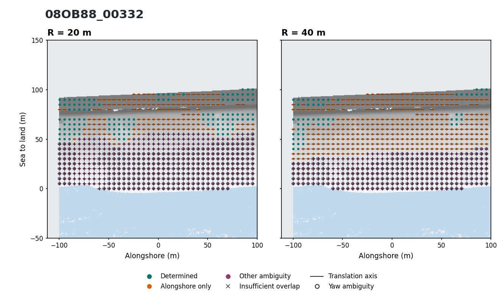
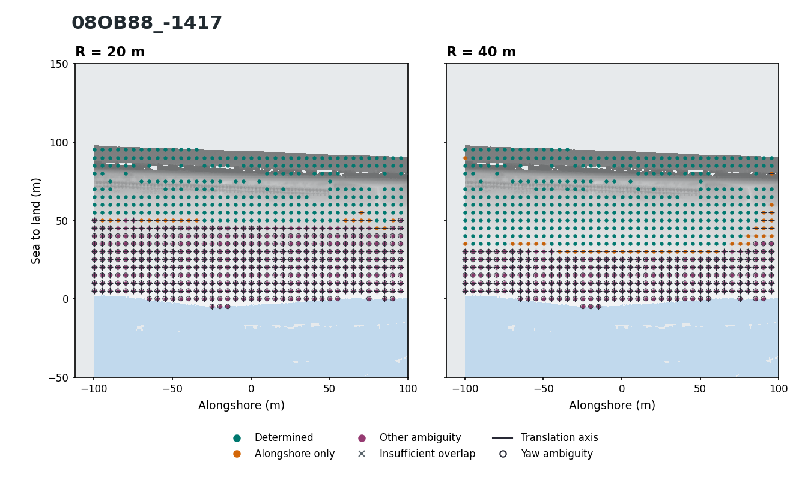

# 071　静岡LASの標高で測った位置の決まりやすさ

作業ブランチは `codex/071-localizability-map`。起点の `realtime-map` は
`e288f783b95adc76ea9d2470e888906dfc93bb01`。確定した実装とテストは
`d5769ec7559e5f7d00fc2c0227f89ed5a8ddcb2e`、集計と図・点データは
`20dfc743220fc09fbd965f03d1b4b55b5c47c499`。本報告は後続コミットに収録する。

指示書の62枚に対し、対象ブランチのLASディレクトリは標高NPZが60枚、READMEと索引が各1件だった。
索引とGit上のNPZは名前まで一致した。validation 12枚とtest 48枚の全件を使い、評価対象の5か所も全て含めた。
残りの2枚は入力がないため未集計。 [LASデータの説明](../../data/shizuoka_beach_las/README_ja.md) · [全120行の集計](summary.csv)

## 全砂浜の集計

| 砂浜 | R (m) | 点数 | 判定不能 | まぎらわしい点 | 海岸方向だけ | 決まる点 | 間隔の中央値／最大 (m) |
| --- | ---: | ---: | ---: | ---: | ---: | ---: | ---: |
| 60枚計 | 20 | 58644 | 0 | 42903 (73.16%) | 8106 (13.82%) | 15741 | 5 / 110 |
| 60枚計 | 40 | 58644 | 0 | 43324 (73.88%) | 10131 (17.28%) | 15320 | 5 / 115 |

「海岸方向だけ」は「まぎらわしい点」の内数。割合の分母は判定可能な点数。間隔の中央値・最大は、
各浜で決まる点が1つ以上ある海岸方向の列を取り、その隣接列どうしの間隔を集めた値。
全体値は各点と各間隔をプールして計算した。決まる列より外側の区間は含めていない。
間隔を計算できた組数はR = 20 mで2066組、40 mで1856組。
 [全体集計CSV](pooled.csv)

R = 20 mから40 mに変えると、決まる点が増えた浜は23枚、減った浜は36枚、同数は1枚だった。
比較に使う地形が広がるほか、回転に対する1 m相当の最小試行が4°から2°に変わるため、
この差には判定対象となる角度の違いも含まれる。

## 評価対象の5か所

| 砂浜 | R (m) | 点数 | 判定不能 | まぎらわしい点 | 海岸方向だけ | 決まる点 | 間隔の中央値／最大 (m) |
| --- | ---: | ---: | ---: | ---: | ---: | ---: | ---: |
| [08OB86_-0205](maps/08OB86_-0205.png) | 20 | 751 | 0 | 674 (89.75%) | 63 (8.39%) | 77 | 5 / 5 |
| [08OB86_-0205](maps/08OB86_-0205.png) | 40 | 751 | 0 | 741 (98.67%) | 64 (8.52%) | 10 | 5 / 5 |
| [08OB88_-1417](maps/08OB88_-1417.png) | 20 | 686 | 0 | 412 (60.06%) | 19 (2.77%) | 274 | 5 / 5 |
| [08OB88_-1417](maps/08OB88_-1417.png) | 40 | 686 | 0 | 297 (43.29%) | 44 (6.41%) | 389 | 5 / 5 |
| [08OB88_-0167](maps/08OB88_-0167.png) | 20 | 876 | 0 | 682 (77.85%) | 188 (21.46%) | 194 | 5 / 10 |
| [08OB88_-0167](maps/08OB88_-0167.png) | 40 | 876 | 0 | 680 (77.63%) | 289 (32.99%) | 196 | 5 / 5 |
| [08OB88_00332](maps/08OB88_00332.png) | 20 | 725 | 0 | 597 (82.34%) | 164 (22.62%) | 128 | 5 / 25 |
| [08OB88_00332](maps/08OB88_00332.png) | 40 | 725 | 0 | 666 (91.86%) | 375 (51.72%) | 59 | 5 / 115 |
| [08OB89_-0847](maps/08OB89_-0847.png) | 20 | 1190 | 0 | 963 (80.92%) | 77 (6.47%) | 227 | 5 / 5 |
| [08OB89_-0847](maps/08OB89_-0847.png) | 40 | 1190 | 0 | 982 (82.52%) | 117 (9.83%) | 208 | 5 / 5 |

### 代表図

緑は3方向とも決まる点、橙は海岸に沿う方向だけがまぎらわしい点、紫はそれ以外のまぎらわしい点。
点に重ねた黒線はそれぞれの並進方向、黒い輪は回転方向のまぎらわしさを表す。
灰色の背景は欠測、淡青は標高0 m未満、標高0 m以上の背景はグレースケールで示した。





<details>
<summary>全60枚 × 2半径の集計と図へのリンク</summary>


| 砂浜 | R (m) | 点数 | 判定不能 | まぎらわしい点 | 海岸方向だけ | 決まる点 | 間隔の中央値／最大 (m) |
| --- | ---: | ---: | ---: | ---: | ---: | ---: | ---: |
| [08OB86_00294](maps/08OB86_00294.png) | 20 | 797 | 0 | 610 (76.54%) | 33 (4.14%) | 187 | 5 / 5 |
| [08OB86_00294](maps/08OB86_00294.png) | 40 | 797 | 0 | 695 (87.20%) | 103 (12.92%) | 102 | 5 / 5 |
| [08OB86_-0205](maps/08OB86_-0205.png) | 20 | 751 | 0 | 674 (89.75%) | 63 (8.39%) | 77 | 5 / 5 |
| [08OB86_-0205](maps/08OB86_-0205.png) | 40 | 751 | 0 | 741 (98.67%) | 64 (8.52%) | 10 | 5 / 5 |
| [08OB87_-0206](maps/08OB87_-0206.png) | 20 | 789 | 0 | 590 (74.78%) | 62 (7.86%) | 199 | 5 / 5 |
| [08OB87_-0206](maps/08OB87_-0206.png) | 40 | 789 | 0 | 620 (78.58%) | 146 (18.50%) | 169 | 5 / 25 |
| [08OB87_-0706](maps/08OB87_-0706.png) | 20 | 790 | 0 | 636 (80.51%) | 52 (6.58%) | 154 | 5 / 25 |
| [08OB87_-0706](maps/08OB87_-0706.png) | 40 | 790 | 0 | 738 (93.42%) | 57 (7.22%) | 52 | 5 / 45 |
| [08OB88_-1417](maps/08OB88_-1417.png) | 20 | 686 | 0 | 412 (60.06%) | 19 (2.77%) | 274 | 5 / 5 |
| [08OB88_-1417](maps/08OB88_-1417.png) | 40 | 686 | 0 | 297 (43.29%) | 44 (6.41%) | 389 | 5 / 5 |
| [08OB88_-0167](maps/08OB88_-0167.png) | 20 | 876 | 0 | 682 (77.85%) | 188 (21.46%) | 194 | 5 / 10 |
| [08OB88_-0167](maps/08OB88_-0167.png) | 40 | 876 | 0 | 680 (77.63%) | 289 (32.99%) | 196 | 5 / 5 |
| [08OB88_00332](maps/08OB88_00332.png) | 20 | 725 | 0 | 597 (82.34%) | 164 (22.62%) | 128 | 5 / 25 |
| [08OB88_00332](maps/08OB88_00332.png) | 40 | 725 | 0 | 666 (91.86%) | 375 (51.72%) | 59 | 5 / 115 |
| [08OB88_01332](maps/08OB88_01332.png) | 20 | 1098 | 0 | 972 (88.52%) | 241 (21.95%) | 126 | 5 / 10 |
| [08OB88_01332](maps/08OB88_01332.png) | 40 | 1098 | 0 | 981 (89.34%) | 211 (19.22%) | 117 | 5 / 10 |
| [08OB88_01832](maps/08OB88_01832.png) | 20 | 1014 | 0 | 839 (82.74%) | 212 (20.91%) | 175 | 5 / 15 |
| [08OB88_01832](maps/08OB88_01832.png) | 40 | 1014 | 0 | 936 (92.31%) | 143 (14.10%) | 78 | 5 / 65 |
| [08OB89_00152](maps/08OB89_00152.png) | 20 | 1185 | 0 | 946 (79.83%) | 103 (8.69%) | 239 | 5 / 15 |
| [08OB89_00152](maps/08OB89_00152.png) | 40 | 1185 | 0 | 989 (83.46%) | 67 (5.65%) | 196 | 5 / 25 |
| [08OB89_-0347](maps/08OB89_-0347.png) | 20 | 1184 | 0 | 948 (80.07%) | 229 (19.34%) | 236 | 5 / 20 |
| [08OB89_-0347](maps/08OB89_-0347.png) | 40 | 1184 | 0 | 942 (79.56%) | 239 (20.19%) | 242 | 5 / 20 |
| [08OB89_-0847](maps/08OB89_-0847.png) | 20 | 1190 | 0 | 963 (80.92%) | 77 (6.47%) | 227 | 5 / 5 |
| [08OB89_-0847](maps/08OB89_-0847.png) | 40 | 1190 | 0 | 982 (82.52%) | 117 (9.83%) | 208 | 5 / 5 |
| [08OB89_-1597](maps/08OB89_-1597.png) | 20 | 1189 | 0 | 983 (82.67%) | 264 (22.20%) | 206 | 5 / 5 |
| [08OB89_-1597](maps/08OB89_-1597.png) | 40 | 1189 | 0 | 965 (81.16%) | 181 (15.22%) | 224 | 5 / 5 |
| [08OC80_-1089](maps/08OC80_-1089.png) | 20 | 1188 | 0 | 1104 (92.93%) | 336 (28.28%) | 84 | 5 / 40 |
| [08OC80_-1089](maps/08OC80_-1089.png) | 40 | 1188 | 0 | 1168 (98.32%) | 373 (31.40%) | 20 | 5 / 20 |
| [08OC80_-0589](maps/08OC80_-0589.png) | 20 | 1194 | 0 | 1145 (95.90%) | 238 (19.93%) | 49 | 5 / 110 |
| [08OC80_-0589](maps/08OC80_-0589.png) | 40 | 1194 | 0 | 1185 (99.25%) | 142 (11.89%) | 9 | 5 / 5 |
| [08OC80_00160](maps/08OC80_00160.png) | 20 | 1172 | 0 | 898 (76.62%) | 194 (16.55%) | 274 | 5 / 10 |
| [08OC80_00160](maps/08OC80_00160.png) | 40 | 1172 | 0 | 872 (74.40%) | 112 (9.56%) | 300 | 5 / 5 |
| [08OC80_00660](maps/08OC80_00660.png) | 20 | 1174 | 0 | 718 (61.16%) | 136 (11.58%) | 456 | 5 / 5 |
| [08OC80_00660](maps/08OC80_00660.png) | 40 | 1174 | 0 | 736 (62.69%) | 119 (10.14%) | 438 | 5 / 5 |
| [08OC90_00270](maps/08OC90_00270.png) | 20 | 1164 | 0 | 967 (83.08%) | 135 (11.60%) | 197 | 5 / 5 |
| [08OC90_00270](maps/08OC90_00270.png) | 40 | 1164 | 0 | 1032 (88.66%) | 163 (14.00%) | 132 | 5 / 5 |
| [08OC91_-1688](maps/08OC91_-1688.png) | 20 | 1192 | 0 | 990 (83.05%) | 289 (24.24%) | 202 | 5 / 20 |
| [08OC91_-1688](maps/08OC91_-1688.png) | 40 | 1192 | 0 | 1053 (88.34%) | 247 (20.72%) | 139 | 5 / 20 |
| [08OC91_-0938](maps/08OC91_-0938.png) | 20 | 1066 | 0 | 704 (66.04%) | 98 (9.19%) | 362 | 5 / 5 |
| [08OC91_-0938](maps/08OC91_-0938.png) | 40 | 1066 | 0 | 721 (67.64%) | 74 (6.94%) | 345 | 5 / 5 |
| [08OC91_-0438](maps/08OC91_-0438.png) | 20 | 986 | 0 | 827 (83.87%) | 261 (26.47%) | 159 | 5 / 20 |
| [08OC91_-0438](maps/08OC91_-0438.png) | 40 | 986 | 0 | 873 (88.54%) | 169 (17.14%) | 113 | 5 / 45 |
| [08OC91_00061](maps/08OC91_00061.png) | 20 | 983 | 0 | 658 (66.94%) | 122 (12.41%) | 325 | 5 / 5 |
| [08OC91_00061](maps/08OC91_00061.png) | 40 | 983 | 0 | 629 (63.99%) | 208 (21.16%) | 354 | 5 / 5 |
| [08OC91_00811](maps/08OC91_00811.png) | 20 | 1058 | 0 | 825 (77.98%) | 199 (18.81%) | 233 | 5 / 45 |
| [08OC91_00811](maps/08OC91_00811.png) | 40 | 1058 | 0 | 891 (84.22%) | 204 (19.28%) | 167 | 5 / 20 |
| [08OC91_01311](maps/08OC91_01311.png) | 20 | 870 | 0 | 785 (90.23%) | 128 (14.71%) | 85 | 5 / 30 |
| [08OC91_01311](maps/08OC91_01311.png) | 40 | 870 | 0 | 861 (98.97%) | 97 (11.15%) | 9 | 5 / 35 |
| [08OC92_-0891](maps/08OC92_-0891.png) | 20 | 777 | 0 | 524 (67.44%) | 85 (10.94%) | 253 | 5 / 5 |
| [08OC92_-0891](maps/08OC92_-0891.png) | 40 | 777 | 0 | 569 (73.23%) | 246 (31.66%) | 208 | 5 / 5 |
| [08OC92_-0141](maps/08OC92_-0141.png) | 20 | 733 | 0 | 597 (81.45%) | 134 (18.28%) | 136 | 5 / 15 |
| [08OC92_-0141](maps/08OC92_-0141.png) | 40 | 733 | 0 | 598 (81.58%) | 173 (23.60%) | 135 | 5 / 20 |
| [08OC92_00608](maps/08OC92_00608.png) | 20 | 750 | 0 | 653 (87.07%) | 166 (22.13%) | 97 | 5 / 30 |
| [08OC92_00608](maps/08OC92_00608.png) | 40 | 750 | 0 | 722 (96.27%) | 145 (19.33%) | 28 | 5 / 25 |
| [08OC93_-1519](maps/08OC93_-1519.png) | 20 | 795 | 0 | 620 (77.99%) | 105 (13.21%) | 175 | 5 / 5 |
| [08OC93_-1519](maps/08OC93_-1519.png) | 40 | 795 | 0 | 634 (79.75%) | 81 (10.19%) | 161 | 5 / 5 |
| [08OC94_-0954](maps/08OC94_-0954.png) | 20 | 688 | 0 | 420 (61.05%) | 126 (18.31%) | 268 | 5 / 5 |
| [08OC94_-0954](maps/08OC94_-0954.png) | 40 | 688 | 0 | 365 (53.05%) | 213 (30.96%) | 323 | 5 / 10 |
| [08OC95_01428](maps/08OC95_01428.png) | 20 | 668 | 0 | 497 (74.40%) | 244 (36.53%) | 171 | 5 / 5 |
| [08OC95_01428](maps/08OC95_01428.png) | 40 | 668 | 0 | 551 (82.49%) | 450 (67.37%) | 117 | 5 / 5 |
| [08OC95_00928](maps/08OC95_00928.png) | 20 | 887 | 0 | 666 (75.08%) | 331 (37.32%) | 221 | 5 / 5 |
| [08OC95_00928](maps/08OC95_00928.png) | 40 | 887 | 0 | 728 (82.07%) | 487 (54.90%) | 159 | 5 / 10 |
| [08OC95_00428](maps/08OC95_00428.png) | 20 | 1017 | 0 | 678 (66.67%) | 189 (18.58%) | 339 | 5 / 5 |
| [08OC95_00428](maps/08OC95_00428.png) | 40 | 1017 | 0 | 686 (67.45%) | 183 (17.99%) | 331 | 5 / 5 |
| [08OC95_-0321](maps/08OC95_-0321.png) | 20 | 1059 | 0 | 920 (86.87%) | 172 (16.24%) | 139 | 5 / 25 |
| [08OC95_-0321](maps/08OC95_-0321.png) | 40 | 1059 | 0 | 962 (90.84%) | 123 (11.61%) | 97 | 5 / 5 |
| [08OC95_-0821](maps/08OC95_-0821.png) | 20 | 1172 | 0 | 1010 (86.18%) | 81 (6.91%) | 162 | 5 / 5 |
| [08OC95_-0821](maps/08OC95_-0821.png) | 40 | 1172 | 0 | 1048 (89.42%) | 67 (5.72%) | 124 | 5 / 5 |
| [08OC95_-1321](maps/08OC95_-1321.png) | 20 | 1150 | 0 | 1031 (89.65%) | 156 (13.57%) | 119 | 5 / 70 |
| [08OC95_-1321](maps/08OC95_-1321.png) | 40 | 1150 | 0 | 1089 (94.70%) | 56 (4.87%) | 61 | 5 / 75 |
| [08OC95_-2071](maps/08OC95_-2071.png) | 20 | 1197 | 0 | 1136 (94.90%) | 167 (13.95%) | 61 | 5 / 85 |
| [08OC95_-2071](maps/08OC95_-2071.png) | 40 | 1197 | 0 | 1156 (96.57%) | 28 (2.34%) | 41 | 5 / 15 |
| [08OC96_00073](maps/08OC96_00073.png) | 20 | 1157 | 0 | 882 (76.23%) | 14 (1.21%) | 275 | 5 / 5 |
| [08OC96_00073](maps/08OC96_00073.png) | 40 | 1157 | 0 | 893 (77.18%) | 34 (2.94%) | 264 | 5 / 10 |
| [08OC96_-0676](maps/08OC96_-0676.png) | 20 | 1140 | 0 | 647 (56.75%) | 84 (7.37%) | 493 | 5 / 5 |
| [08OC96_-0676](maps/08OC96_-0676.png) | 40 | 1140 | 0 | 589 (51.67%) | 161 (14.12%) | 551 | 5 / 5 |
| [08OC96_-1426](maps/08OC96_-1426.png) | 20 | 934 | 0 | 237 (25.37%) | 58 (6.21%) | 697 | 5 / 5 |
| [08OC96_-1426](maps/08OC96_-1426.png) | 40 | 934 | 0 | 54 (5.78%) | 13 (1.39%) | 880 | 5 / 5 |
| [08OC97_01672](maps/08OC97_01672.png) | 20 | 1142 | 0 | 654 (57.27%) | 43 (3.77%) | 488 | 5 / 5 |
| [08OC97_01672](maps/08OC97_01672.png) | 40 | 1142 | 0 | 635 (55.60%) | 143 (12.52%) | 507 | 5 / 5 |
| [08OC97_01172](maps/08OC97_01172.png) | 20 | 1138 | 0 | 581 (51.05%) | 189 (16.61%) | 557 | 5 / 5 |
| [08OC97_01172](maps/08OC97_01172.png) | 40 | 1138 | 0 | 658 (57.82%) | 273 (23.99%) | 480 | 5 / 5 |
| [08OC97_00422](maps/08OC97_00422.png) | 20 | 1150 | 0 | 785 (68.26%) | 169 (14.70%) | 365 | 5 / 5 |
| [08OC97_00422](maps/08OC97_00422.png) | 40 | 1150 | 0 | 790 (68.70%) | 280 (24.35%) | 360 | 5 / 5 |
| [08OC97_-0077](maps/08OC97_-0077.png) | 20 | 1171 | 0 | 746 (63.71%) | 77 (6.58%) | 425 | 5 / 5 |
| [08OC97_-0077](maps/08OC97_-0077.png) | 40 | 1171 | 0 | 715 (61.06%) | 184 (15.71%) | 456 | 5 / 5 |
| [08OC97_-0577](maps/08OC97_-0577.png) | 20 | 1172 | 0 | 689 (58.79%) | 112 (9.56%) | 483 | 5 / 5 |
| [08OC97_-0577](maps/08OC97_-0577.png) | 40 | 1172 | 0 | 704 (60.07%) | 249 (21.25%) | 468 | 5 / 5 |
| [08OC97_-1077](maps/08OC97_-1077.png) | 20 | 1164 | 0 | 574 (49.31%) | 60 (5.15%) | 590 | 5 / 5 |
| [08OC97_-1077](maps/08OC97_-1077.png) | 40 | 1164 | 0 | 513 (44.07%) | 128 (11.00%) | 651 | 5 / 5 |
| [08OC97_-1827](maps/08OC97_-1827.png) | 20 | 1079 | 0 | 637 (59.04%) | 95 (8.80%) | 442 | 5 / 5 |
| [08OC97_-1827](maps/08OC97_-1827.png) | 40 | 1079 | 0 | 574 (53.20%) | 90 (8.34%) | 505 | 5 / 5 |
| [08OC98_-1601](maps/08OC98_-1601.png) | 20 | 907 | 0 | 575 (63.40%) | 101 (11.14%) | 332 | 5 / 5 |
| [08OC98_-1601](maps/08OC98_-1601.png) | 40 | 907 | 0 | 575 (63.40%) | 188 (20.73%) | 332 | 5 / 5 |
| [08OC98_-1101](maps/08OC98_-1101.png) | 20 | 754 | 0 | 534 (70.82%) | 106 (14.06%) | 220 | 5 / 5 |
| [08OC98_-1101](maps/08OC98_-1101.png) | 40 | 754 | 0 | 573 (75.99%) | 252 (33.42%) | 181 | 5 / 5 |
| [08OC98_-0351](maps/08OC98_-0351.png) | 20 | 922 | 0 | 643 (69.74%) | 64 (6.94%) | 279 | 5 / 5 |
| [08OC98_-0351](maps/08OC98_-0351.png) | 40 | 922 | 0 | 598 (64.86%) | 140 (15.18%) | 324 | 5 / 5 |
| [08OC98_00148](maps/08OC98_00148.png) | 20 | 1115 | 0 | 590 (52.91%) | 22 (1.97%) | 525 | 5 / 5 |
| [08OC98_00148](maps/08OC98_00148.png) | 40 | 1115 | 0 | 537 (48.16%) | 73 (6.55%) | 578 | 5 / 5 |
| [08OC98_00648](maps/08OC98_00648.png) | 20 | 811 | 0 | 589 (72.63%) | 108 (13.32%) | 222 | 5 / 15 |
| [08OC98_00648](maps/08OC98_00648.png) | 40 | 811 | 0 | 517 (63.75%) | 166 (20.47%) | 294 | 5 / 25 |
| [08OC98_01398](maps/08OC98_01398.png) | 20 | 884 | 0 | 622 (70.36%) | 66 (7.47%) | 262 | 5 / 5 |
| [08OC98_01398](maps/08OC98_01398.png) | 40 | 884 | 0 | 585 (66.18%) | 89 (10.07%) | 299 | 5 / 5 |
| [08OC98_01898](maps/08OC98_01898.png) | 20 | 746 | 0 | 467 (62.60%) | 118 (15.82%) | 279 | 5 / 5 |
| [08OC98_01898](maps/08OC98_01898.png) | 40 | 746 | 0 | 518 (69.44%) | 323 (43.30%) | 228 | 5 / 5 |
| [08OC99_-1516](maps/08OC99_-1516.png) | 20 | 882 | 0 | 842 (95.46%) | 100 (11.34%) | 40 | 5 / 5 |
| [08OC99_-1516](maps/08OC99_-1516.png) | 40 | 882 | 0 | 882 (100.00%) | 93 (10.54%) | 0 | — / — |
| [08OC99_-1016](maps/08OC99_-1016.png) | 20 | 831 | 0 | 549 (66.06%) | 95 (11.43%) | 282 | 5 / 5 |
| [08OC99_-1016](maps/08OC99_-1016.png) | 40 | 831 | 0 | 545 (65.58%) | 199 (23.95%) | 286 | 5 / 5 |
| [08OC99_-0016](maps/08OC99_-0016.png) | 20 | 969 | 0 | 748 (77.19%) | 109 (11.25%) | 221 | 5 / 5 |
| [08OC99_-0016](maps/08OC99_-0016.png) | 40 | 969 | 0 | 700 (72.24%) | 169 (17.44%) | 269 | 5 / 5 |
| [08OC99_00483](maps/08OC99_00483.png) | 20 | 807 | 0 | 494 (61.21%) | 130 (16.11%) | 313 | 5 / 5 |
| [08OC99_00483](maps/08OC99_00483.png) | 40 | 807 | 0 | 420 (52.04%) | 194 (24.04%) | 387 | 5 / 5 |
| [08OC99_00983](maps/08OC99_00983.png) | 20 | 830 | 0 | 433 (52.17%) | 110 (13.25%) | 397 | 5 / 5 |
| [08OC99_00983](maps/08OC99_00983.png) | 40 | 830 | 0 | 345 (41.57%) | 131 (15.78%) | 485 | 5 / 5 |
| [08OC99_01733](maps/08OC99_01733.png) | 20 | 877 | 0 | 482 (54.96%) | 63 (7.18%) | 395 | 5 / 5 |
| [08OC99_01733](maps/08OC99_01733.png) | 40 | 877 | 0 | 388 (44.24%) | 87 (9.92%) | 489 | 5 / 5 |
| [08PD00_-1730](maps/08PD00_-1730.png) | 20 | 848 | 0 | 678 (79.95%) | 214 (25.24%) | 170 | 5 / 5 |
| [08PD00_-1730](maps/08PD00_-1730.png) | 40 | 848 | 0 | 655 (77.24%) | 276 (32.55%) | 193 | 5 / 5 |

</details>

## 計算方法

- 有限かつ標高0 m以上の陸で、既存の傾斜計算が25°以下の0.5 mマスから、配列の原点を基準に5 m間隔で候補を取った。LASの配列第1軸が海岸に沿う方向、第2軸は海から陸へ向かう。海に向かう変位を正として比較した。
- 地表から1.4 mの視点から、既存の `visibility.py` と同じセル通過判定と視線の高さで遮蔽を求めた。1.4 mは既存のLiDAR取り付け高さ。欠測は傾斜と遮蔽を求めるときだけ最近傍で補った。範囲の比較には元の視点から見える陸だけを使い、ずらした先で標高が得られる陸との共通部分に限った。回転には双線形補間を使い、非ゼロの重みを持つ補間元が全て有効な場合だけ採用した。
- 海岸方向・海向きは各±3 mを0.5 m刻み、回転は±10°を2°刻みで1軸ずつ比較した。共通部分の標高差からその平均を引き、二乗平均を求めた。単一の標高差から二乗平均を評価しないよう、重なりは2マス以上を条件にした。元位置の二乗平均に0.05² m²を加えた値を、1 m以上離れた候補で下回るとその軸を「まぎらわしい」とした。
- 回転は円周上の移動量 `R × |θ|` で1 mに換算した。元位置の近くでは3組の軸の組み合わせも4点ずつ評価し、中央差分で3×3のヘッセ行列を作った。回転軸を `R × θ` に揃えた上で固有値を求め、最小固有値の固有ベクトルの成分が最も大きい軸を記録した。近接する最小固有値から向きが一意に取れない場合は `tied`、差分が不足した場合は `unavailable` を記録した。
- 各浜の `points/<砂浜>.npz` に、候補のマスと座標、47試行のオフセット（格子・格子・度）、二乗平均と重なり数、方向ごとの判定、ヘッセ行列、固有値、最も曲がり方が弱い向き、最終分類を収録した。

## 未確認の範囲

- 標高だけを同時期・同一の標高地図に重ねる試算。実際のLiDAR点群の疎密・死角、測量時期のずれ、LiDAR慣性オドメトリ、点群マッチング、走行中の誤差は測っていない。LASの0.5 m格子に残らない小岩などが細かいドローン地図に写れば、この試算より決まる場所が増える可能性がある。一方、現実の観測ノイズや地形変化は同じ場所でも照合を難しくし得る。
- 方向ごとの大きなずれを調べた。複数軸を同時に大きく動かした場合の別解は探索していない。視野が切り出しの端にかかる場所では重なりが減るため、境界付近の判定に影響する。
  有限差分のヘッセ行列には、最小固有値が負の点がR = 20 mで21点、40 mで1点あった。判定には固有値と別に1 m以上の試行で得た二乗平均を使った。決まる点の間隔は岸方向の投影上での計算で、実際に走る経路に沿った間隔は未確認。
- 実行はクラウドのPythonのみ。Gazebo、ROS2、研究PCでの照合・計測は実施していない。

## 変更・追加ファイル

- `conference/experiments/localizability_map.py` — 標高照合、方向の判定、CSV・NPZ・PNGの生成。
- `conference/tests/test_localizability_map.py` — 合成地形、遮蔽の一致、境界の重なり、曲率の混合項、間隔のテスト。
- `conference/results/localizability_map/` — 本報告、`summary.csv`、`pooled.csv`、`maps/*.png` 60枚、`points/*.npz` 60件、`analysis_log.txt`、`verification_log.txt`。

差分は上の新規ファイルに限定した。既存の地図計算、テスト、結果ファイルは起点と同じGit blobである。

## 実行コマンド

Python 3.12.14の既存venvを使用した。全パッケージが `conference/requirements-venv.txt` の固定版と一致した。
主な版はNumPy 2.3.5、SciPy 1.17.0、Matplotlib 3.10.8。
CPUはAMD EPYC 9V45 96-Core Processor。クラウドのCPU枠は2コア相当。

```bash
git fetch origin realtime-map
git switch -c codex/071-localizability-map FETCH_HEAD
git ls-files 'conference/data/shizuoka_beach_las/*.npz'
cd conference
export OPENBLAS_NUM_THREADS=1 MPLCONFIGDIR=/tmp/071-mpl XDG_CACHE_HOME=/tmp/071-cache
mkdir -p /tmp/071-logs
/tmp/thesis036-venv/bin/python -u -m tests.test_planners > /tmp/071-logs/before.txt 2>&1

set -o pipefail
printf '%s\n' tests/test_*.py | sed 's/\.py$//;s|/|.|g' | rg -v '^tests\.test_localizability_map$' |
  xargs -P 4 -I '{}' bash -c '
    module=$1
    log=/tmp/071-logs/$module.txt
    printf "\$ /tmp/thesis036-venv/bin/python -u -m %s\n" "$module" > "$log"
    /tmp/thesis036-venv/bin/python -u -m "$module" >> "$log" 2>&1
    status=$?
    printf "\nexit=%s\n" "$status" >> "$log"
    printf "%s exit=%s\n" "$module" "$status"
    exit "$status"
  ' bash '{}'
/tmp/thesis036-venv/bin/python -u -m tests.test_localizability_map
{ time -p /tmp/thesis036-venv/bin/python -m experiments.localizability_map --out /tmp/071-final --workers 2; } 2>&1 | tee /tmp/071-logs/analysis.txt
{ time -p /tmp/thesis036-venv/bin/python -m experiments.localizability_map --out /tmp/071-repeat --patch 08OB86_-0205; } 2>&1 | tee /tmp/071-logs/repeat.txt
for item in points/08OB86_-0205.npz maps/08OB86_-0205.png; do
  cmp "/tmp/071-final/$item" "/tmp/071-repeat/$item" || exit
done
PYTHONPATH=. /tmp/thesis036-venv/bin/python /tmp/071-check-oracle.py 08OB86_-0205
PYTHONPATH=. /tmp/thesis036-venv/bin/python /tmp/071-check-oracle.py 08OB88_00332
PYTHONPATH=. /tmp/thesis036-venv/bin/python /tmp/071-check-artifacts.py
git diff --check
```

補助照合では、既存の `visible_cells` とSciPy `map_coordinates(order=1)` から評価浜2枚の各3点で全試行の
二乗平均と重なり件数を独立に計算した。最初の照合で発見したパッチ外の埋め値は欠測扱いに修正し、全件を再計算した。
最終の全120行の集計をNPZから再集計して一致を確認した。`08OB86_-0205` は別実行の図とNPZがバイト単位で一致した。
 `/tmp` の補助プログラムはこの実行での検算に使った。 [実行ログ](analysis_log.txt) · [追加照合ログ](verification_log.txt)

### スクリプトが表示した全体集計

```csv
patch,split,radius_m,positions,tested,insufficient,ambiguous,tangent_only,determined,ambiguous_pct,tangent_only_pct,gap_n,gap_median_m,gap_max_m
all,all,20.0,58644,58644,0,42903,8106,15741,73.15837937384899,13.822385921833435,2066,5.0,110.0
all,all,40.0,58644,58644,0,43324,10131,15320,73.87627037719119,17.275424595866586,1856,5.0,115.0
```

## テスト出力全文

56モジュールが終了コード0。新規モジュールは8件、既存モジュールは55本。起点でも `tests.test_planners` が通った。

<details>
<summary>変更前の計画テストと最終の全テスト出力</summary>

```text
$ /tmp/thesis036-venv/bin/python -u -m tests.test_planners  # 変更前
all planner tests passed
roll-aware tests passed

$ /tmp/thesis036-venv/bin/python -u -m tests.test_beach_terrain
beach determinism, shapes, finite values, water/wet and unchanged rolling passed
averaged sea/wet/dry/inland profiles and foreshore slopes passed (validation seeds)
scarp 45-degree coverage passed: [np.float64(0.465), np.float64(0.615), np.float64(0.0), np.float64(0.16), np.float64(0.555)]
beach scenarios, delegated planner equality and exact smoothing passed (15 scenarios)
exact beach online safety passed (9 trajectories)
all beach-terrain tests passed

exit=0

$ /tmp/thesis036-venv/bin/python -u -m tests.test_collision
segment_cells passed (2000 seeded segments vs exhaustive SAT, reversal and boundary cases)
corner-grazing reproduction and exact rejection passed
legacy online and smoothing regressions passed
exact online safety passed (41 trajectories, A* and D* Lite)
all collision tests passed

exit=0

$ /tmp/thesis036-venv/bin/python -u -m tests.test_common_eval
beach beach centre n=1 no_path=1
1 runs -> /tmp/tmphg7nfxzy/output
synthetic: geometry, revision boundaries, stops, timing, gzip, omissions and overwrite protection passed
030 08OB87_-0706 C0 n=3 completed=3
030 08OB87_-0706 C1 n=3 completed=3
030 08OB87_-0706 C2 n=3 completed=3
030 08OB88_-0167 C0 n=3 no_path=3
030 08OB88_-0167 C1 n=3 no_path=3
030 08OB88_-0167 C2 n=3 rollover=3
030 08OB88_-1417 C0 n=3 no_path=3
030 08OB88_-1417 C1 n=3 completed=3
030 08OB88_-1417 C2 n=3 completed=3
030 08OB89_-0347 C0 n=3 no_path=3
030 08OB89_-0347 C1 n=3 no_path=3
030 08OB89_-0347 C2 n=3 partial=3
030 08OB89_-0847 C0 n=3 no_path=3
030 08OB89_-0847 C1 n=3 completed=1 stuck=2
030 08OB89_-0847 C2 n=3 completed=2 partial=1
45 runs -> /tmp/tmphg7nfxzy/030
030 compared per-field counts: {'exit_code': 45, 'outcome': 45, 'status': 45, 'recorded_status': 45, 'goals_reached': 45, 'returned_to_start': 45, 'truth_lethal_len_m': 45, 'truth_lethal_entries': 45, 'debris_len_m': 45, 'debris_entries': 45, 'lethal_cells': 45, 'debris_cells': 45, 'rolled_over': 45, 'deviation_mean_m': 45, 'deviation_max_m': 45, 'n_plans': 45, 'failed_plans': 45, 'fail_goal_cell': 45, 'fail_start_cell': 45, 'fail_start_steep': 45, 'map_fp_cells': 43, 'map_fn_cells': 43, 'map_fp_steep_cells': 43, 'map_fp_obstacle_only_cells': 43, 'detector_fp_cells': 43, 'detector_fn_cells': 43, 'map_updates': 45, 'map_update_s_p95': 45, 'stops_unreachable': 15, 'relaxed_len_m': 15, 'relaxed_truth_lethal_len_m': 15, 'rollover_t_s': 3}
035 08OB86_-0205 S1 n=1 completed=1
035 08OB86_-0205 S2 n=1 other_error=1
035 08OB87_-0706 P1 n=3 completed=3
035 08OB88_-0167 P1 n=3 no_path=3
035 08OB88_-1417 P1 n=3 completed=3
035 08OB89_-0347 P1 n=3 no_path=3
035 08OB89_-0847 P1 n=3 completed=3
17 runs -> /tmp/tmphg7nfxzy/035
035 compared per-field counts: {'exit_code': 17, 'outcome': 17, 'status': 17, 'n_plans': 16, 'n_replans': 16, 'failed_plans': 16, 'fail_goal_cell': 16, 'ev_off_path': 16, 'ev_unsafe_tilt': 16, 'ev_safety_replanned': 16, 'map_updates': 16, 'map_update_s_median': 16, 'map_update_s_p95': 16, 'map_update_s_max': 16, 'queue_drops': 16} plus 6 sensor rows
037 08OB86_-0205 L n=3 unknown=3
037 08OB86_-0205 LC n=3 unknown=3
037 08OB88_-0167 L n=3 unknown=3
037 08OB88_-0167 LC n=3 unknown=3
037 08OB88_-1417 L n=3 unknown=3
037 08OB88_-1417 LC n=3 unknown=3
037 08OB88_00332 L n=3 unknown=3
037 08OB88_00332 LC n=3 unknown=3
037 08OB89_-0847 L n=3 unknown=3
037 08OB89_-0847 LC n=3 unknown=3
30 runs -> /tmp/tmphg7nfxzy/037
037 matched 30 metadata/exit records; absent raw outcome, geometry, events and updates stayed blank
all common evaluation tests passed

exit=0

$ /tmp/thesis036-venv/bin/python -u -m tests.test_distance_clearance
/tmp/thesis036-venv/lib/python3.12/site-packages/fastapi/testclient.py:1: StarletteDeprecationWarning: Using `httpx` with `starlette.testclient` is deprecated; install `httpx2` instead.
  from starlette.testclient import TestClient as TestClient  # noqa
08OB86_00294 completed
08OB86_00294 completed
08OB86_00294 completed
08OB86_00294 completed
08OB86_00294 completed
08OB86_00294 completed
08OB86_00294 completed
08OB86_00294 completed
08OB86_00294 completed
08OB86_00294 completed
08OB86_00294 completed
08OB86_00294 completed
08OB86_00294 completed
08OB86_00294 completed
08OB86_00294 completed
08OB86_00294 completed
08OB86_00294 completed
08OB86_00294 completed
08OB86_00294 completed
08OB86_00294 completed
08OB86_00294 completed
08OB86_00294 completed
08OB86_00294 completed
08OB86_00294 completed
1 PASS: default/centre/overlap/overlap_goal match the base on this host for maps, plans, manifests and ROS dispatch
2 PASS: hard mask matches centre and exact rectangle distance; quadratic band and endpoint limits
3 PASS: distance increases box clearance and all three forced corridors remain passable
4 PASS: cost-acceptable shortcuts cannot reduce the exact segment-to-box minimum
5 PASS: local queries omit distant tiles and incremental distance/cost match the full rebuild
08OB86_00294 completed
integration PASS: metadata, Docker/ROS options, Multi terrain/safety modes and recorded obstacle costs
all task060 distance clearance tests passed

exit=0

$ /tmp/thesis036-venv/bin/python -u -m tests.test_dstar
static agreement passed (20 random grids, tolerance 1e-9)
dynamic agreement passed (5 seeds x 20 updates, tolerance 1e-9)
corner constraints, cost decreases, unreachable/reopened routes and ties passed
task 001 regression passed (ridge soft and hills hard, search omitted)
D* Lite safety passed (20 trajectories, normal and every-step replanning)
error handling and fixed/adaptive-with-map prior handling passed
all D* Lite tests passed

exit=0

$ /tmp/thesis036-venv/bin/python -u -m tests.test_edge_margin
sampling: all ten frozen default/zero-margin outputs byte-identical; 12-point draws meet 10m, 5m separation and reachability
sampling boundaries: inclusive margin, no start snapping, invalid margins and zero goals passed
cohort: independently recomputed the five changed beaches; all other metadata exactly equals task021; archived world-height bytes retained
synthetic start fixture: an insufficient start margin excludes the tour before sampling or planning, without moving it
report: 40 rows mix untouched cached rows with synthetic reruns; incomplete outcomes stay unknown; descriptive pairs, no energy/tests of significance
real adapter preparation: partial controls and both selected LiDAR cohorts accept exactly the same new metadata without ROS
dispatch fixtures: only changed eligible beaches reach the old runners; identical tour/world inputs, matched LiDAR conditions and no legacy finalizer
Docker fixture: normal read-only-source wrapper forwards fixed 0.3x/1s and refuses an existing manifest
all edge-margin tests passed (ROS2/Gazebo not required; fixture records are not experimental data)

exit=0

$ /tmp/thesis036-venv/bin/python -u -m tests.test_endpoint_component
component topology: exact four-neighbour BFS, no free/diagonal bridges or distance cap; raw masks, costs and input arrays protected
component runtime: enclosed synthetic start escapes through search AND latest-map handoff; mapper remains immutable
3b PASS: substitute remains nearby after replanning and arrival
4 PASS: actual async runtime stops, waits 1 sim second, retries once, skips and terminates
4b PASS: stale blocked handoff stops and terminates after one timed retry
component lifecycle: unchanged nearby-target tracking, one timed retry, skip and stale-handoff stop contracts passed
legacy bytes: only two corrected start_steep labels differ in replay; all other fields and four preparation variants unchanged
028b saved replay: {'case': 'results/rtf_check/divergence/R1_05/physical_1/raw/08OB87_-0706', 'failure_class': 'start_steep', 'policy': 'escape', 'none': 'no_path', 'result': 'no_path', 'goal': [347, 145], 'outcome': 'unreachable', 'relaxed_cells': 1, 'relaxed_truth_lethal_cells': 0, 'raw_cells_cleared': 0, 'raw_path_cells': 0, 'relaxed_length_m': 0.0, 'truth_lethal_length_m': 0.0, 'cells': []}
028b saved replay: {'case': 'results/rtf_check/divergence/R1_05/physical_1/raw/08OB87_-0706', 'failure_class': 'start_steep', 'policy': 'escape_component', 'none': 'no_path', 'result': 'no_path', 'goal': [347, 145], 'outcome': 'unreachable', 'relaxed_cells': 0, 'relaxed_truth_lethal_cells': 0, 'raw_cells_cleared': 0, 'raw_path_cells': 0, 'relaxed_length_m': 0.0, 'truth_lethal_length_m': 0.0, 'cells': []}
028b saved replay: {'case': 'results/rtf_check/hayashi_first_gazebo_check/physical_3/raw/08OB87_-0706', 'failure_class': 'start_steep', 'policy': 'escape', 'none': 'no_path', 'result': 'no_path', 'goal': [347, 145], 'outcome': 'unreachable', 'relaxed_cells': 1, 'relaxed_truth_lethal_cells': 0, 'raw_cells_cleared': 0, 'raw_path_cells': 0, 'relaxed_length_m': 0.0, 'truth_lethal_length_m': 0.0, 'cells': []}
028b saved replay: {'case': 'results/rtf_check/hayashi_first_gazebo_check/physical_3/raw/08OB87_-0706', 'failure_class': 'start_steep', 'policy': 'escape_component', 'none': 'no_path', 'result': 'no_path', 'goal': [347, 145], 'outcome': 'unreachable', 'relaxed_cells': 0, 'relaxed_truth_lethal_cells': 0, 'raw_cells_cleared': 0, 'raw_path_cells': 0, 'relaxed_length_m': 0.0, 'truth_lethal_length_m': 0.0, 'cells': []}
028b saved replay: {'case': 'results/lidar_fine/physical_10/raw/08OB88_-1417', 'failure_class': 'goal_cell', 'policy': 'escape', 'none': 'no_path', 'result': 'path', 'goal': [198, 151], 'outcome': 'nearby', 'relaxed_cells': 0, 'relaxed_truth_lethal_cells': 0, 'raw_cells_cleared': 0, 'raw_path_cells': 0, 'relaxed_length_m': 0.0, 'truth_lethal_length_m': 0.0, 'cells': []}
028b saved replay: {'case': 'results/lidar_fine/physical_10/raw/08OB88_-1417', 'failure_class': 'goal_cell', 'policy': 'escape_component', 'none': 'no_path', 'result': 'path', 'goal': [198, 151], 'outcome': 'nearby', 'relaxed_cells': 0, 'relaxed_truth_lethal_cells': 0, 'raw_cells_cleared': 0, 'raw_path_cells': 0, 'relaxed_length_m': 0.0, 'truth_lethal_length_m': 0.0, 'cells': []}
saved component contract: both start_steep cases clear ZERO cells, protect all raw masks, retry once and advance to the next stop
all task028b component tests passed (Python only; Gazebo not run)

exit=0

$ /tmp/thesis036-venv/bin/python -u -m tests.test_endpoint_policy
1 PASS: default original runtime, path and CSV bytes unchanged
2 PASS: fixed 0.5m start escape; all three raw masks remain blocked
3 PASS: reachable nearest substitute <=1.0m; raw goal unreachable
3b PASS: substitute remains nearby after replanning and arrival
4 PASS: actual async runtime stops, waits 1 sim second, retries once, skips and terminates
4b PASS: stale blocked handoff stops and terminates after one timed retry
5 PASS: exact failed map, classifications, 10s snapshots/newest 3, offline exact lengths
5b PASS: time-aligned actual-travel audit; ROS callback holds zero velocity and retains run log
6 replay: {'case': 'results/rtf_check/divergence/R1_05/physical_1/raw/08OB87_-0706', 'failure_class': 'start_steep', 'none': 'no_path', 'escape': 'unreachable_after_retry_then_next_stop', 'goal': [347, 145], 'outcome': 'unreachable', 'relaxed_cells': 1, 'relaxed_truth_lethal_cells': 0, 'raw_cells_cleared': 0, 'relaxed_length_m': 0.0, 'truth_lethal_length_m': 0.0, 'cells': []}
6 replay: {'case': 'results/rtf_check/hayashi_first_gazebo_check/physical_3/raw/08OB87_-0706', 'failure_class': 'start_steep', 'none': 'no_path', 'escape': 'unreachable_after_retry_then_next_stop', 'goal': [347, 145], 'outcome': 'unreachable', 'relaxed_cells': 1, 'relaxed_truth_lethal_cells': 0, 'raw_cells_cleared': 0, 'relaxed_length_m': 0.0, 'truth_lethal_length_m': 0.0, 'cells': []}
6 replay: {'case': 'results/lidar_fine/physical_10/raw/08OB88_-1417', 'failure_class': 'goal_cell', 'none': 'no_path', 'escape': 'path', 'goal': [198, 151], 'outcome': 'nearby', 'relaxed_cells': 0, 'relaxed_truth_lethal_cells': 0, 'raw_cells_cleared': 0, 'relaxed_length_m': 0.0, 'truth_lethal_length_m': 0.0, 'cells': []}
6 PASS: three saved failures reproduced without changing fixed constants
Task028 endpoint policy tests passed; full existing suite is run separately (requirement 7).

exit=0

$ /tmp/thesis036-venv/bin/python -u -m tests.test_false_steep_causes
1 PASS: geometry, exact slope labels, box halo, point counts, missing stencil, relief, sea/nodata and view angles
2 PASS: committed final/first/failure data produce CSVs and a missing run is explicitly skipped
all task053 false-steep-cause tests passed

exit=0

$ /tmp/thesis036-venv/bin/python -u -m tests.test_false_steep_inspect
1 PASS: actual lethal and steep layers, true halo and independent obstacles; first/middle/last/max
2 PASS: signed high/low endpoint errors and central/edge stencil, with optional point counts
3 PASS: fine-cell centres, inclusive 0.2 and 0.5 m, empty and absent obstacle maps
4 PASS: missing records have explicit skip reasons; independent final evidence and optional counts retained
all task069 false-steep inspection tests passed

exit=0

$ /tmp/thesis036-venv/bin/python -u -m tests.test_footprint
dilation: 0.5m circle, rocks not doubled, zero radius, immutable costs/endpoints and raster rounding passed
proximity: analytic line-circle lengths, overlapping unions and tangencies passed
requested LAS case: inflated planner reports no_path without moving endpoints
online: zero radius preserves exact task014 trajectory and planning count
rollover: strict +/-90deg threshold, first time/position and immutable fake records passed
statistics: two sizes averaged within beach, incomplete pairs excluded, one fixed Holm family passed (synthetic fixtures only)
Gazebo selection: six fixed scenarios, inflated-only selection and explicit infeasibility passed
comparison: unknown physical outcomes stay unknown; rollover pairs excluded; explicit executed denominator passed (fixtures only)
three-method reports: each contrast uses its own completion cohort; third-method failure does not drop old pairs (fixtures only)
all footprint and rollover tests passed

exit=0

$ /tmp/thesis036-venv/bin/python -u -m tests.test_geo
/tmp/thesis036-venv/lib/python3.12/site-packages/fastapi/testclient.py:1: StarletteDeprecationWarning: Using `httpx` with `starlette.testclient` is deprecated; install `httpx2` instead.
  from starlette.testclient import TestClient as TestClient  # noqa
zone VIII reference differences [latitude_deg, longitude_deg]:
-4.25145429972e-09 2.46816966865e-09
-4.06389943919e-09 -3.64556740351e-09
2.36028796508e-09 -3.05306002701e-10
2.78198797332e-10 -4.38916458734e-10
projection round-trip max error [m]: 7.10133463144e-09
geographic sidecars: 13 maps; source axes, coastline anchor, half-cell offset, round trips and NPZ hashes passed
Web APIs: geographic map conversions, unavailable-map response and unchanged legacy metadata/image passed
all geographic conversion tests passed

exit=0

$ /tmp/thesis036-venv/bin/python -u -m tests.test_goal_region
/tmp/thesis036-venv/lib/python3.12/site-packages/fastapi/testclient.py:1: StarletteDeprecationWarning: Using `httpx` with `starlette.testclient` is deprecated; install `httpx2` instead.
  from starlette.testclient import TestClient as TestClient  # noqa
08OB86_00294 completed
08OB86_00294 completed
08OB86_00294 completed
08OB86_00294 completed
08OB86_00294 completed
08OB86_00294 completed
08OB86_00294 completed
08OB86_00294 completed
1 PASS: same-host pre-change versus none manifest, ROS dispatch, command and runtime log bytes
selection PASS: nearest feasible ring, strict visibility/steep filters, blocked start and cost tie
2 PASS: box halo unmodified; centre/overlap_goal/distance, v1/v2, plan snapshots and no reachable candidate
3 PASS: steep halo, restore before arrival, stale substitution rejected by the preserved safety handoff
08OB86_00294 completed
configuration PASS: manifest, ROS options, direct CLI, Docker forwarding and incompatible mode
all task063 goal-region tests passed

exit=0

$ /tmp/thesis036-venv/bin/python -u -m tests.test_gpu_rendering
/tmp/thesis036-venv/lib/python3.12/site-packages/fastapi/testclient.py:1: StarletteDeprecationWarning: Using `httpx` with `starlette.testclient` is deprecated; install `httpx2` instead.
  from starlette.testclient import TestClient as TestClient  # noqa
Docker PASS: implicit/explicit CPU argv and env byte-identical to 045 and 056 bases; GPU mounts read-only vendor, forces EGL selection, rejects missing file before Docker, preserves toolkit errors
08OB86_00294 completed
08OB86_00294 completed
manifest PASS: CPU preparation and final mocked dispatch byte parity; GPU records passed EGL vendor only
renderer/cloud PASS: 054 Mesa/llvmpipe, sample NVIDIA and partial contexts; earliest pre-motion common stamp and matched pose range statistics
summary PASS: valid renderer/RTF/GPU usage kept when a cloud pair is unavailable
08OB86_00294 completed
GPU checkpoint PASS: run folder and Ogre2 verdict remain in the manifest before normal teardown
partial summary PASS: 054 GPU manifest without run_folder, interrupted mission and signal exit keep CPU fields
all task045/056 GPU rendering tests passed

exit=0

$ /tmp/thesis036-venv/bin/python -u -m tests.test_ground_estimate
1 PASS: implicit/explicit all_returns match pre-change update JSON, snapshots, histories, NPZ and multi-sensor sidecar bytes
2 PASS: 0.55m box creates false steep neighbours only with all_returns; box detection/inflation and all evidence unchanged
ground_estimate x y slope_deg steep box_lethal
all_returns 9 10 28.810793742973065 True True
all_returns 11 10 28.810793742973065 True True
all_returns 10 9 28.810793742973065 True True
all_returns 10 11 28.810793742973065 True True
non_obstacle 9 10 0.0 False True
non_obstacle 11 10 0.0 False True
non_obstacle 10 9 0.0 False True
non_obstacle 10 11 0.0 False True
3 PASS: all-excluded cells retain prior height and seen status; last-64 ALL returns displace older ground, then ground observations resume
4 PASS: sub-0.3m terrain changes retained; bilinear prior and the unchanged >=0.3m obstacle boundary used
5 PASS: LiDAR+two cameras share unchanged 2+1 detection evidence, source attribution and filtering; ground-only median removes false steep cells
configuration PASS: byte-identical default manifests; opt-in factory, CLI, ROS parameter and actual node constructor propagation; invalid/coarse combinations rejected
all ground-estimate tests passed; requirement 6 is verified by running every conference/tests module separately (Python only)

exit=0

$ /tmp/thesis036-venv/bin/python -u -m tests.test_ground_near_obstacle
/tmp/thesis036-venv/lib/python3.12/site-packages/fastapi/testclient.py:1: StarletteDeprecationWarning: Using `httpx` with `starlette.testclient` is deprecated; install `httpx2` instead.
  from starlette.testclient import TestClient as TestClient  # noqa
08OB86_00294 completed
08OB86_00294 completed
08OB86_00294 completed
08OB86_00294 completed
08OB86_00294 completed
08OB86_00294 completed
08OB86_00294 completed
08OB86_00294 completed
08OB86_00294 completed
1 PASS: same-host old/implicit/explicit keep map, sensor, plan, ROS and manifest bytes
2 PASS: low box wall induces a false steep cell only in keep; same detections, halo and coverage
3 PASS: the true ramp remains steep and detection is identical for prior and local reference
4 PASS: zero returns preserves prior/previous height; 0.2m boundary; dirty history agrees with full rebuild
08OB86_00294 completed
integration PASS: Fine/Multi, manifest, ROS and Docker args, distance/no_inflate/pose trace/plan maps, prior height only
all task062 ground-near-obstacle tests passed

exit=0

$ /tmp/thesis036-venv/bin/python -u -m tests.test_gz_compare
comparison scenarios: first six LAS test patches, clean 200m seed0; both methods match direct start/goal/path calls
unavailable-world fixture: all scenarios retained, one export attempt per beach, no invented physical measurements
worlds: all six LAS maps reconstructed from decoded PNGs within 0.1m; default exports unchanged by explicit legacy limit; invalid limits rejected
comparison report: 6x2 kinematic fixtures agree with analyze_run; paired medians, immutable raw logs and excluded columns passed
fixture values are simulated test data, not Gazebo measurements
all Gazebo comparison tests passed (ROS2/Gazebo not required)

exit=0

$ /tmp/thesis036-venv/bin/python -u -m tests.test_gz_online_batch
scenarios: first ten LAS test beaches; truth/prior arrays, seed-selected five points, task014 order and inflated plans agree with direct calls
runtime: unchanged async worker uses the predeparture order; opt-in masks and blocked endpoints verified
synthetic fixtures only: completion/stuck/rollover/timeout, five-target prefix, contact, active-path deviation, planning times and immutable originals passed
raw CSV parts: strict file limit, repeated headers, exact numeric strings and complete record order passed
unrun report: twenty scenarios retained, unknown physical outcomes stay blank, no energy/map/world artifacts and overwrite refused
synthetic paired counts: incomplete tours excluded from paired medians; each outcome retains the actual-recording denominator
all Gazebo online batch tests passed (ROS2/Gazebo not required; fixture measurements are not experimental data)

exit=0

$ /tmp/thesis036-venv/bin/python -u -m tests.test_lab_geometry
1 PASS: flat terrain and physical 5/12/22/30deg planes match independent eight-neighbour formula; all six cost stages and uint8 truncation
2 PASS: <=3 valid neighbours and absent centres stay unknown; fourth valid neighbour enables cost
3 PASS: pinned Jazzy setCostmap integer conversion, 253/254 blockage and allowed unknown=253
4 PASS: no raw obstacle contact/corner cuts; blocked starts and disconnected goals rejected; independent Dijkstra optimum; one 0.35m square-distance inflation
5 PASS: task013 A*/TA*-S all non-energy path metrics and scenario identifiers match clean/debris, 100/200m; times independently remeasured
all lab-geometry tests passed; requirement 6 is checked by the full conference/tests suite

exit=0

$ /tmp/thesis036-venv/bin/python -u -m tests.test_lidar_figures
T4: 24 rows
T5: 38 rows
T6: 20 rows
T7: 12 rows
F8–F11, T4–T7, numbers_lidar.tex and sources.json: /tmp/tmp9z0z370r/archive
archive PASS: all figures/tables, macros recalculated from source CSVs and exact input hashes
missing/044 PASS: remaining outputs and missing-input message; common schema extends the figures
output guard PASS: existing results, pillar-one output and paper paths rejected
050 PASS: completion and both T5 scopes are recalculated from the committed CSV
Skipped missing results file: /tmp/tmp9z0z370r/terrain/results/eval_ground_endpoint/runs.csv
Skipped missing results file: /tmp/tmp9z0z370r/terrain/results/eval_035/runs.csv
Skipped missing results file: /tmp/tmp9z0z370r/terrain/results/real_sensors_compare/runs.csv
Skipped missing results file: /tmp/tmp9z0z370r/terrain/results/rtf_compare/stage_b/common_eval/runs.csv
Skipped missing results file: /tmp/tmp9z0z370r/terrain/results/eval_064/common_eval_all/runs.csv
Skipped missing results file: /tmp/tmp9z0z370r/terrain/results/waypoint_feasibility/goal_cell.csv
Skipped missing results file: /tmp/tmp9z0z370r/terrain/results/terrain_from_prior/goals.csv
Skipped missing results file: /tmp/tmp9z0z370r/terrain/results/map_speed/timing.csv
Skipped missing results file: /tmp/tmp9z0z370r/terrain/results/rtf_compare/stage_b/sensor_updates.csv
T4: 10 rows
T5: 15 rows
T6: 4 rows
T7: 0 rows
F8–F11, T4–T7, numbers_lidar.tex and sources.json: /tmp/tmp9z0z370r/terrain/out
057 PASS: missing input is reported and an added CSV updates F10, the tables and input hashes
legacy PASS: same-environment 030–044 tables, F9 statistics and all prior numeric macros match
064 PASS: 180 committed runs, six GPU cohorts and T4–T6/count macros match the CSV
T7 PASS: exactly 4 comparisons × 3 measures, two-sided Fisher and within-measure Holm p values
pre-068 PASS: T4–T6 rows for 030–057, old macros and F8–F10 match same-host baseline bytes
all LiDAR figure tests passed

exit=0

$ /tmp/thesis036-venv/bin/python -u -m tests.test_local_speed
1 PASS: pre-change map NPZ/snapshot/history/sidecar, world and manifest SHA-256 match; explicit prior matches implicit default
Task036 task023 aggregation skipped: the task023 report requires --map fine. Manifest and available raw results: /tmp/tmpsxoix1cw/ten
024 08OB86_00294 start=[52, 195] points=[[309, 113], [273, 232], [104, 176], [46, 121], [250, 270]] unchanged=False
024 08OB86_-0205 start=[49, 270] points=[[114, 102], [114, 214], [42, 179], [135, 255], [93, 197]] unchanged=True
024 08OB87_-0706 start=[50, 200] points=[[89, 197], [263, 259], [59, 119], [347, 145], [39, 236]] unchanged=False
024 08OB88_-1417 start=[70, 169] points=[[337, 140], [313, 165], [199, 151], [264, 194], [203, 229]] unchanged=True
024 08OB88_-0167 start=[38, 231] points=[[137, 294], [249, 150], [202, 281], [31, 208], [348, 149]] unchanged=True
024 08OB88_00332 start=[45, 228] points=[[142, 207], [38, 131], [203, 180], [136, 171], [70, 116]] unchanged=True
024 08OB88_01832 start=[36, 214] points=[[223, 254], [335, 247], [159, 229], [264, 180], [133, 240]] unchanged=False
024 08OB89_00152 start=[48, 341] points=[[296, 173], [183, 372], [207, 192], [328, 186], [193, 222]] unchanged=False
024 08OB89_-0347 start=[55, 326] points=[[294, 224], [164, 169], [213, 144], [195, 352], [264, 374]] unchanged=False
024 08OB89_-0847 start=[70, 146] points=[[269, 98], [75, 211], [227, 332], [281, 117], [350, 279]] unchanged=True
024 PASS: 10/10 archived waypoint lists, 5/5 unchanged scenarios, default manifest bytes and wrapper forwarding
032 slope=0 box=False shift=0: fine/coarse=(0, 0)
032 slope=0 box=False shift=-0.4: fine/coarse=(0, 0)
032 slope=0 box=False shift=0.4: fine/coarse=(0, 0)
032 slope=0 box=True shift=0: fine/coarse=(0, 0)
032 slope=0 box=True shift=-0.4: fine/coarse=(0, 0)
032 slope=0 box=True shift=0.4: fine/coarse=(0, 0)
032 slope=20 box=False shift=0: fine/coarse=(0, 0)
032 slope=20 box=False shift=-0.4: fine/coarse=(0, 0)
032 slope=20 box=False shift=0.4: fine/coarse=(0, 0)
032 slope=20 box=True shift=0: fine/coarse=(0, 0)
032 slope=20 box=True shift=-0.4: fine/coarse=(0, 0)
032 slope=20 box=True shift=0.4: fine/coarse=(0, 0)
CPU AMD EPYC 9V45 96-Core Processor
fixture sensor input accepted repeats before_median_s before_p95_s after_median_s after_p95_s fine_diff coarse_diff
synthetic lidar 28800 28800 12 3.503918 3.943662 0.122385 0.172062 0 0
synthetic camera1 26750 26750 12 5.118244 7.525719 0.012911 0.049158 0 0
saved_b0b lidar 28800 11741 1 1.594804 1.594804 0.035328 0.035328 1 1
saved_b0b camera1 26750 9604 1 2.733146 2.733146 0.137951 0.137951 0 0
saved_b0b camera2 26750 9242 1 4.109369 4.109369 0.046242 0.046242 0 0
all local speed tests passed

exit=0

$ /tmp/thesis036-venv/bin/python -u -m tests.test_localizability_map
test_alongshore_gaps_ignore_duplicate_cross_shore_positions (__main__.LocalizabilityTests.test_alongshore_gaps_ignore_duplicate_cross_shore_positions) ... ok
test_extruded_shoreline_leaves_alongshore_ambiguous (__main__.LocalizabilityTests.test_extruded_shoreline_leaves_alongshore_ambiguous) ... ok
test_hessian_includes_mixed_derivatives_in_physical_units (__main__.LocalizabilityTests.test_hessian_includes_mixed_derivatives_in_physical_units) ... ok
test_matching_ignores_samples_shifted_outside_the_patch (__main__.LocalizabilityTests.test_matching_ignores_samples_shifted_outside_the_patch) ... ok
test_off_centre_cone_is_determined (__main__.LocalizabilityTests.test_off_centre_cone_is_determined) ... ok
test_repeated_hill_has_second_minimum (__main__.LocalizabilityTests.test_repeated_hill_has_second_minimum) ... ok
test_uniform_source_height_offset_does_not_change_result (__main__.LocalizabilityTests.test_uniform_source_height_offset_does_not_change_result) ... ok
test_visibility_agrees_with_existing_ray_model_at_edges (__main__.LocalizabilityTests.test_visibility_agrees_with_existing_ray_model_at_edges) ... ok

----------------------------------------------------------------------
Ran 8 tests in 1.505s

OK

exit=0

$ /tmp/thesis036-venv/bin/python -u -m tests.test_map_speed
byte-identical replay against the pre-038 implementation: 88 update states; states differing from the hashes stored on the recording machine: 0

exit=0

$ /tmp/thesis036-venv/bin/python -u -m tests.test_mapfiles_sim
/tmp/thesis036-venv/lib/python3.12/site-packages/fastapi/testclient.py:1: StarletteDeprecationWarning: Using `httpx` with `starlette.testclient` is deprecated; install `httpx2` instead.
  from starlette.testclient import TestClient as TestClient  # noqa
maps: 5 lossless scenario round trips, float32+residual, NaN, all 23 files and all 17 legacy IDs passed
straight completed True max_deviation_m 3.552713678800501e-15 elapsed_s 19.700000000000003
right_angle completed True max_deviation_m 0.20226302369017546 elapsed_s 39.650000000000006
closed completed True max_deviation_m 0.3173559828528229 elapsed_s 68.35000000000001
controller: reverse-heading spin then advance, curvature-preserving saturation, timeout passed
tour map=flat_test_100m.npz elapsed_s=248.15 deviation_mean_m=0.006614475997696592 deviation_max_m=0.33848962758007467 path_lethal_cells=0 out_of_bounds_samples=0 completed=True
contact_cells_xy_m []
tour map=beach_gentle_200m_100.npz elapsed_s=418.45000000000005 deviation_mean_m=0.01568040573287969 deviation_max_m=0.20112452978749665 path_lethal_cells=0 out_of_bounds_samples=0 completed=True
contact_cells_xy_m []
gazebo flat_test_100m.npz pixels 257 size_m 100.0 max_error_m 0.0 boxes 3
gazebo real_08OB87_-0206_200m_0.npz pixels 2049 size_m 200.0 max_error_m 0.06374200885325632 boxes 0
API: 40 maps, file metadata/PNG, five-point planning/simulation, 404/422, immediate 409 and guard recovery passed
all mapfiles/simulation tests passed

exit=0

$ /tmp/thesis036-venv/bin/python -u -m tests.test_mission
/tmp/thesis036-venv/lib/python3.12/site-packages/fastapi/testclient.py:1: StarletteDeprecationWarning: Using `httpx` with `starlette.testclient` is deprecated; install `httpx2` instead.
  from starlette.testclient import TestClient as TestClient  # noqa
maps: 5 synthetic + 12 validation, cache, PNG dimensions/orientation passed
parity: 5-point terrain order/cost/path and Euclidean order/physical legs passed
validation: outside, water, blocked, unreachable, counts, rounding, duplicate/invalid base passed
safety: synthetic/beach_gentle/200/100, 5 points, terrain/euclid contact=0
safety: synthetic/beach_steep/200/100, 5 points, terrain/euclid contact=0
safety: synthetic/beach_scarp/200/100, 5 points, terrain/euclid contact=0
safety: real/08OB87_-0206/200, 5 points, terrain/euclid contact=0
safety: real/08OB88_01332/200, 5 points, terrain/euclid contact=0
API: maps/info/PNG/plan/static, 404/422, responsive worker, immediate 409 and guard recovery passed
all mission tests passed

exit=0

$ /tmp/thesis036-venv/bin/python -u -m tests.test_natural_terrain
natural generation determinism, distinct seeds, shape and finite values passed
pre-erosion radial spectrum passed: [-3.5227452123825955, -3.4854938900090673, -3.5147015961346426, -3.469782545726739, -3.4636674128050786]
rock area law: 0.4 0.02703765778384137 0.02660688949938067
rock area law: 0.6 0.014010959187524073 0.013724330217025335
rock area law: 1.0 0.003425544099666588 0.003651617375374042
natural scenarios and exact online safety passed (15 trajectories)
experiment oracle contact audit passed (both reference planners)
all natural-terrain tests passed

exit=0

$ /tmp/thesis036-venv/bin/python -u -m tests.test_obstacle_clearance
1 PASS: centre default/explicit, prior/local, fine/multi; maps match the pre-041 implementation on this machine (recorded hashes also match); manifest, ROS-mocked commands and existing none/v1/v2 files match baseline
2 mode min_path_clearance_m lethal_cells path_grid
centre 0.477533728 4 [(10, 15), (11, 7)]
overlap 1.123456796 12 [(10, 15), (12, 10), (12, 8), (11, 7)]
3 PASS: full recompute after 20 updates across prior/local and fine/multi, plus dense/sparse edge cases
3 planning PASS: inferred overlap halo blocks unseen cells in normal and diagnostic planner snapshots
4 B PASS: periodic observed data incl. empty map, exact trajectory-to-box distance, CSV parts and truth-mask fallback
4 C1-C3 PASS: missing plan_history, shared path_distance (300 decisions, 23 rounding cases), class default
4 C4 and routing PASS: env-selected 1.0 honoured, overlap manifest, ROS command and wrapper
4 ROS constructor PASS: v2 runtime, overlap mapper and diagnostics selected together
all task041 obstacle clearance tests passed

exit=0

$ /tmp/thesis036-venv/bin/python -u -m tests.test_online
regression passed (ridge/100 m, seeds 0 and 7)
perfect prior passed (all terrain kinds/50 m/seed 0)
coarse prior passed (shape, no rocks, partial blocks, noise, robot/weights, edges)
prior policies passed (hard/soft/ignore, sensing overrides, cell-specific triggers)
safety passed (60 trajectories: five online variants and constrained oracle)
all online tests passed

exit=0

$ /tmp/thesis036-venv/bin/python -u -m tests.test_online_deadend
safeguards: unknown-only memory, known truth precedence, strict N_B threshold and per-leg reset passed
08OB86_00294: disabled trajectory/count parity and A/B/A+B stale five-point contacts=0
08OB86_-0205: disabled trajectory/count parity and A/B/A+B stale five-point contacts=0
08OB87_-0706: disabled trajectory/count parity and A/B/A+B stale five-point contacts=0
08OC99_01733 stale R10: validation-frozen B completed without contact
all online dead-end tests passed

exit=0

$ /tmp/thesis036-venv/bin/python -u -m tests.test_online_mission
/tmp/thesis036-venv/lib/python3.12/site-packages/fastapi/testclient.py:1: StarletteDeprecationWarning: Using `httpx` with `starlette.testclient` is deprecated; install `httpx2` instead.
  from starlette.testclient import TestClient as TestClient  # noqa
beach_gentle: no-prior/coarse exact trajectory and plan-count parity; contact=0
beach_steep: no-prior/coarse exact trajectory and plan-count parity; contact=0
08OB87_-0206: no-prior/coarse exact trajectory and plan-count parity; contact=0
08OB88_01332: no-prior/coarse exact trajectory and plan-count parity; contact=0
08OB87_-0206 stale five-point tour: online contact=0; fixed debris cells= 11
08OB88_01332 stale five-point tour: online contact=0; fixed debris cells= 18
08OB89_-1597 stale five-point tour: online contact=0; fixed debris cells= 6
async: worker blocked while simulation time advances, old path/positive commands continue; latest-pose replacement, one trajectory, plan/event logs and stale/cross-run rejection passed
follower adapter: legacy completion/telemetry unchanged; intermediate-leg CSV stays open; final completion and stationary watchdog terminate the run
maps/API: debris elevations, cost/lethal/obstacle/water/nodata match; coarse prior, legacy telemetry, live path/count validation and online=false default passed
all online-mission tests passed

exit=0

$ /tmp/thesis036-venv/bin/python -u -m tests.test_online_safety
1 PASS: implicit/explicit none match pre-change runtime command JSON, plans/diagnostic bytes, follower trajectory/mission bytes and manifests
2 PASS: LiDAR and perfect-radius joins exempt only the start cell; later lethal cells remain rejected
3 PASS: actual stuck_0847_C1_r2_t1345 fixture search and handoff
online_fixes search_success handoff path_points outside_start_lethal_cells start_lethal
none True False 0 0 True
v1 True True 5 0 True
4 PASS: consecutive join rejection terminates at exactly 10 simulation seconds; acceptance resets the interval
5 PASS: known free-to-lethal on remaining path triggers lethal_changed only in v1; off-path changes do not replan; pending changes reset on planning
6 PASS: +/-26deg roll/pitch and 0.8m deviation stop; 24/25deg and 0.7/0.75m do not; zero linear and angular speed
safety recovery PASS: stop invalidates old work, replans from measured position, accepts replacement, ignores stale status and ends on no-path
ROS adapter PASS: real callbacks publish zero/status, preserve the open run, relay the stop and resume on a replanned path
diagnostics/concurrency PASS: v1 records diagnostics without 028b relaxation; busy pre-stop work cannot hand off and recovery uses the latest pose
configuration PASS: v1 manifest/CLI and both ROS parameter commands; 028b unchanged and excluded from v1
all online-safety tests passed; requirement 7 is checked by the complete conference/tests run

exit=0

$ /tmp/thesis036-venv/bin/python -u -m tests.test_overlap_goal
/tmp/thesis036-venv/lib/python3.12/site-packages/fastapi/testclient.py:1: StarletteDeprecationWarning: Using `httpx` with `starlette.testclient` is deprecated; install `httpx2` instead.
  from starlette.testclient import TestClient as TestClient  # noqa
08OB86_00294 completed
08OB86_00294 completed
08OB86_00294 completed
08OB86_00294 completed
08OB86_00294 completed
08OB86_00294 completed
08OB86_00294 completed
08OB86_00294 completed
08OB86_00294 completed
08OB86_00294 completed
08OB86_00294 completed
08OB86_00294 completed
08OB86_00294 completed
08OB86_00294 completed
08OB86_00294 completed
08OB86_00294 completed
08OB86_00294 completed
08OB86_00294 completed
1 PASS: same-host default, explicit centre and overlap bytes for Fine/Multi, none/v1/v2, manifest, ROS launch, paths, diagnostics and plan maps
2 PASS: overlap-only goal opens even if unseen; centre halo, prior rock and steep halo still block; Fine/Multi and sensor/prior/prior_veto
3 PASS: intermediate and former goals retain overlap, old start handoff rules apply, latest centre blockage triggers v1/v2 replanning
08OB86_00294 completed
4 PASS: manifest, ROS and mocked Docker forwarding, fine-only validation, both synthetic paths and 12 archived goals
all task052 overlap goal tests passed

exit=0

$ /tmp/thesis036-venv/bin/python -u -m tests.test_path_tracking
1 PASS: before/current same-host manifest, ROS states, commands, trajectory, replan and stop bytes for none/v1/v2
2 PASS: straight speed, 2m corner window, 60-degree 0.5 m/s cap and strict 45-degree spin
3 PASS: 0.3 s rise/decay, 80% steady turn response, no-lag trace equals robot_sim
wiring PASS: opt-in initial/replacement paths with none/v1/v2, manifest, ROS args and Docker stub
all task043 tracking tests passed

exit=0

$ /tmp/thesis036-venv/bin/python -u -m tests.test_plan_map_snapshots
/tmp/thesis036-venv/lib/python3.12/site-packages/fastapi/testclient.py:1: StarletteDeprecationWarning: Using `httpx` with `starlette.testclient` is deprecated; install `httpx2` instead.
  from starlette.testclient import TestClient as TestClient  # noqa
08OB86_00294 completed
08OB86_00294 completed
08OB86_00294 completed
08OB86_00294 completed
08OB86_00294 completed
08OB86_00294 completed
08OB86_00294 completed
1 PASS: same-host default manifest, missions, commands, plan CSV and diagnostic NPZ bytes; opt-in forwarding
Plan map recording stopped at 4.5 sim s: storage limit
2 PASS: exact search maps, signed-zero/delta cost, paths, prior_veto mask, handoff association and byte cap
approach: 1 rows
goal_cell: 1 rows
skipped: 0 rows
/tmp/tmpyfe3_ha7/absent [approach and goal_cell] skipped: no saved search maps; cannot inspect box detection or first goal block
3 PASS: interpolated closest approach uses the last handed-off plan; first blocked goal and missing-record handling
all task051 plan map snapshot tests passed

exit=0

$ /tmp/thesis036-venv/bin/python -u -m tests.test_planners
all planner tests passed
roll-aware tests passed

exit=0

$ /tmp/thesis036-venv/bin/python -u -m tests.test_pointcloud_map
flat fixture: median height, zero slope/cost, exact hit-only mask, unknown cells and immutable prior passed
box fixtures: prior-relative clusters, exact TraversabilityMap features, steep inflation and bounded unknown halo passed
registration: model/sensor offset, roll/pitch/yaw convention and stamped SO(3) interpolation passed
PointCloud2 layouts: endian, point/row padding, truncation, nonfinite/range/bounds filtering passed
model: default SDF bytes unchanged; 16 x 2deg channels, 360deg/10Hz/30m and configurable assumed mount/noise passed
LiDAR runtime: worker and delayed handoff use hit-only clouds; truth maps and virtual_sense are unavailable
/workspace/thesis_Bunker/conference/experiments/gz_lidar_report.py:159: FutureWarning: The behavior of DataFrame concatenation with empty or all-NA entries is deprecated. In a future version, this will no longer exclude empty or all-NA columns when determining the result dtypes. To retain the old behavior, exclude the relevant entries before the concat operation.
  data = pd.concat([old, pd.DataFrame(rows)], ignore_index=True)
quality fixtures: unique hit-cell errors, measured map times, unchanged task021 controls and unknown LiDAR outcomes passed
all pointcloud map tests passed (synthetic fixtures only; no Gazebo measurements)

exit=0

$ /tmp/thesis036-venv/bin/python -u -m tests.test_pointcloud_map_fine
flat: no obstacles; only hit cells become known
noisy box fixture (seed, coarse outside lethal, fine outside lethal): [(100, 12, 8), (101, 11, 8), (102, 12, 8), (103, 12, 8), (104, 12, 8)]
box retained; 0.5m heights/cost/seen bytes and steep inflation unchanged
one dilation: exhaustive centre-to-square distance, repeated/additive seeds, centre radius bound, packed save passed
centre clearance: 0.1m side spill leaves the next coarse centre free; all <=0.5m centres blocked
boundaries: all 25 subcell phases, four map corners and diagonal square-edge clearance passed
legacy: default/explicit coarse use the unchanged class; full controlled-clock update and NPZ bytes identical
selection: legacy manifest bytes identical; fine preserves exact task022 cohort, mesh/0.3x/1s protocol
Docker wrapper fixture: coarse defaults preserved; both fine flag spellings forward the fixed run settings
/workspace/thesis_Bunker/conference/experiments/lidar_fine_report.py:168: FutureWarning: The behavior of DataFrame concatenation with empty or all-NA entries is deprecated. In a future version, this will no longer exclude empty or all-NA columns when determining the result dtypes. To retain the old behavior, exclude the relevant entries before the concat operation.
  data = pd.concat([old, pd.DataFrame(rows)], ignore_index=True)
map audit fixtures: final-lethal versus raw-detector errors distinguished; four methods retain cached values and missing fine outcomes
all fine-grid pointcloud tests passed (synthetic fixtures only, no Gazebo results)

exit=0

$ /tmp/thesis036-venv/bin/python -u -m tests.test_pose_trace
/tmp/thesis036-venv/lib/python3.12/site-packages/fastapi/testclient.py:1: StarletteDeprecationWarning: Using `httpx` with `starlette.testclient` is deprecated; install `httpx2` instead.
  from starlette.testclient import TestClient as TestClient  # noqa
08OB86_00294 completed
08OB86_00294 completed
08OB86_00294 completed
08OB86_00294 completed
08OB86_00294 completed
08OB86_00294 completed
1 PASS: same-host default manifest, run files, ROS arguments, commands, timeout boundary and control bytes for none/v1/v2
2 PASS: shared upstream, follower receipt, follower processing, missing data, stamp fallback and CPU evidence
Task058 preparation only; Gazebo not executed: /tmp/tmpg5iinjdk/prepared
08OB86_00294 completed
3 PASS: CLI/manifest, ROS trace destinations, fake Docker, bounded CSV rollover and CPU sample
all task058 pose trace tests passed

exit=0

$ /tmp/thesis036-venv/bin/python -u -m tests.test_prior_free
1 PASS: pre-change map NPZ/snapshot/history/sidecar, world and manifest SHA-256 match; explicit prior matches implicit default
2-4 PASS: flat/20deg plane and 0.4m boxes, with exact and +/-0.4m shifted priors
slope_deg box prior_shift_m reference false_positive_cells missed_cells
0.0 False 0.0 prior 0 0
0.0 False 0.0 local 0 0
0.0 False -0.4 prior 81 0
0.0 False -0.4 local 0 0
0.0 False 0.4 prior 0 0
0.0 False 0.4 local 0 0
0.0 True 0.0 prior 0 0
0.0 True 0.0 local 0 0
0.0 True -0.4 prior 80 0
0.0 True -0.4 local 0 0
0.0 True 0.4 prior 0 1
0.0 True 0.4 local 0 0
20.0 False 0.0 prior 0 0
20.0 False 0.0 local 0 0
20.0 False -0.4 prior 81 0
20.0 False -0.4 local 0 0
20.0 False 0.4 prior 0 0
20.0 False 0.4 local 0 0
20.0 True 0.0 prior 0 0
20.0 True 0.0 local 0 0
20.0 True -0.4 prior 80 0
20.0 True -0.4 local 0 0
20.0 True 0.4 prior 0 1
20.0 True 0.4 local 0 0
local support PASS: fewer than 3/collinear minima remain unclassified; both real sensor modes fuse sensor-only evidence and attribution
5 PASS: true world box tops equal component maximum; lower edges/footprints/collision-visual sizes and truth NPZ unchanged
6 PASS: SeedSequence reproducibility, distinct patch seeds, preserved sea/nodata, flat none and immutable input arrays
configuration PASS: factory/CLI/manifest/ROS command forwarding; invalid coarse/local rejected; Gazebo not started
all prior-free tests passed; requirement 7 is checked by the separate complete test-module run

exit=0

$ /tmp/thesis036-venv/bin/python -u -m tests.test_real_beach
all 60 patches loaded: shapes, 12/48 split, nearest-data fill passed
all 60 patches satisfy sea-to-land orientation
08OB86_00294: 100/200m crops, deterministic clean/debris scenarios, reachability and forbidden masks passed
08OB86_-0205: 100/200m crops, deterministic clean/debris scenarios, reachability and forbidden masks passed
08OB87_-0706: 100/200m crops, deterministic clean/debris scenarios, reachability and forbidden masks passed
08OB88_-1417: 100/200m crops, deterministic clean/debris scenarios, reachability and forbidden masks passed
08OB88_-0167: 100/200m crops, deterministic clean/debris scenarios, reachability and forbidden masks passed
08OB86_00294: exact offline and coarse R5 c10 online safety passed, clean/debris
08OB86_-0205: exact offline and coarse R5 c10 online safety passed, clean/debris
08OB87_-0706: exact offline and coarse R5 c10 online safety passed, clean/debris
08OB88_-1417: exact offline and coarse R5 c10 online safety passed, clean/debris
08OB88_-0167: exact offline and coarse R5 c10 online safety passed, clean/debris
real-beach test groups failed: 0
all real-beach tests passed

exit=0

$ /tmp/thesis036-venv/bin/python -u -m tests.test_real_beach_las
data: all 60 LAS patches, 12/48 split, exact names/order/origin/axes, npts and sea-to-land orientation passed
quantized_0.1m_fraction: new_max 0.0035301084084904803 old_min 0.27882342564826246
defaults: implicit/explicit shizuoka_beach are bit-identical for the first 3 test patches
08OB86_00294: LAS 100/200m clean/debris repeatability, masks and reachability passed
08OB86_-0205: LAS 100/200m clean/debris repeatability, masks and reachability passed
08OB87_-0706: LAS 100/200m clean/debris repeatability, masks and reachability passed
08OB88_-1417: LAS 100/200m clean/debris repeatability, masks and reachability passed
08OB88_-0167: LAS 100/200m clean/debris repeatability, masks and reachability passed
08OB86_00294: exact offline and coarse R5 c10 safety, clean/debris contact=0
08OB86_-0205: exact offline and coarse R5 c10 safety, clean/debris contact=0
08OB87_-0706: exact offline and coarse R5 c10 safety, clean/debris contact=0
08OB88_-1417: exact offline and coarse R5 c10 safety, clean/debris contact=0
08OB88_-0167: exact offline and coarse R5 c10 safety, clean/debris contact=0
/tmp/thesis036-venv/lib/python3.12/site-packages/fastapi/testclient.py:1: StarletteDeprecationWarning: Using `httpx` with `starlette.testclient` is deprecated; install `httpx2` instead.
  from starlette.testclient import TestClient as TestClient  # noqa
mapfiles: all 12 LAS validation files match build_real exactly and retain Ground attribution
comparison: identity joins reject missing/duplicate cases; 16-bit PNG filters preserve standard-decoded height samples
all real-beach LAS tests passed

exit=0

$ /tmp/thesis036-venv/bin/python -u -m tests.test_real_sensors
PASS legacy model SDF (with/without LiDAR) and fine-map NPZ SHA256 match pre-change bytes
PASS real preset mounts, symmetry, unchanged LiDAR spec and camera FOV/ranges without intrinsics
A2 camera1: image=214x125, horizontal_deg=87.000000000000, vertical_deg=57.999358468411, intrinsics=absent
A2 camera2: image=214x125, horizontal_deg=87.000000000000, vertical_deg=57.999358468411, intrinsics=absent
PASS A2: three camera-free SDFs byte-identical; depth SDF/spec change only prescribed resolution and intrinsics
PASS arbitrary sensor/model roll-pitch-yaw and translation match independent homogeneous transform
PASS both outward cameras: ground/box registration, shared 2+1 evidence, one inflation and saved provenance
PASS synthetic camera boxes in LiDAR blind zone at 1.5/2/3m; residual 1m blind zone disclosed
PASS per-sensor range/FOV/finite filtering and byte-identical task023 fusion/inflation for registered input
PASS manifest records all real specs/mounts; explicit fine selection; Docker wrapper forwards sensor flags
PASS A2 wrapper: unset flags preserve full legacy argv bytes; individual/both/empty supplied values forwarded (fake Docker only)
PASS analytic 4.105m LiDAR near bound, discrete-beam gap, rear blind zone and camera symmetry
PASS actual ROS adapter: bounded queues, fair sources, stamped transforms, logs and freshness (transport mocked)
all real sensor tests passed (synthetic/geometry only; Gazebo not run)

exit=0

$ /tmp/thesis036-venv/bin/python -u -m tests.test_review_fixes
1 PASS: none/v1 commands, ROS follower state and log bytes unchanged; full manifest hashes 8/8
A1 v1 second tilt after 9s: replanned
A1 v2 second tilt after 9s: terminal unsafe_tilt
A1 v2 second tilt after 10s: terminal unsafe_tilt
A1 v2 second tilt after 10.1s: replanned
A2 v1 duplicate segment, 0.8m: running
A2 v2 duplicate segment, 0.8m: off_path
A3 v1 near passed segment and 0.8m from remaining route: running
A3 v2 near passed segment and 0.8m from remaining route: off_path
B6 PASS: the box is detected with support 0.70m from its centre
B9 PASS: dense/cKDTree agree on 298 heights, including unknown support
B8 5f36770 local_ground_032.py SHA-256 5a57c07f09d31e0fcf7508de6ddc28e05253cca13939eeda767ffca2ef7491f5
B8 5f36770 pointcloud_map_multi_032.py SHA-256 710d81185c5a945e9c89d1d679414c6846832f779edbc6a9e9065823ba67dc96
v2 configuration PASS: manifest, CLI, both ROS parameters and async factory
B10 PASS: fine world input NPZ, world SDF and heightmap match byte for byte; coarse matching remains explicit
Task036 task023 aggregation skipped: the waypoint cohort differs from the cached task022 controls. Manifest and available raw results: /tmp/tmpolwy3_xa/edge
Task036 task023 aggregation skipped: the task023 report requires --map fine. Manifest and available raw results: /tmp/tmpolwy3_xa/coarse
Task036 task023 aggregation skipped: opt-in conditions require separate evaluation from task023. Manifest and available raw results: /tmp/tmpolwy3_xa/opt-in
B11 PASS: standard aggregation selected only for a comparable fine cohort
B7 controlled scan fine_diff coarse_diff lethal_diff
0 0 0 0
1 0 0 0
2 0 0 0
3 0 0 0
4 0 0 0
5 0 0 0
6 0 0 0
7 0 0 0
8 0 0 0
9 0 0 0
10 0 0 0
11 0 0 0
B7 review scan fine_diff coarse_diff lethal_diff
0 0 0 0
1 0 0 0
2 0 0 0
3 0 0 0
4 0 0 0
5 0 0 2
6 2 2 1
7 4 2 0
8 8 2 0
9 10 3 5
10 13 3 0
11 11 2 0
all task040 review-fix tests passed

exit=0

$ /tmp/thesis036-venv/bin/python -u -m tests.test_risk_prior
coarse elevation/refactor passed (16 terrain/cell/noise combinations)
calibration passed (all-cell counts/means, deterministic pooling, JSON, test-seed rejection)
empty-bin fallback and boundary assignment passed
risk cost passed (expected means, lambda monotonicity/clipping, noise, unchanged lethal mask)
risk-prior safety passed (40 trajectories, 40 successful; 20 m cells, R=5/15 m, lambda=0/1)
all risk-prior tests passed

exit=0

$ /tmp/thesis036-venv/bin/python -u -m tests.test_ros2_gz
/tmp/thesis036-venv/lib/python3.12/site-packages/fastapi/testclient.py:1: StarletteDeprecationWarning: Using `httpx` with `starlette.testclient` is deprecated; install `httpx2` instead.
  from starlette.testclient import TestClient as TestClient  # noqa
model: 150kg box inertia, 0.699m spacing, 4 wheels/side, DiffDrive joints, IMU, world pose and opt-in external visual passed
packages: ament_python metadata, resource markers, node entry points, launch/bridge configuration and Python syntax passed
follower: bit-identical kinematic trajectory, completion, stationary watchdog and CSV fields passed
data_source synthetic_robot_sim
source completed elapsed_s deviation_mean_m deviation_max_m lethal_cells
recorded True 34.2 0.02959598405434589 0.3173397734180379 0
kinematic True 34.2 0.02959598405434589 0.3173397734180379 0
attitude actual_p95_deg map_p95_deg
roll 0.0 0.0
pitch 0.0 0.0
data_source synthetic_robot_sim
source completed elapsed_s deviation_mean_m deviation_max_m lethal_cells
recorded True 7.7 0.0 0.0 0
kinematic True 7.7 0.0 0.0 0
attitude actual_p95_deg map_p95_deg
roll 0.0 11.309932474020224
pitch 0.0 5.710593137499648
report: synthetic robot_sim CSV deviation/contact/time parity, kinematic comparison and plots passed (not Gazebo measurements)
API: send/fetch/id/204, telemetry/freshness, invalid map/path 422 and bridge map rejection passed
worlds: original PNG hashes/obstacle XML preserved, effective terrain transforms unchanged, sensors and IMU added
all ROS-free ROS2/Gazebo tests passed

exit=0

$ /tmp/thesis036-venv/bin/python -u -m tests.test_rtf_option
/workspace/thesis_Bunker/conference/experiments/lidar_fine_report.py:168: FutureWarning: The behavior of DataFrame concatenation with empty or all-NA entries is deprecated. In a future version, this will no longer exclude empty or all-NA columns when determining the result dtypes. To retain the old behavior, exclude the relevant entries before the concat operation.
  data = pd.concat([old, pd.DataFrame(rows)], ignore_index=True)
/workspace/thesis_Bunker/conference/experiments/lidar_fine_report.py:168: FutureWarning: The behavior of DataFrame concatenation with empty or all-NA entries is deprecated. In a future version, this will no longer exclude empty or all-NA columns when determining the result dtypes. To retain the old behavior, exclude the relevant entries before the concat operation.
  data = pd.concat([old, pd.DataFrame(rows)], ignore_index=True)
default 0.3 PASS: omitted/explicit match, manifest and report match pre-change hashes (full manifest)
1.0 PASS: historical overlay manifest settings and world target match; stale=1.0, step=0.001, LiDAR=10Hz
validation PASS: explicit 0.3 overrides environment; legacy rtf_check still works; invalid factor, stale and coarse rejected
wrapper PASS: split and equals options forward unchanged, with identical Docker setup
run finalization PASS: explicit 1.0 preserves manifest and skips incompatible task023 summary
all task039 RTF option tests passed

exit=0

$ /tmp/thesis036-venv/bin/python -u -m tests.test_slope_uncertainty
/tmp/thesis036-venv/lib/python3.12/site-packages/fastapi/testclient.py:1: StarletteDeprecationWarning: Using `httpx` with `starlette.testclient` is deprecated; install `httpx2` instead.
  from starlette.testclient import TestClient as TestClient  # noqa
08OB86_00294 completed
08OB86_00294 completed
08OB86_00294 completed
1 PASS: same-host old/default/none Fine and Multi map, manifest, ROS dispatch and plan bytes
2 PASS: 26-degree noisy slope is passable at cost 1.0; supported 30-degree slope keeps its halo
3 PASS: sample and slope errors, shared corner, prior/single/held fallbacks and local ground
08OB86_00294 completed
wiring PASS: manifest, ROS CLI, shell forwarding, independent obstacle clearance and plan fields
all task066 slope uncertainty tests passed

exit=0

$ /tmp/thesis036-venv/bin/python -u -m tests.test_stale_prior_risk
/tmp/thesis036-venv/lib/python3.12/site-packages/fastapi/testclient.py:1: StarletteDeprecationWarning: Using `httpx` with `starlette.testclient` is deprecated; install `httpx2` instead.
  from starlette.testclient import TestClient as TestClient  # noqa
08OB86_00294 completed
08OB86_00294 completed
08OB86_00294 completed
08OB86_00294 completed
08OB86_00294 completed
08OB86_00294 completed
08OB86_00294 completed
08OB86_00294 completed
1 PASS: sensor and prior NPZ, snapshot, multi-sensor sidecar and mocked runner bytes match same-host base
2 PASS: cutoff at 32 of 63/64; unchanged height crossing triggers veto, 0.5m halo, subsequent clearing
3 PASS: unchanged real prior slopes in all three modes; both prior modes also forbid unobserved steep cells
08OB86_00294 completed
configuration PASS: manifest, ROS argument, planner CLI, Multi local/overlap, fine-only validation and fake Docker
all task048 stale-prior-risk tests passed

exit=0

$ /tmp/thesis036-venv/bin/python -u -m tests.test_steep_clearance
/tmp/thesis036-venv/lib/python3.12/site-packages/fastapi/testclient.py:1: StarletteDeprecationWarning: Using `httpx` with `starlette.testclient` is deprecated; install `httpx2` instead.
  from starlette.testclient import TestClient as TestClient  # noqa
08OB86_00294 completed
08OB86_00294 completed
08OB86_00294 completed
08OB86_00294 completed
08OB86_00294 completed
08OB86_00294 completed
08OB86_00294 completed
08OB86_00294 completed
08OB86_00294 completed
08OB86_00294 completed
08OB86_00294 completed
08OB86_00294 completed
08OB86_00294 completed
08OB86_00294 completed
08OB86_00294 completed
08OB86_00294 completed
08OB86_00294 completed
08OB86_00294 completed
1 PASS: identical same-host Fine/Multi, map, manifest, mission, diagnostics and runtime bytes for centre
2 PASS: unchanged hard stencil, exact square distances and quadratic soft costs add to obstacle costs
3 PASS: route moves farther from slopes and all three forced gaps remain reachable
4 PASS: no clearance-reducing shortcuts; local add/remove and all terrain sources match rebuild
08OB86_00294 completed
integration PASS: CLI, manifest, ROS and fake Docker, Multi and both saved soft layers
all task065 steep clearance tests passed

exit=0

$ /tmp/thesis036-venv/bin/python -u -m tests.test_steep_near_obstacle
/tmp/thesis036-venv/lib/python3.12/site-packages/fastapi/testclient.py:1: StarletteDeprecationWarning: Using `httpx` with `starlette.testclient` is deprecated; install `httpx2` instead.
  from starlette.testclient import TestClient as TestClient  # noqa
08OB86_00294 completed
08OB86_00294 completed
08OB86_00294 completed
08OB86_00294 completed
08OB86_00294 completed
08OB86_00294 completed
08OB86_00294 completed
08OB86_00294 completed
08OB86_00294 completed
1 PASS: same-host implicit and explicit keep, Fine/Multi, all terrain sources, manifests, ROS args and plan logs
2 PASS: covered slope stays lethal, external slope keeps inflation, obstacle/height/cost bytes agree
3 PASS: obstacle-only local update and later height changes match full rebuild for Fine/Multi and all clearances
prior/veto PASS: prior seeds and rocks kept, former inferred halo refreshed, overlap_goal and plan maps work with none/v1/v2
08OB86_00294 completed
CLI PASS: fine-only opt-in, manifest, ROS args and fake Docker forwarding
all task055 steep-near-obstacle tests passed

exit=0

$ /tmp/thesis036-venv/bin/python -u -m tests.test_terrain_from_prior
/tmp/thesis036-venv/lib/python3.12/site-packages/fastapi/testclient.py:1: StarletteDeprecationWarning: Using `httpx` with `starlette.testclient` is deprecated; install `httpx2` instead.
  from starlette.testclient import TestClient as TestClient  # noqa
08OB86_00294 completed
08OB86_00294 completed
08OB86_00294 completed
08OB86_00294 completed
08OB86_00294 completed
08OB86_00294 completed
08OB86_00294 completed
08OB86_00294 completed
08OB86_00294 completed
1 PASS: same-host before/after NPZ, update results, multi-sensor sidecars, snapshots and none/v1/v2 dispatch bytes
2 PASS: apparent steepness blocks the goal only with sensor terrain, with the same sensor elevation and box evidence
3 PASS: Fine/Multi × prior/local with overlap retains box and unobserved true steep hazards; v1/v2 tilt stop intact
08OB86_00294 completed
configuration PASS: manifest, production command, direct planner CLI, real-sensor factory and fake Docker
4 PASS: all 35 failures classified; 9/14 recovered on final maps, 3/6 on failure snapshots, 15 without either
all task047 terrain-source tests passed

exit=0

$ /tmp/thesis036-venv/bin/python -u -m tests.test_thesis_figures

T1
 debris    metric  n    A_median   TAS_median  delta_median              p         p_holm
  False mean_cost 48 0.110342949 0.0767774554 -0.0352167333 7.10542736e-15 5.68434189e-14
  False     climb 48  1.50126915  0.890802236  -0.410943017 7.10542736e-15 5.68434189e-14
  False  p95_roll 48  5.45746622     3.567633   -1.89097743 7.10542736e-15 5.68434189e-14
  False length_xy 48         NaN          NaN   -2.00026809   0.0276182014   0.0552364028
   True mean_cost 48 0.154226921 0.0855587032 -0.0582350381 7.10542736e-15 5.68434189e-14
   True     climb 48  2.07159806   1.30575231  -0.803948405 2.13162821e-14 6.39488462e-14
   True  p95_roll 48  6.86720155   3.63401103   -2.80093993 7.10542736e-15 5.68434189e-14
   True length_xy 48         NaN          NaN  -0.764154874    0.947340222    0.947340222

T2
 radius_m   mode  runs  completed  touching   dJ_median     dJ_p90  replans_median  plan_s_median  plan_s_p95  plan_s_max
        5  fixed    48         48        46   3.8297614 10.8951737               0   0.0943159025 0.513914058  1.09228056
        5 online    48         46         0   1.9542052 10.2738521             101   0.0464642375  0.28593965  1.26618145
       10  fixed    48         48        46   3.8297614 10.8951737               0   0.0960627685 0.506711613  1.25659096
       10 online    48         46         0 0.945069248  6.6029207            94.5   0.0510014495 0.292423272  1.32438343
       15  fixed    48         48        46   3.8297614 10.8951737               0    0.094235528 0.485409814  1.26557115
       15 online    48         47         0 0.688622405 5.29694595              85    0.057362561 0.305458798  1.76405173

T3
                                world         mode  completed  path_lethal_cells  elapsed_s  roll_p95_actual_deg  pitch_p95_actual_deg  roll_p95_map_deg  pitch_p95_map_deg
              file/flat_test_100m.npz offline tour       True                  0    249.412       8.05631294e-09        6.79662109e-10                 0                  0
    file/real_08OB87_-0206_200m_0.npz offline tour       True                  0      348.2           4.76005563            6.20167607        4.58473933         6.31735413
file/real_las_08OB87_-0206_200m_0.npz offline tour       True                  0    289.516           3.83941424            2.47900287        3.84957483         2.58651471
       real_las_08OB87_-0206 / debris        fixed      False                  0      96.15           4.54713144            5.69114628        5.33797683         6.55378208
       real_las_08OB87_-0206 / debris       online       True                  0     190.95           4.31378469            4.21973305        4.30333238         3.67841423
thesis: F1-F7 PDF/PNG, T1-T3 LaTeX/Markdown and numbers.tex generated
statistics: 48 paired beaches, size means, medians and archived contact counts verified
outputs: no excluded measurement columns or values; all thesis figure tests passed

exit=0

$ /tmp/thesis036-venv/bin/python -u -m tests.test_tour
kappa=0 agrees with legacy A* (20 random 25x25 grids)
directed A*/Dijkstra agree with all-simple-path exhaustive oracle (10 grids); unreachable/corners/budget passed
uphill/downhill identity, segment units and nonincreasing exact smoothing passed
Held-Karp matches all permutations (30 asymmetric matrices at each of 2..8 destinations); ties/closure passed
beach_gentle: reproducible reachable separated waypoints; all directed legs safe; matrix agrees with individual A*/Dijkstra planning (kappa=0 and physical)
beach_steep: reproducible reachable separated waypoints; all directed legs safe; matrix agrees with individual A*/Dijkstra planning (kappa=0 and physical)
beach_scarp: reproducible reachable separated waypoints; all directed legs safe; matrix agrees with individual A*/Dijkstra planning (kappa=0 and physical)
all multi-goal tour tests passed

exit=0

$ /tmp/thesis036-venv/bin/python -u -m tests.test_tracking_error
1 PASS: full-path distance, Menger curvature, slope, motion direction and command bins
2 PASS: pre-path samples, same-time revisions, causal switches and task042 percentile parity
approaches PASS: interpolated strict clearance and same-box attribution
3 PASS: committed archive tables, explicit skipped input and published event-evidence coverage
all task061 tracking-error tests passed

exit=0

$ /tmp/thesis036-venv/bin/python -u -m tests.test_visibility
visibility: all cells in the physical radius visible on flat terrain, including clipped edges
visibility: front and wall top visible, cells behind the wall occluded
visibility: raising the sensor 0.5 -> 0.8 -> 1.2m never loses a visible cell
sensing: bool mask/cost/lethal tuple and explicit raw-obstacle assumed height passed
control: radial trajectory/count parity; contact diagnostics agree with exact trajectory audit
all visibility tests passed

exit=0

$ /tmp/thesis036-venv/bin/python -u -m tests.test_waypoint_feasibility
/tmp/thesis036-venv/lib/python3.12/site-packages/fastapi/testclient.py:1: StarletteDeprecationWarning: Using `httpx` with `starlette.testclient` is deprecated; install `httpx2` instead.
  from starlette.testclient import TestClient as TestClient  # noqa
geometry PASS: statuses, 1 m boundary, closest A* cell/tie, no-corner-cut, off-grid and invalid start
08OB86_00294 completed
08OB86_00294 completed
08OB86_00294 completed
none PASS: three same-environment manifests, and command/mission bytes at a mocked live dispatch
08OB86_00294 completed
substitute PASS: replanned closed tour, skips and stable order in manifest and published command
Task046 preparation only; Gazebo not executed: /tmp/tmp6taf89yj/cli
CLI/wrapper/API PASS: prepare-only, 028b conflict, forwarding and read-only preview
all waypoint feasibility tests passed

exit=0
```

</details>
