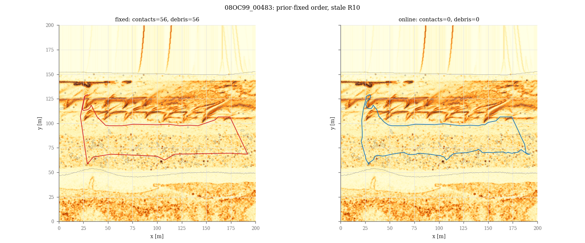

# 指示書014：ROS2から逐次呼び出せる地図更新・再計画

取得した最新の `realtime-map` (`e7ac5e4`) を土台に、`codex/online-replanning-ros2` で実装した。
既存の `tapp/online.py` と他の計画・コスト計算、両データ、既存実験結果、既存地図・worldは変更していない。
ROS非依存の実装、ROS2ノード、連続した追従ログ、Web表示、新しい地図/world、全Python実験を実装した。
新規テストは通過したが、既存のLAS地図枚数テストが追加ファイルと衝突するため「全テスト通過」は未達。
Gazeboの物理走行は依存パッケージ取得失敗のため未実施。計測値は作っていない。

## 実装したファイルと関数

- `tapp/online_mission.py`：`OnlinePlanner.observe/start_leg/update`、`virtual_sense`、`run_online_mission`。
  TA*-S exactの検索・平滑化、初見の通行不可／想定コスト+0.05超過／移動距離による再計画、現在位置からのLOS接続を既存実装と一致させた。
  `update`の座標はメートル。理想移動シミュレーターは追加の任意引数`distance_m`で正確な折れ線の移動長を渡す。
  `robot_weights`は既にコストに反映済みの重みとして保持し、特徴量を計算し直さない。
  `ordered_tour`は出発前の方向付き巡回順序、`run_fixed_mission`は再計画しない比較経路を生成する。
  `run_online_mission`のwaypointsは順序付きの停止地点であり、最後に基地を渡して閉巡回とする。1地点だけなら片道1区間。
- `online_runtime.py`：`AsyncOnlineMission`の単一ワーカーで順序決定と計画を実行。ROS側は待たず、計画中の位置の観測を保持する。
  結果を最新位置へつなぎ、観測済み障害物に接続・経路が触れる結果は棄却する。停止・新しいミッションの古い結果は適用しない。
- `online_planner.py`：truth/priorを読み、`/ground_truth`を受け、`/mission/online_command`と`/mission/path`へ経路を出す。
- `path_follower.py`：オンラインの同一走行の経路差し替えで`RunLog`を継続。
  `trajectory.csv`を切らず、`replans.csv`に適用時刻・理由・遅延・移動量、`plans.csv`に初回を含む各検索時間を保存。
  区間の終わりは次の区間を待ち、最終区間の完了または立ち往生等で走行を閉じる。既定のoffline経路は維持。
- `sim.launch.py`：既定`online:=false`、追加の`prior_map`と`sense_radius_m`、LAS worldの対応付け。
- `webui/robot_api.py`と`static/app.js`：任意の`current_path`・`n_replans`を追加。旧状態投稿は同じ既存項目を返す。
  現在の経路は緑の破線、実軌跡は従来の紫、状態欄に再計画回数を表示する。
- `data_prep/export_maps.py`：`export_stale_map`で指定のvalidationパッチに漂着物を加えた地図を追加。
  漂着物を加えた後の標高面と、水域・欠測・膨張前の障害物マスクを保存し、再読込後の配列を完全一致で確認。
- 新しいworldは未変更の`export_gazebo.py`で生成し、新しいPNGだけを既存の可逆圧縮スクリプトで圧縮した。
- `experiments/online_mission.py`：全条件の軌跡・区間結果・巡回順序・計画時間・CSV・集計・比較図を出力。
- `experiments/audit_online_mission.py`：全条件のキーと計画時間の件数を照合し、保存軌跡から未完走区間の実移動長を再計算。
- `gz_checks/online_checks.py`と`run_online_checks.sh`：同じ5点の固定経路／オンラインを漂着物ありworldで実行し、実際の完走・接触・時間を保存する確認手順。
- `tests/test_online_mission.py`：既存実装との軌跡完全一致、漂着物回避、スレッドの遅延、連続ログ、追従ノードの既定動作・区間完了・立ち往生・失敗時の状態、地図とAPIを検証。
  許可された`test_mapfiles_sim.py`の件数チェックは、既存35枚の正確な名前と追加1枚を検査する形へ変更した。

変更ファイル一覧（生成CSV・図・ログ・監査資料を含む）：

- `conference/data_prep/export_maps.py`
- `conference/experiments/audit_online_mission.py`
- `conference/experiments/online_mission.py`
- `conference/gazebo_worlds/real_las_08OB87_-0206_debris/README_ja.md`
- `conference/gazebo_worlds/real_las_08OB87_-0206_debris/heightmap.png`
- `conference/gazebo_worlds/real_las_08OB87_-0206_debris/world.sdf`
- `conference/maps/README_ja.md`
- `conference/maps/real_las_08OB87_-0206_200m_0_debris.npz`
- `conference/results/online_mission/DELIVERY_ja.md`
- `conference/results/online_mission/REPORT_ja.md`
- `conference/results/online_mission/adapter_final_log.txt`
- `conference/results/online_mission/artifact_sha256.json`
- `conference/results/online_mission/audit_log.txt`
- `conference/results/online_mission/baseline_sha256.json`
- `conference/results/online_mission/browser_log.txt`
- `conference/results/online_mission/docker_environment_log.txt`
- `conference/results/online_mission/docker_full_image_failure_log.txt`
- `conference/results/online_mission/environment.json`
- `conference/results/online_mission/existing_tests_log.txt`
- `conference/results/online_mission/experiment_progress_log.txt`
- `conference/results/online_mission/experiment_source_sha256.json`
- `conference/results/online_mission/export_maps_log.txt`
- `conference/results/online_mission/export_world_log.txt`
- `conference/results/online_mission/failure_details.csv`
- `conference/results/online_mission/failures.csv`
- `conference/results/online_mission/gazebo/launcher_failure.json`
- `conference/results/online_mission/gazebo_launcher_log.txt`
- `conference/results/online_mission/heightmap_lossless.json`
- `conference/results/online_mission/legacy_las_count_proposed.patch`
- `conference/results/online_mission/missions.csv`
- `conference/results/online_mission/online_mission_log.txt`
- `conference/results/online_mission/plan_times_coarse_c10.csv`
- `conference/results/online_mission/plan_times_oracle.csv`
- `conference/results/online_mission/plan_times_stale.csv`
- `conference/results/online_mission/planner_before_log.txt`
- `conference/results/online_mission/planning_timing_audit.json`
- `conference/results/online_mission/preservation_audit.json`
- `conference/results/online_mission/runtime.json`
- `conference/results/online_mission/stale_example_01.png`
- `conference/results/online_mission/stale_example_02.png`
- `conference/results/online_mission/stale_example_03.png`
- `conference/results/online_mission/summary.csv`
- `conference/results/online_mission/test_online_mission_log.txt`
- `conference/results/online_mission/traces/08OB86_-0205.json`
- `conference/results/online_mission/traces/08OB86_-0205.npz`
- `conference/results/online_mission/traces/08OB86_00294.json`
- `conference/results/online_mission/traces/08OB86_00294.npz`
- `conference/results/online_mission/traces/08OB87_-0706.json`
- `conference/results/online_mission/traces/08OB87_-0706.npz`
- `conference/results/online_mission/traces/08OB88_-0167.json`
- `conference/results/online_mission/traces/08OB88_-0167.npz`
- `conference/results/online_mission/traces/08OB88_-1417.json`
- `conference/results/online_mission/traces/08OB88_-1417.npz`
- `conference/results/online_mission/traces/08OB88_00332.json`
- `conference/results/online_mission/traces/08OB88_00332.npz`
- `conference/results/online_mission/traces/08OB88_01832.json`
- `conference/results/online_mission/traces/08OB88_01832.npz`
- `conference/results/online_mission/traces/08OB89_-0347.json`
- `conference/results/online_mission/traces/08OB89_-0347.npz`
- `conference/results/online_mission/traces/08OB89_-0847.json`
- `conference/results/online_mission/traces/08OB89_-0847.npz`
- `conference/results/online_mission/traces/08OB89_00152.json`
- `conference/results/online_mission/traces/08OB89_00152.npz`
- `conference/results/online_mission/traces/08OC80_-0589.json`
- `conference/results/online_mission/traces/08OC80_-0589.npz`
- `conference/results/online_mission/traces/08OC80_-1089.json`
- `conference/results/online_mission/traces/08OC80_-1089.npz`
- `conference/results/online_mission/traces/08OC80_00160.json`
- `conference/results/online_mission/traces/08OC80_00160.npz`
- `conference/results/online_mission/traces/08OC80_00660.json`
- `conference/results/online_mission/traces/08OC80_00660.npz`
- `conference/results/online_mission/traces/08OC91_-0438.json`
- `conference/results/online_mission/traces/08OC91_-0438.npz`
- `conference/results/online_mission/traces/08OC91_-0938.json`
- `conference/results/online_mission/traces/08OC91_-0938.npz`
- `conference/results/online_mission/traces/08OC91_-1688.json`
- `conference/results/online_mission/traces/08OC91_-1688.npz`
- `conference/results/online_mission/traces/08OC91_00061.json`
- `conference/results/online_mission/traces/08OC91_00061.npz`
- `conference/results/online_mission/traces/08OC91_01311.json`
- `conference/results/online_mission/traces/08OC91_01311.npz`
- `conference/results/online_mission/traces/08OC92_-0141.json`
- `conference/results/online_mission/traces/08OC92_-0141.npz`
- `conference/results/online_mission/traces/08OC92_-0891.json`
- `conference/results/online_mission/traces/08OC92_-0891.npz`
- `conference/results/online_mission/traces/08OC92_00608.json`
- `conference/results/online_mission/traces/08OC92_00608.npz`
- `conference/results/online_mission/traces/08OC94_-0954.json`
- `conference/results/online_mission/traces/08OC94_-0954.npz`
- `conference/results/online_mission/traces/08OC95_-0821.json`
- `conference/results/online_mission/traces/08OC95_-0821.npz`
- `conference/results/online_mission/traces/08OC95_-1321.json`
- `conference/results/online_mission/traces/08OC95_-1321.npz`
- `conference/results/online_mission/traces/08OC95_-2071.json`
- `conference/results/online_mission/traces/08OC95_-2071.npz`
- `conference/results/online_mission/traces/08OC95_00428.json`
- `conference/results/online_mission/traces/08OC95_00428.npz`
- `conference/results/online_mission/traces/08OC95_00928.json`
- `conference/results/online_mission/traces/08OC95_00928.npz`
- `conference/results/online_mission/traces/08OC95_01428.json`
- `conference/results/online_mission/traces/08OC95_01428.npz`
- `conference/results/online_mission/traces/08OC96_-1426.json`
- `conference/results/online_mission/traces/08OC96_-1426.npz`
- `conference/results/online_mission/traces/08OC96_00073.json`
- `conference/results/online_mission/traces/08OC96_00073.npz`
- `conference/results/online_mission/traces/08OC97_-0577.json`
- `conference/results/online_mission/traces/08OC97_-0577.npz`
- `conference/results/online_mission/traces/08OC97_-1077.json`
- `conference/results/online_mission/traces/08OC97_-1077.npz`
- `conference/results/online_mission/traces/08OC97_-1827.json`
- `conference/results/online_mission/traces/08OC97_-1827.npz`
- `conference/results/online_mission/traces/08OC97_00422.json`
- `conference/results/online_mission/traces/08OC97_00422.npz`
- `conference/results/online_mission/traces/08OC97_01172.json`
- `conference/results/online_mission/traces/08OC97_01172.npz`
- `conference/results/online_mission/traces/08OC97_01672.json`
- `conference/results/online_mission/traces/08OC97_01672.npz`
- `conference/results/online_mission/traces/08OC98_-0351.json`
- `conference/results/online_mission/traces/08OC98_-0351.npz`
- `conference/results/online_mission/traces/08OC98_-1601.json`
- `conference/results/online_mission/traces/08OC98_-1601.npz`
- `conference/results/online_mission/traces/08OC98_00148.json`
- `conference/results/online_mission/traces/08OC98_00148.npz`
- `conference/results/online_mission/traces/08OC98_00648.json`
- `conference/results/online_mission/traces/08OC98_00648.npz`
- `conference/results/online_mission/traces/08OC98_01398.json`
- `conference/results/online_mission/traces/08OC98_01398.npz`
- `conference/results/online_mission/traces/08OC99_-0016.json`
- `conference/results/online_mission/traces/08OC99_-0016.npz`
- `conference/results/online_mission/traces/08OC99_-1016.json`
- `conference/results/online_mission/traces/08OC99_-1016.npz`
- `conference/results/online_mission/traces/08OC99_-1516.json`
- `conference/results/online_mission/traces/08OC99_-1516.npz`
- `conference/results/online_mission/traces/08OC99_00483.json`
- `conference/results/online_mission/traces/08OC99_00483.npz`
- `conference/results/online_mission/traces/08OC99_01733.json`
- `conference/results/online_mission/traces/08OC99_01733.npz`
- `conference/results/online_mission/traces/08PD00_-1730.json`
- `conference/results/online_mission/traces/08PD00_-1730.npz`
- `conference/results/online_mission/ui_desktop.png`
- `conference/results/online_mission/ui_tablet.png`
- `conference/ros2_jazzy/README_ja.md`
- `conference/ros2_jazzy/gz_checks/online_checks.py`
- `conference/ros2_jazzy/gz_checks/run_online_checks.sh`
- `conference/ros2_jazzy/src/thesis_bunker_gz/launch/sim.launch.py`
- `conference/ros2_jazzy/src/thesis_bunker_mission/setup.py`
- `conference/ros2_jazzy/src/thesis_bunker_mission/thesis_bunker_mission/online_planner.py`
- `conference/ros2_jazzy/src/thesis_bunker_mission/thesis_bunker_mission/online_runtime.py`
- `conference/ros2_jazzy/src/thesis_bunker_mission/thesis_bunker_mission/path_follower.py`
- `conference/tapp/online_mission.py`
- `conference/tests/test_mapfiles_sim.py`
- `conference/tests/test_online_mission.py`
- `conference/webui/README_ja.md`
- `conference/webui/check_online_mission.py`
- `conference/webui/robot_api.py`
- `conference/webui/static/app.js`


## 固定した実験条件と比較方法

LAS版testの全48パッチ、200m、データシード0。パラメータの調整はしていない。
巡回地点は`SeedSequence([0,3000,200,patch_index])`で指示書009(D)と同じ12点を選び、その最初の5点を使う。
staleの地点は漂着物ありのtruthで到達可能な地点から選ぶ。各事前地図で出発前にterrain方式の巡回順序を一度だけ決定し、基地へ戻る。
方向付き巡回順序と、各区間のTA*-S exactによる経路の目的関数は区別する。

- oracle：漂着物なしtruthをそのまま事前地図に使い、通行不可はhardで守る。
- coarse c10：同じtruthを既存`coarse_prior(tm,10)`で処理し、順序決定の標高も同じブロック平均の標高を使う。実行中は既存と同じsoft prior。
- stale：漂着物なしを事前地図、漂着物ありをtruthに使う。実行中はsoft prior。
- 半径は5・10・15m。移動は既存と同じ1mずつの理想的な折れ線移動。区間間でも観測地図を引き継ぐ。
- Jは既存`experiments.beach_terrain.metrics`の`length_xy*(1+DEFAULT_W*mean_cost)`を巡回全軌跡で評価する。
- coarseの参照は同じclean truth・地点の全地形既知巡回。staleの参照は同じdebris truth・同じ地点で別途実行した全地形既知巡回。
  oracleの順序もtruthから決める。この参照は同じ手法が全地形を知る場合であり、Jの大域最適性を保証するものではない。
- 再計画なしは事前地図だけでTA*-S exactの各区間を計算し、そのまま実行する。半径に依存しない経路を各Rの比較層で実行しているため、3層を独立した場所と数えない。
- 接触は成功／失敗にかかわらず走った軌跡の正確なsupercoverで数える。`touching`は全通行不可、`debris_touching`はtruthの膨張済みrockからpriorのrockを除いた新しい漂着物領域。
  漂着物によって新たに急斜面になったセル等は全通行不可の数にも含めて判断する。
- dJの分布は完走した走行から計算する。未完走と、走行前に事前地図の巡回順序が作れなかったケースを隠さず表示する。
- 比較図はR10の再計画なしで漂着物接触セルが多かった順の3例を固定規則で選び、同じ事前地図で決めた順序のオンライン経路と並べる。

## 実行したコマンド

`conference/`で以下を実行。全既存モジュールの各コマンドは下の出力全文にも記載した。

```bash
python3 -m tests.test_planners  # 変更前
python3 -m tests.test_online_mission
python3 data_prep/export_maps.py
python3 data_prep/export_gazebo.py maps/real_las_08OB87_-0206_200m_0_debris.npz gazebo_worlds/real_las_08OB87_-0206_debris
python3 data_prep/compress_heightmap_png.py gazebo_worlds/real_las_08OB87_-0206_debris/heightmap.png
OPENBLAS_NUM_THREADS=1 MPLCONFIGDIR=/tmp/online-mission-mpl XDG_CACHE_HOME=/tmp/online-mission-cache python3 experiments/online_mission.py
python3 experiments/audit_online_mission.py
WEBUI_BASE_URL=http://127.0.0.1:8081 python3 -m webui.check_online_mission
```

既存`test_mapfiles_sim`の全テスト関数と末尾のCSV書出しは、`RESULTS`だけを一時フォルダに向けて実行した。
アサーションを変えず、既存結果を上書きしないための実行時設定である。残りの既存テストは各`python3 -m tests.<名前>`で実行した。
新規テスト全文に加え、最後に追加した失敗時の状態確認を含む追従アダプター／スレッドの対象テストも再実行した。
ブラウザー確認には実際の地図・プランナーと、明示した表示用の模擬ロボット状態を使った。Gazeboの走行値として扱っていない。

リポジトリ直下から物理確認も試した：

```bash
bash conference/ros2_jazzy/gz_checks/run_online_checks.sh
```

## テスト出力全文

変更前のplanner：


```text
all planner tests passed
roll-aware tests passed
```


既存全13モジュール：

```text
$ python3 -m tests.test_beach_terrain
beach determinism, shapes, finite values, water/wet and unchanged rolling passed
averaged sea/wet/dry/inland profiles and foreshore slopes passed (validation seeds)
scarp 45-degree coverage passed: [np.float64(0.465), np.float64(0.615), np.float64(0.0), np.float64(0.16), np.float64(0.555)]
beach scenarios, delegated planner equality and exact smoothing passed (15 scenarios)
exact beach online safety passed (9 trajectories)
all beach-terrain tests passed
exit code: 0
$ python3 -m tests.test_collision
segment_cells passed (2000 seeded segments vs exhaustive SAT, reversal and boundary cases)
corner-grazing reproduction and exact rejection passed
legacy online and smoothing regressions passed
exact online safety passed (41 trajectories, A* and D* Lite)
all collision tests passed
exit code: 0
$ python3 -m tests.test_dstar
static agreement passed (20 random grids, tolerance 1e-9)
dynamic agreement passed (5 seeds x 20 updates, tolerance 1e-9)
corner constraints, cost decreases, unreachable/reopened routes and ties passed
task 001 regression passed (ridge soft and hills hard, search omitted)
D* Lite safety passed (20 trajectories, normal and every-step replanning)
error handling and fixed/adaptive-with-map prior handling passed
all D* Lite tests passed
exit code: 0
$ tests.test_mapfiles_sim (all functions, temporary RESULTS)
/opt/codex/runtimes/codex-primary-runtime/dependencies/python/lib/python3.12/site-packages/fastapi/testclient.py:1: StarletteDeprecationWarning: Using `httpx` with `starlette.testclient` is deprecated; install `httpx2` instead.
  from starlette.testclient import TestClient as TestClient  # noqa
maps: 5 lossless scenario round trips, float32+residual, NaN, all 23 files and all 17 legacy IDs passed
straight completed True max_deviation_m 3.552713678800501e-15 elapsed_s 19.700000000000003
right_angle completed True max_deviation_m 0.20226302369017546 elapsed_s 39.650000000000006
closed completed True max_deviation_m 0.3173559828528229 elapsed_s 68.35000000000001
controller: reverse-heading spin then advance, curvature-preserving saturation, timeout passed
tour map=flat_test_100m.npz elapsed_s=248.15 deviation_mean_m=0.006614475997696592 deviation_max_m=0.33848962758007467 path_lethal_cells=0 out_of_bounds_samples=0 completed=True
contact_cells_xy_m []
tour map=beach_gentle_200m_100.npz elapsed_s=418.45000000000005 deviation_mean_m=0.01568040573287969 deviation_max_m=0.20112452978749665 path_lethal_cells=0 out_of_bounds_samples=0 completed=True
contact_cells_xy_m []
gazebo flat_test_100m.npz pixels 257 size_m 100.0 max_error_m 0.0 boxes 3
gazebo real_08OB87_-0206_200m_0.npz pixels 2049 size_m 200.0 max_error_m 0.06374200885325632 boxes 0
API: 40 maps, file metadata/PNG, five-point planning/simulation, 404/422, immediate 409 and guard recovery passed
all mapfiles/simulation tests passed (test output folder redirected; assertions unchanged)
exit code: 0
$ python3 -m tests.test_mission
/opt/codex/runtimes/codex-primary-runtime/dependencies/python/lib/python3.12/site-packages/fastapi/testclient.py:1: StarletteDeprecationWarning: Using `httpx` with `starlette.testclient` is deprecated; install `httpx2` instead.
  from starlette.testclient import TestClient as TestClient  # noqa
maps: 5 synthetic + 12 validation, cache, PNG dimensions/orientation passed
parity: 5-point terrain order/cost/path and Euclidean order/physical legs passed
validation: outside, water, blocked, unreachable, counts, rounding, duplicate/invalid base passed
safety: synthetic/beach_gentle/200/100, 5 points, terrain/euclid contact=0
safety: synthetic/beach_steep/200/100, 5 points, terrain/euclid contact=0
safety: synthetic/beach_scarp/200/100, 5 points, terrain/euclid contact=0
safety: real/08OB87_-0206/200, 5 points, terrain/euclid contact=0
safety: real/08OB88_01332/200, 5 points, terrain/euclid contact=0
API: maps/info/PNG/plan/static, 404/422, responsive worker, immediate 409 and guard recovery passed
all mission tests passed
exit code: 0
$ python3 -m tests.test_natural_terrain
natural generation determinism, distinct seeds, shape and finite values passed
pre-erosion radial spectrum passed: [-3.5227452123825955, -3.4854938900090673, -3.5147015961346426, -3.469782545726739, -3.4636674128050786]
rock area law: 0.4 0.02703765778384137 0.02660688949938067
rock area law: 0.6 0.014010959187524073 0.013724330217025335
rock area law: 1.0 0.003425544099666588 0.003651617375374042
natural scenarios and exact online safety passed (15 trajectories)
experiment oracle contact audit passed (both reference planners)
all natural-terrain tests passed
exit code: 0
$ python3 -m tests.test_online
regression passed (ridge/100 m, seeds 0 and 7)
perfect prior passed (all terrain kinds/50 m/seed 0)
coarse prior passed (shape, no rocks, partial blocks, noise, robot/weights, edges)
prior policies passed (hard/soft/ignore, sensing overrides, cell-specific triggers)
safety passed (60 trajectories: five online variants and constrained oracle)
all online tests passed
exit code: 0
$ python3 -m tests.test_planners
all planner tests passed
roll-aware tests passed
exit code: 0
$ python3 -m tests.test_real_beach
all 60 patches loaded: shapes, 12/48 split, nearest-data fill passed
all 60 patches satisfy sea-to-land orientation
08OB86_00294: 100/200m crops, deterministic clean/debris scenarios, reachability and forbidden masks passed
08OB86_-0205: 100/200m crops, deterministic clean/debris scenarios, reachability and forbidden masks passed
08OB87_-0706: 100/200m crops, deterministic clean/debris scenarios, reachability and forbidden masks passed
08OB88_-1417: 100/200m crops, deterministic clean/debris scenarios, reachability and forbidden masks passed
08OB88_-0167: 100/200m crops, deterministic clean/debris scenarios, reachability and forbidden masks passed
08OB86_00294: exact offline and coarse R5 c10 online safety passed, clean/debris
08OB86_-0205: exact offline and coarse R5 c10 online safety passed, clean/debris
08OB87_-0706: exact offline and coarse R5 c10 online safety passed, clean/debris
08OB88_-1417: exact offline and coarse R5 c10 online safety passed, clean/debris
08OB88_-0167: exact offline and coarse R5 c10 online safety passed, clean/debris
real-beach test groups failed: 0
all real-beach tests passed
exit code: 0
$ python3 -m tests.test_real_beach_las
data: all 60 LAS patches, 12/48 split, exact names/order/origin/axes, npts and sea-to-land orientation passed
quantized_0.1m_fraction: new_max 0.0035301084084904803 old_min 0.27882342564826246
defaults: implicit/explicit shizuoka_beach are bit-identical for the first 3 test patches
08OB86_00294: LAS 100/200m clean/debris repeatability, masks and reachability passed
08OB86_-0205: LAS 100/200m clean/debris repeatability, masks and reachability passed
08OB87_-0706: LAS 100/200m clean/debris repeatability, masks and reachability passed
08OB88_-1417: LAS 100/200m clean/debris repeatability, masks and reachability passed
08OB88_-0167: LAS 100/200m clean/debris repeatability, masks and reachability passed
08OB86_00294: exact offline and coarse R5 c10 safety, clean/debris contact=0
08OB86_-0205: exact offline and coarse R5 c10 safety, clean/debris contact=0
08OB87_-0706: exact offline and coarse R5 c10 safety, clean/debris contact=0
08OB88_-1417: exact offline and coarse R5 c10 safety, clean/debris contact=0
08OB88_-0167: exact offline and coarse R5 c10 safety, clean/debris contact=0
/opt/codex/runtimes/codex-primary-runtime/dependencies/python/lib/python3.12/site-packages/fastapi/testclient.py:1: StarletteDeprecationWarning: Using `httpx` with `starlette.testclient` is deprecated; install `httpx2` instead.
  from starlette.testclient import TestClient as TestClient  # noqa
Traceback (most recent call last):
  File "<frozen runpy>", line 198, in _run_module_as_main
  File "<frozen runpy>", line 88, in _run_code
  File "/workspace/thesis_Bunker/conference/tests/test_real_beach_las.py", line 239, in <module>
    check()
  File "/workspace/thesis_Bunker/conference/tests/test_real_beach_las.py", line 164, in test_mapfiles
    assert len(files) == len(rows) == 12
           ^^^^^^^^^^^^^^^^^^^^^^^^^^^^^
AssertionError
exit code: 1
$ python3 -m tests.test_risk_prior
coarse elevation/refactor passed (16 terrain/cell/noise combinations)
calibration passed (all-cell counts/means, deterministic pooling, JSON, test-seed rejection)
empty-bin fallback and boundary assignment passed
risk cost passed (expected means, lambda monotonicity/clipping, noise, unchanged lethal mask)
risk-prior safety passed (40 trajectories, 40 successful; 20 m cells, R=5/15 m, lambda=0/1)
all risk-prior tests passed
exit code: 0
$ python3 -m tests.test_ros2_gz
/opt/codex/runtimes/codex-primary-runtime/dependencies/python/lib/python3.12/site-packages/fastapi/testclient.py:1: StarletteDeprecationWarning: Using `httpx` with `starlette.testclient` is deprecated; install `httpx2` instead.
  from starlette.testclient import TestClient as TestClient  # noqa
model: 150kg box inertia, 0.699m spacing, 4 wheels/side, DiffDrive joints, IMU, world pose and opt-in external visual passed
packages: ament_python metadata, resource markers, node entry points, launch/bridge configuration and Python syntax passed
follower: bit-identical kinematic trajectory, completion, stationary watchdog and CSV fields passed
data_source synthetic_robot_sim
source completed elapsed_s deviation_mean_m deviation_max_m lethal_cells
recorded True 34.2 0.02959598405434589 0.3173397734180379 0
kinematic True 34.2 0.02959598405434589 0.3173397734180379 0
attitude actual_p95_deg map_p95_deg
roll 0.0 0.0
pitch 0.0 0.0
data_source synthetic_robot_sim
source completed elapsed_s deviation_mean_m deviation_max_m lethal_cells
recorded True 7.7 0.0 0.0 0
kinematic True 7.7 0.0 0.0 0
attitude actual_p95_deg map_p95_deg
roll 0.0 11.309932474020224
pitch 0.0 5.710593137499648
report: synthetic robot_sim CSV deviation/contact/time parity, kinematic comparison and plots passed (not Gazebo measurements)
API: send/fetch/id/204, telemetry/freshness, invalid map/path 422 and bridge map rejection passed
worlds: original PNG hashes/obstacle XML preserved, effective terrain transforms unchanged, sensors and IMU added
all ROS-free ROS2/Gazebo tests passed
exit code: 0
$ python3 -m tests.test_tour
kappa=0 agrees with legacy A* (20 random 25x25 grids)
directed A*/Dijkstra agree with all-simple-path exhaustive oracle (10 grids); unreachable/corners/budget passed
uphill/downhill identity, segment units and nonincreasing exact smoothing passed
Held-Karp matches all permutations (30 asymmetric matrices at each of 2..8 destinations); ties/closure passed
beach_gentle: reproducible reachable separated waypoints; all directed legs safe; matrix agrees with individual A*/Dijkstra planning (kappa=0 and physical)
beach_steep: reproducible reachable separated waypoints; all directed legs safe; matrix agrees with individual A*/Dijkstra planning (kappa=0 and physical)
beach_scarp: reproducible reachable separated waypoints; all directed legs safe; matrix agrees with individual A*/Dijkstra planning (kappa=0 and physical)
all multi-goal tour tests passed
exit code: 0
Failed modules: ['test_real_beach_las']
```


新規テスト一式：

```text
/opt/codex/runtimes/codex-primary-runtime/dependencies/python/lib/python3.12/site-packages/fastapi/testclient.py:1: StarletteDeprecationWarning: Using `httpx` with `starlette.testclient` is deprecated; install `httpx2` instead.
  from starlette.testclient import TestClient as TestClient  # noqa
beach_gentle: no-prior/coarse exact trajectory and plan-count parity; contact=0
beach_steep: no-prior/coarse exact trajectory and plan-count parity; contact=0
08OB87_-0206: no-prior/coarse exact trajectory and plan-count parity; contact=0
08OB88_01332: no-prior/coarse exact trajectory and plan-count parity; contact=0
08OB87_-0206 stale five-point tour: online contact=0; fixed debris cells= 11
08OB88_01332 stale five-point tour: online contact=0; fixed debris cells= 18
08OB89_-1597 stale five-point tour: online contact=0; fixed debris cells= 6
async: worker blocked while simulation time advances, old path/positive commands continue; latest-pose replacement, one trajectory, plan/event logs and stale/cross-run rejection passed
follower adapter: legacy completion/telemetry unchanged; intermediate-leg CSV stays open; final completion and stationary watchdog terminate the run
maps/API: debris elevations, cost/lethal/obstacle/water/nodata match; coarse prior, legacy telemetry, live path/count validation and online=false default passed
all online-mission tests passed
```


最後の追従アダプター／スレッド確認：

```text
/opt/codex/runtimes/codex-primary-runtime/dependencies/python/lib/python3.12/site-packages/fastapi/testclient.py:1: StarletteDeprecationWarning: Using `httpx` with `starlette.testclient` is deprecated; install `httpx2` instead.
  from starlette.testclient import TestClient as TestClient  # noqa
follower adapter: legacy completion/telemetry unchanged; intermediate-leg CSV stays open; final completion and stationary watchdog terminate the run
async: worker blocked while simulation time advances, old path/positive commands continue; latest-pose replacement, one trajectory, plan/event logs and stale/cross-run rejection passed
```


ブラウザー確認：

```text
browser: current green path replacement, continuous purple trail, replanning count and desktop/tablet layout passed
telemetry_source: labelled browser fixture only; not Gazebo measurements
```


新規テストは通過。既存テストの失敗は`test_real_beach_las`の`glob("real_las_*.npz")`が新しい漂着物地図も数えてしまう固定12枚のチェック。
指示書014が明示的に許可したのは`tests/test_mapfiles_sim.py`の地図件数チェックであり、
「それ以外の既存ファイルは変更しない」とあるため、`test_real_beach_las.py`は変更していない。
既存12枚を正確な`*_200m_0.npz`で選ぶ1行の修正案は`legacy_las_count_proposed.patch`に保存したが、未適用である。
新しい漂着物地図の完全一致は新規テストで別に確認している。テスト失敗を成功と扱わない。

## 集計表（実験スクリプトの出力そのまま）


```text

Task 014: J vs full-truth oracle, same truth/waypoints; bad tail=p90; metres/grid=0.5
     prior  radius_m   mode  runs  completed  failed  contact_audited  touching  debris_touching  dJ_median  dJ_p90  dJ_max  replans_median  replans_max  plan_calls  plan_s_median  plan_s_p95  plan_s_max  calls_over_1s
    oracle         5 online    48         48       0               48         0                0          0       0       0              38           60        2130       0.060777    0.408004     1.19211              4
    oracle        10 online    48         48       0               48         0                0          0       0       0              38           60        2129      0.0603297    0.397455     1.28013              4
    oracle        15 online    48         48       0               48         0                0          0       0       0              38           60        2129      0.0620595    0.394937     1.30781              8
coarse c10         5 online    48         46       2               48         0                0    6.51596 51.8432 78.3836           217.5          457       11142       0.050116    0.300825     1.18225             13
coarse c10        10 online    48         45       3               48         0                0     4.2116 27.6546 58.1804           181.5          443        9347      0.0565181    0.374672     1.72113             28
coarse c10        15 online    48         46       2               48         0                0    2.92738 19.8007 51.9435           156.5          356        8236      0.0657305    0.376629     1.48944             31
     stale         5 online    48         46       2               48         0                0    1.95421 10.2739 30.3772             101          240        6010      0.0464642     0.28594     1.26618              5
     stale         5  fixed    48         48       0               48        46               45    3.82976 10.8952 14.5958               0            0         288      0.0943159    0.513914     1.09228              2
     stale        10 online    48         46       2               48         0                0   0.945069 6.60292 22.8123            94.5          224        5428      0.0510014    0.292423     1.32438             17
     stale        10  fixed    48         48       0               48        46               45    3.82976 10.8952 14.5958               0            0         288      0.0960628    0.506712     1.25659              2
     stale        15 online    48         47       1               48         0                0   0.688622 5.29695 18.6182              85          301        5153      0.0573626    0.305459     1.76405             19
     stale        15  fixed    48         48       0               48        46               45    3.82976 10.8952 14.5958               0            0         288      0.0942355     0.48541     1.26557              2

Incomplete tours and reasons
     prior  radius_m   mode   reason  runs
coarse c10         5 online too_long     2
coarse c10        10 online too_long     3
coarse c10        15 online too_long     2
     stale         5 online too_long     2
     stale        10 online too_long     2
     stale        15 online too_long     1

Stale map: fixed prior-only paths versus online replanning; contacts include failed runs
prior  radius_m   mode  runs  completed  failed  contact_audited  touching  debris_touching  dJ_median  dJ_p90  dJ_max  replans_median  replans_max  plan_calls  plan_s_median  plan_s_p95  plan_s_max  calls_over_1s
stale         5 online    48         46       2               48         0                0    1.95421 10.2739 30.3772             101          240        6010      0.0464642     0.28594     1.26618              5
stale         5  fixed    48         48       0               48        46               45    3.82976 10.8952 14.5958               0            0         288      0.0943159    0.513914     1.09228              2
stale        10 online    48         46       2               48         0                0   0.945069 6.60292 22.8123            94.5          224        5428      0.0510014    0.292423     1.32438             17
stale        10  fixed    48         48       0               48        46               45    3.82976 10.8952 14.5958               0            0         288      0.0960628    0.506712     1.25659              2
stale        15 online    48         47       1               48         0                0   0.688622 5.29695 18.6182              85          301        5153      0.0573626    0.305459     1.76405             19
stale        15  fixed    48         48       0               48        46               45    3.82976 10.8952 14.5958               0            0         288      0.0942355     0.48541     1.26557              2

Measured wall times [s]
 compute_wall_s  figures_wall_s  total_wall_s  workers
        1848.99         4.45801        1853.8        5
Sensing is perfect radius visibility of the fixed truth map, without LiDAR, occlusion or sensor error. Movement follows the polyline exactly; asynchronous latency, tracking and physics are not modeled here.
Tour order is fixed on each prior before departure. Stale uses debris truth waypoints; its denominator is a separately executed full-truth oracle on those same waypoints. Oracle uses hard truth obstacles; coarse/stale use the unchanged soft-prior policy.
Planning times cover A* search and exact cost-aware smoothing, excluding map assembly, sensing and tour ordering. At 1m/s, planning_s seconds corresponds to planning_s metres travelled; these CPU-load-dependent measurements alone do not prove real-time safety.
```


## staleで再計画する意味


```text
 radius_m   mode  runs  completed  failed  contact_audited  touching  debris_touching
        5 online    48         46       2               48         0                0
        5  fixed    48         48       0               48        46               45
       10 online    48         46       2               48         0                0
       10  fixed    48         48       0               48        46               45
       15 online    48         47       1               48         0                0
       15  fixed    48         48       0               48        46               45
```

全オンライン条件で実行した 432 走行のうち完走は 420、通行不可への接触は 0 走行。

再計画なしの接触数と比較することで、古い地図の経路をそのまま追う場合の危険を測った。
固定経路で障害物を通過する比較は、理想移動モデル上で行ったもので、実物が障害物を通り抜けられるという意味ではない。


未完走はすべて、区間の直線距離の6倍を超えた場合の既存と同じ `too_long` 判定。事後に距離上限を広げていない。軌跡から確認した区間ごとの移動長と、計画呼出しの監査全文：

```text
All prescribed identities, unique calls, per-mission planning counts and frozen source hashes passed.

Incomplete-leg distances from saved executed trajectories, default max_factor=6 unchanged
       patch      prior  radius_m   mode   reason  failed_leg  leg_travelled_m  leg_straight_m  travelled_over_straight
08OB88_-0167 coarse c10         5 online too_long           2            175.0       29.038767                 6.026427
08OB88_-0167 coarse c10        10 online too_long           3            354.0       58.843011                 6.016008
08OB88_-0167 coarse c10        15 online too_long           2            175.0       29.038767                 6.026427
08OC95_00928 coarse c10        10 online too_long           1            250.0       41.596274                 6.010154
08OC96_-1426 coarse c10         5 online too_long           4            184.0       30.610456                 6.011018
08OC96_-1426 coarse c10        10 online too_long           3            183.0       30.417922                 6.016190
08OC96_-1426 coarse c10        15 online too_long           3            183.0       30.417922                 6.016190
08OC96_-1426      stale         5 online too_long           3            196.0       32.638168                 6.005239
08OC96_-1426      stale        10 online too_long           3            196.0       32.638168                 6.005239
08OC96_-1426      stale        15 online too_long           3            196.0       32.638168                 6.005239
08OC99_01733      stale         5 online too_long           2            152.0       25.298221                 6.008328
08OC99_01733      stale        10 online too_long           2            152.0       25.298221                 6.008328

All online search+exact smoothing calls; load-dependent wall times, not physical measurements
 online_calls  median_s    p95_s    max_s  calls_over_1s
        51704  0.055373 0.342244 1.764052            129
```





比較図3例はどちらの方式も完走した例である。未完走ケースは上の監査表へ別に示した。UIの[デスクトップ](ui_desktop.png)・[タブレット](ui_tablet.png)画像は表示用の模擬状態で、物理走行の記録ではない。


## 1回の計画時間と1m/sでの適用

全オンライン呼出しをまとめた実測値：

```text
{
  "online_calls": 51704,
  "median_s": 0.0553731835025246,
  "p95_s": 0.3422437244982573,
  "max_s": 1.7640517319960054,
  "calls_over_1s": 129
}
```


```text
     prior  radius_m  plan_calls  plan_s_median  plan_s_p95  plan_s_max  calls_over_1s
    oracle         5        2130       0.060777    0.408004    1.192113              4
    oracle        10        2129       0.060330    0.397455    1.280128              4
    oracle        15        2129       0.062060    0.394937    1.307814              8
coarse c10         5       11142       0.050116    0.300825    1.182247             13
coarse c10        10        9347       0.056518    0.374672    1.721133             28
coarse c10        15        8236       0.065730    0.376629    1.489439             31
     stale         5        6010       0.046464    0.285940    1.266181              5
     stale        10        5428       0.051001    0.292423    1.324383             17
     stale        15        5153       0.057363    0.305459    1.764052             19
```


1m/sなら、検索・平滑化にt秒かかる間にtメートル進む。上表のp95・最大は、その時間だけで進む距離に数値上そのまま対応する。
ただしROSでの適用が間に合うことは未検証。Python実験は計画待ち中の移動を模擬しない。
オンラインの計測範囲はA*検索＋exact平滑化で、観測・地図組立・巡回順序決定・キュー待ちは含まない。
固定経路比較の実装では乗数配列の組立も計測に含む。主ログ末尾の計測範囲の一般注記はfixedの範囲を正確に表していないため、ここで区別して記す。CSVの時間は実測値のまま変更していない。
実際のROS側は要求からonline_plannerが結果を渡すまでの実時間・sim時間・位置移動量と、追従ノードの差し替え時刻を記録する設計だが、今回その物理測定値は取得できていない。
センサー半径より短い時間で計画できても、遮蔽、位置誤差、追従のずれ、物理的な衝突を含む安全保証にはならない。
5ワーカーの実験とテストによるCPU共有があり、実機搭載CPUの時間として一般化しない。

## 実行時間と環境


```text
{
  "compute_wall_s": 1848.9899419630092,
  "figures_wall_s": 4.458012888993835,
  "total_wall_s": 1853.8033062100003,
  "workers": 5
}
```

```text
{
  "base": "e7ac5e4",
  "branch": "codex/online-replanning-ros2",
  "python": "3.12.14",
  "numpy": "2.3.5",
  "scipy": "1.17.0",
  "pandas": "2.2.3",
  "cpu_max": "400000 100000",
  "experiment_env": {
    "OPENBLAS_NUM_THREADS": "1",
    "MPLCONFIGDIR": "/tmp/online-mission-mpl",
    "XDG_CACHE_HOME": "/tmp/online-mission-cache"
  },
  "gazebo_status": "not_executed",
  "gazebo_blockers": [
    "desktop-full image layer failed: no space left on device",
    "ROS2 packages HTTP and HTTPS both proxy 403 Forbidden; ros-jazzy-ros-gz unavailable"
  ]
}
```


## 地図・worldの生成と保全


```text
filename bytes shape
beach_gentle_100m_100.npz 350414 (200, 200)
beach_gentle_200m_100.npz 1387328 (400, 400)
beach_scarp_100m_100.npz 345052 (200, 200)
beach_scarp_200m_100.npz 1385591 (400, 400)
beach_steep_100m_100.npz 343970 (200, 200)
beach_steep_200m_100.npz 1366333 (400, 400)
flat_test_100m.npz 2679 (200, 200)
hills_100m_100.npz 336678 (200, 200)
hills_200m_100.npz 1344189 (400, 400)
real_08OB87_-0206_200m_0.npz 289106 (400, 400)
real_08OB88_01332_200m_0.npz 330826 (400, 400)
real_08OB89_-1597_200m_0.npz 342021 (400, 400)
real_08OC90_00270_200m_0.npz 314247 (400, 400)
real_08OC91_00811_200m_0.npz 329359 (400, 400)
real_08OC93_-1519_200m_0.npz 283523 (400, 400)
real_08OC95_-0321_200m_0.npz 373060 (400, 400)
real_08OC96_-0676_200m_0.npz 424352 (400, 400)
real_08OC97_-0077_200m_0.npz 403776 (400, 400)
real_08OC98_-1101_200m_0.npz 292594 (400, 400)
real_08OC98_01898_200m_0.npz 337849 (400, 400)
real_08OC99_00983_200m_0.npz 369582 (400, 400)
real_las_08OB87_-0206_200m_0.npz 398591 (400, 400)
real_las_08OB87_-0206_200m_0_debris.npz 738204 (400, 400)
real_las_08OB88_01332_200m_0.npz 526941 (400, 400)
real_las_08OB89_-1597_200m_0.npz 525882 (400, 400)
real_las_08OC90_00270_200m_0.npz 544691 (400, 400)
real_las_08OC91_00811_200m_0.npz 494585 (400, 400)
real_las_08OC93_-1519_200m_0.npz 381091 (400, 400)
real_las_08OC95_-0321_200m_0.npz 490627 (400, 400)
real_las_08OC96_-0676_200m_0.npz 525716 (400, 400)
real_las_08OC97_-0077_200m_0.npz 557198 (400, 400)
real_las_08OC98_-1101_200m_0.npz 376698 (400, 400)
real_las_08OC98_01898_200m_0.npz 392838 (400, 400)
real_las_08OC99_00983_200m_0.npz 452698 (400, 400)
rolling_100m_100.npz 338249 (200, 200)
rolling_200m_100.npz 1348342 (400, 400)
map_count 36 total_bytes 19050641
```

```text
map pixels side_m max_error_m quantization_bound_m obstacle_boxes
real_las_08OB87_-0206_200m_0_debris.npz 2049 200.0 0.07629140363858733 6.23610787859658e-05 265
```

```text
{
  "before_bytes": 5105292,
  "after_bytes": 2785538,
  "png_filter": 1,
  "decoded_height_samples_sha256": "2294a73e9bee56b1a683646b562abc94b4ff02b3a756e527875b5da98a32cbc4",
  "samples_unchanged": true
}
```


```text
{
  "base_commit": "e7ac5e4111d157a96b77cbe1da77b4e3aecd2d16",
  "tracked_conference_files_checked": 639,
  "changed_existing_files": [
    "conference/data_prep/export_maps.py",
    "conference/maps/README_ja.md",
    "conference/ros2_jazzy/README_ja.md",
    "conference/ros2_jazzy/src/thesis_bunker_gz/launch/sim.launch.py",
    "conference/ros2_jazzy/src/thesis_bunker_mission/setup.py",
    "conference/ros2_jazzy/src/thesis_bunker_mission/thesis_bunker_mission/path_follower.py",
    "conference/tests/test_mapfiles_sim.py",
    "conference/webui/README_ja.md",
    "conference/webui/robot_api.py",
    "conference/webui/static/app.js"
  ],
  "only_authorized_existing_files_changed": true,
  "unchanged_existing_files": 629,
  "old_maps_byte_identical": 35,
  "all_old_data_results_worlds_byte_identical": true,
  "active_experiment_sources_unchanged": true
}
```


`baseline_sha256.json`に基づき、許可された既存ファイル以外の全追跡ファイル、特に旧データ・旧実験結果・既存地図・worldのSHA-256が一致することを確認した。
`experiment_source_sha256.json`は全実験中に固定した2ソース。`artifact_sha256.json`は実際の主要出力の照合用。
新規ファイルはすべて5 MB未満。

## Gazebo確認でできなかったこと

Dockerのhello-worldは動作したが、`osrf/ros:jazzy-desktop-full`はレイヤー展開時に`no space left on device`で失敗した。
小さい`ros:jazzy-ros-base`は取得できたが、必要な`ros-jazzy-ros-gz`の配布先がHTTP・HTTPSともにプロキシから403を返し、依存をインストールできなかった。
ROS2パッケージのcolconビルドとGazebo物理走行は未実行。`launcher_failure.json`は実際の失敗状態を記録し、`results.json`の物理値を埋めていない。
スクリプトはROS非依存の構文確認とワーカー／追従アダプターのテストまでであり、実機・Gazeboの完走を主張しない。


```text
{
  "status": "not_completed",
  "exit_code": 100,
  "message": "Docker dependency/build/check command failed. Inspect logs; no physical measurements were fabricated."
}
```

```text
Ign:1 https://packages.ros.org/ros2/ubuntu noble InRelease
Get:2 http://archive.ubuntu.com/ubuntu noble InRelease [256 kB]
Get:3 http://security.ubuntu.com/ubuntu noble-security InRelease [126 kB]
Get:4 http://archive.ubuntu.com/ubuntu noble-updates InRelease [126 kB]
Get:5 http://archive.ubuntu.com/ubuntu noble-backports InRelease [126 kB]
Ign:1 https://packages.ros.org/ros2/ubuntu noble InRelease
Get:6 http://security.ubuntu.com/ubuntu noble-security/restricted amd64 Packages [2122 kB]
Get:7 http://security.ubuntu.com/ubuntu noble-security/main amd64 Packages [1412 kB]
Get:8 http://archive.ubuntu.com/ubuntu noble/restricted amd64 Packages [117 kB]
Get:9 http://security.ubuntu.com/ubuntu noble-security/universe amd64 Packages [1550 kB]
Get:10 http://security.ubuntu.com/ubuntu noble-security/multiverse amd64 Packages [55.6 kB]
Get:11 http://archive.ubuntu.com/ubuntu noble/multiverse amd64 Packages [331 kB]
Get:12 http://archive.ubuntu.com/ubuntu noble/main amd64 Packages [1808 kB]
Get:13 http://archive.ubuntu.com/ubuntu noble/universe amd64 Packages [19.3 MB]
Get:14 http://archive.ubuntu.com/ubuntu noble-updates/main amd64 Packages [1741 kB]
Ign:1 https://packages.ros.org/ros2/ubuntu noble InRelease
Get:15 http://archive.ubuntu.com/ubuntu noble-updates/universe amd64 Packages [2172 kB]
Get:16 http://archive.ubuntu.com/ubuntu noble-updates/restricted amd64 Packages [2240 kB]
Get:17 http://archive.ubuntu.com/ubuntu noble-updates/multiverse amd64 Packages [61.7 kB]
Get:18 http://archive.ubuntu.com/ubuntu noble-backports/main amd64 Packages [49.0 kB]
Get:19 http://archive.ubuntu.com/ubuntu noble-backports/universe amd64 Packages [36.0 kB]
Get:20 http://archive.ubuntu.com/ubuntu noble-backports/multiverse amd64 Packages [669 B]
Err:1 https://packages.ros.org/ros2/ubuntu noble InRelease
  Invalid response from proxy: HTTP/1.1 403 Forbidden  content-length: 16  content-type: text/plain  date: Fri, 30 Oct 2026 09:39:55 GMT  server: envoy  connection: close     [IP: 172.31.1.125 8080]
Fetched 33.6 MB in 7s (4753 kB/s)
Reading package lists...
W: Failed to fetch https://packages.ros.org/ros2/ubuntu/dists/noble/InRelease  Invalid response from proxy: HTTP/1.1 403 Forbidden  content-length: 16  content-type: text/plain  date: Fri, 30 Oct 2026 09:39:55 GMT  server: envoy  connection: close     [IP: 172.31.1.125 8080]
W: Some index files failed to download. They have been ignored, or old ones used instead.
Reading package lists...
Building dependency tree...
Reading state information...
E: Unable to locate package ros-jazzy-ros-gz
```


## センサーの簡単化と分からないこと

ロボットの周囲半径Rに入るマスの値を、worldを作った同じ地図ファイルから誤差なく読む。
これはLiDAR・カメラの模擬ではなく、遮蔽・見えない陰・測距誤差・自己位置誤差・観測遅れ・実際の漂着物検出精度を評価できない。
truthは固定であり、観測後に動く漂着物も評価しない。Pythonでは理想的に経路をたどるので、非同期の計算遅延と追従誤差を含む安全性は別途確認が必要。
巡回順序を走行中に変えること、点群からの地図生成、実機は行っていない。

## 提出

pushとPR作成の結果は[DELIVERY_ja.md](DELIVERY_ja.md)を参照。
旧LASテストの1行変更の許可がないため全テスト通過は未達。Gazebo実測値も未取得であり、これらを完了と見なさない。

## 出典

静岡県「VIRTUAL SHIZUOKA 静岡県 中西部沿岸 点群データ」ALB 地面の点群（Ground）。
https://www.geospatial.jp/ckan/dataset/shizuoka-2025-pointcloud-alb 。CC BY 4.0 / ODbL。この地図は、上のデータを加工して作成したものです。
漂着物は固定シードで加えた人工の仮定であり、測量時の漂着物を実測したものではない。
