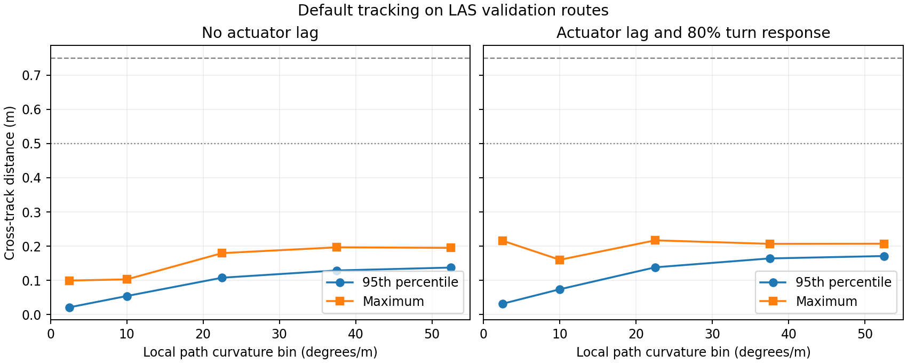

# 043 経路追従の比較

実装コミットは [e1c364ece0d576b6426c555c85c1370c6e60e62d](https://github.com/tako-1012/thesis_Bunker/commit/e1c364ece0d576b6426c555c85c1370c6e60e62d)。基点は作業開始時の `origin/realtime-map` の `fa86d83aa72ad2eb086e8c1f448aa063971cfa9d`。この報告と生成した結果は実装コミットの次に `codex/043-path-tracking` に記録する。

`corner_slow` では、遅れあり模型の60経路中56経路で最大ずれが減った。60経路を合わせた最大値は0.2170 mから0.2098 mに下がり、全サンプルの95%値は0.05452 mから0.05475 mに上がった。完走時間は全60経路で延び、同じ経路での増分の中央値は1.675秒（割合の中央値は1.715%）だった。どの模型・追従方式でも0.5 mを超えなかった。 [走行別CSV](runs.csv) · [集計CSV](summary.csv)

## 実装と変更ファイル

- `conference/tapp/tracking.py` を追加。Pure Pursuit の経路上の進捗、目標点、到着判定を再利用する。進捗位置から2.0 m先までの頂点で向きの変化の絶対値を足し、合計を最大180°として速度式に入れる。S字で左右の変化が相殺されず、180°を超えて速度が上がることもない。速度の下限係数は0.3。目標点への向きのずれが45°を超えたら並進指令を0にし、その場で回る。既存の角速度上限は引き続き適用する。
- `conference/tapp/tracking_sim.py` を追加。0.3秒の一次遅れを並進・回転速度に適用し、回転の定常応答を指令の80%にする。
- `conference/ros2_jazzy/src/thesis_bunker_mission/thesis_bunker_mission/path_follower.py` と同ディレクトリの `online_runtime.py` を変更。初回の経路と再計画後の経路に追従方式を渡す。停止判定は選んだ `--online-fixes` のままとし、`corner_slow` だけを走行ログの `mission.json` に記録する。
- `conference/ros2_jazzy/gz_checks/lidar_checks.py` と `run_lidar_checks.sh` を変更。既存の引数転送で `--tracking` を渡し、`corner_slow` では選んだ方式と3つの定数を manifest に記録する。取得した走行ログは追従方式の比較用に保存する。
- `conference/experiments/path_tracking.py` と `conference/tests/test_path_tracking.py` を追加。前者は検証経路の計画と模型での比較、後者はバイト一致、速度・その場旋回、模型の応答、引数の受け渡しを確認する。
- `conference/results/path_tracking/` にこの報告、`plans.json`、`runs.csv`、`summary.csv`、`curvature.csv`、`deviation_curvature.png`、`tracking_log.txt` を追加。

## 検証用砂浜の模型比較

LAS の検証用12か所に、地点シード `range(100, 105)` を適用した。各シードにつき開始地点から到達可能な目的地を1つ選んだ。200 m四方、地形シード100、漂着物あり、急斜面の車体幅分の膨張ありで、TA*-S が計画した60本の同一経路を4条件で使った。初期姿勢は各経路の最初の区間に沿わせ、0.05秒刻みで走らせた。遅れなしの `default` は既存の `robot_sim.py` をそのまま呼んだ。 [使用した経路](plans.json)

ずれはロボット中心から計画経路の折れ線までの最短距離。表の最大・95%値は全走行の全時刻サンプルをまとめた値で、完走時間は走行別の中央値。閾値超過は連続して超えた区間を1回とし、超過サンプルから次のサンプルまでの時間を合計した。

| 模型 | 追従 | 完走 | 最大 (m) | 95%値 (m) | 0.50 m超 (秒／回) | 0.75 m超 (秒／回) | 完走時間中央値 (秒) |
|---|---|---:|---:|---:|---:|---:|---:|
| 遅れなし | `default` | 60/60 | 0.19657 | 0.03534 | 0／0 | 0／0 | 88.225 |
| 遅れなし | `corner_slow` | 60/60 | 0.21104 | 0.03770 | 0／0 | 0／0 | 91.650 |
| 遅れあり | `default` | 60/60 | 0.21703 | 0.05452 | 0／0 | 0／0 | 88.775 |
| 遅れあり | `corner_slow` | 60/60 | 0.20977 | 0.05475 | 0／0 | 0／0 | 91.825 |

遅れありでは、同じ経路での最大ずれの差の中央値が−11.8 mm、走行別95%値の差の中央値が−1.7 mmだった。走行別95%値が下がったのは47/60経路。全サンプルの95%値は各走行のサンプルをまとめて計算しているため、走行ごとに計算した95%値の差とは集計単位が異なる。遅れなしでは最大ずれが51/60経路で増え、完走時間の増分の中央値は1.700秒（割合の中央値は1.778%）だった。 [走行別CSV](runs.csv)

図は `default` のサンプルを、経路への最近接点の前後各1 mでの絶対旋回角を区間長で割った曲率でまとめた。両模型で曲率帯が高くなるほど95%値が上がった。遅れありの最大値は15–30°/m帯で0.217 mで、0–5°/m帯にも0.216 mのずれがあった。横線は0.5 mと0.75 m。 [曲率帯別CSV](curvature.csv)

### 比較スクリプトの出力全文

~~~text
08OB87_-0206 planned=5/5
08OB88_01332 planned=5/5
08OB89_-1597 planned=5/5
08OC90_00270 planned=5/5
08OC91_00811 planned=5/5
08OC93_-1519 planned=5/5
08OC95_-0321 planned=5/5
08OC96_-0676 planned=5/5
08OC97_-0077 planned=5/5
08OC98_-1101 planned=5/5
08OC98_01898 planned=5/5
08OC99_00983 planned=5/5
model,tracking,runs,completed,median_completed_s,deviation_max_m,deviation_p95_m,over_05_s,over_05_episodes,over_075_s,over_075_episodes
no_lag,default,60,60,88.225,0.19656907092270695,0.035335039243377594,0.0,0,0.0,0
no_lag,corner_slow,60,60,91.65,0.2110369158827962,0.03769736863089902,0.0,0,0.0,0
lagged,default,60,60,88.775,0.21702908263977647,0.05451926079696831,0.0,0,0.0,0
lagged,corner_slow,60,60,91.825,0.20977204819745993,0.054752964833387756,0.0,0,0.0,0
no_lag completed_pairs=60 median_delta_s=1.700 median_delta_pct=1.778
lagged completed_pairs=60 median_delta_s=1.675 median_delta_pct=1.715
~~~

## 研究 PC での評価案

037と同じ5地点（08OB86_-0205、08OB88_-1417、08OB88_-0167、08OB88_00332、08OB89_-0847）で、L（`lidar_real`）とLC（`lidar_real+depth2`）を各3反復し、同じ地点・センサー・反復で追従方式を対にする。60走行で追従方式以外の引数、地形と地点、コンテナイメージ、物理設定、描画方式を揃える。出力先は追従方式と反復ごとに分ける。以下はLCの1反復の例。Lでは `--sensors lidar_real` を使う。 [037の走行スクリプト](../real_sensors_compare/run037.sh)

~~~bash
cd conference
patch=08OB89_-0847
for tracking in default corner_slow; do
    THESIS_FINE_PROTOCOL=rtf_check THESIS_ONLY_PATCH="$patch" THESIS_ROS_DOMAIN_ID=63 \
      THESIS_REAL_TIME_FACTOR=0.3 THESIS_STALE_TIMEOUT_S=1.0 THESIS_SOFTWARE_RENDERING=1 \
      THESIS_ROS_IMAGE=thesis/jazzy-gz:1 \
      bash ros2_jazzy/gz_checks/run_lidar_checks.sh \
        "results/path_tracking_gz/$patch/LC_r1/$tracking" \
        --patch-count 3 --map fine --ground-estimate non_obstacle --online-fixes v1 \
        --diagnostics --obstacle-reference prior --sensors lidar_real+depth2 \
        --tracking "$tracking"
done
~~~

各条件の完走率、走行時間、再計画前後のずれの最大・95%値、0.5 mと0.75 mの超過時間・回数、`off_path` 停止、実際の漂着物への接触・最接近距離を対で比較する。停止後の移動が見えるよう、`off_path` の前後の時刻付き姿勢・速度指令・障害物マスクも保存する。

## 確認できた範囲

- 模型は初期経路を追う単一目的地の比較。点群による地図更新、再計画、傾斜・接地・横滑り、指令停止後の Gazebo 上の制動、漂着物接触を再現していない。閾値は模型内では計測にだけ使った。ROSノードの代役を使う単体テストで、追従方式の切り替え後も v1・v2 の傾きによる停止が働くことを確認した。
- 0.3秒と80%は比較条件として事前に固定した値で、BUNKERの測定値ではない。全240走行でずれが0.218 m未満だったため、模型では037のような大きなずれや `off_path` の減少は評価できなかった。Gazeboと研究 PC での比較は未実施。
- バイト一致テストは、基点コミットのソースを同じ Python プロセスで動かすため、その Git オブジェクトを必要とする。保存済みの別環境のハッシュは使っていない。manifest は合成の地点一覧を両側に与え、走行記録はROSの代役と同じ姿勢列・再計画・停止を与えて比較した。

## 実行コマンドとテスト出力

Codex Cloud の `thesis_Bunker`、x86_64 AMD EPYC 9V45、Python 3.12.14。既存の venv `/tmp/thesis036-venv` の9パッケージが `conference/requirements-venv.txt` の全固定版と一致していたため、再インストールは不要だった。

~~~bash
git fetch origin realtime-map
git switch -c codex/043-path-tracking origin/realtime-map
cd conference
export OPENBLAS_NUM_THREADS=1 MPLCONFIGDIR=/tmp/043-mpl XDG_CACHE_HOME=/tmp/043-cache
mkdir -p /tmp/043-logs
set -o pipefail
# 変更前
/tmp/thesis036-venv/bin/python -m tests.test_planners
# 変更後
/tmp/thesis036-venv/bin/python -u -m tests.test_path_tracking
bash -n ros2_jazzy/gz_checks/run_lidar_checks.sh
/tmp/thesis036-venv/bin/python -u -m experiments.path_tracking \
    --output results/path_tracking --workers 2 | tee results/path_tracking/tracking_log.txt
for f in tests/test_*.py; do printf '%s\n' "${f%.py}"; done |
    tr / . | xargs -P 4 -I '{}' bash -c '
        module=$1
        log=/tmp/043-logs/${module}.txt
        printf "\$ /tmp/thesis036-venv/bin/python -u -m %s\n" "$module" >"$log"
        /tmp/thesis036-venv/bin/python -u -m "$module" >>"$log" 2>&1
        status=$?
        printf "\nexit=%s\n" "$status" >>"$log"
        printf "%s exit=%s\n" "$module" "$status"
        exit "$status"
    ' bash '{}'
git diff --check
~~~

### 変更前のプランナーテスト

~~~text
all planner tests passed
roll-aware tests passed
~~~

### 変更後の全テスト

既存の36本と追加した1本の計37モジュールが終了コード0。以下は各モジュールの標準出力と標準エラーの全文。

全37モジュールの実行出力

~~~~text
$ /tmp/thesis036-venv/bin/python -u -m tests.test_beach_terrain
beach determinism, shapes, finite values, water/wet and unchanged rolling passed
averaged sea/wet/dry/inland profiles and foreshore slopes passed (validation seeds)
scarp 45-degree coverage passed: [np.float64(0.465), np.float64(0.615), np.float64(0.0), np.float64(0.16), np.float64(0.555)]
beach scenarios, delegated planner equality and exact smoothing passed (15 scenarios)
exact beach online safety passed (9 trajectories)
all beach-terrain tests passed

exit=0

$ /tmp/thesis036-venv/bin/python -u -m tests.test_collision
segment_cells passed (2000 seeded segments vs exhaustive SAT, reversal and boundary cases)
corner-grazing reproduction and exact rejection passed
legacy online and smoothing regressions passed
exact online safety passed (41 trajectories, A* and D* Lite)
all collision tests passed

exit=0

$ /tmp/thesis036-venv/bin/python -u -m tests.test_dstar
static agreement passed (20 random grids, tolerance 1e-9)
dynamic agreement passed (5 seeds x 20 updates, tolerance 1e-9)
corner constraints, cost decreases, unreachable/reopened routes and ties passed
task 001 regression passed (ridge soft and hills hard, search omitted)
D* Lite safety passed (20 trajectories, normal and every-step replanning)
error handling and fixed/adaptive-with-map prior handling passed
all D* Lite tests passed

exit=0

$ /tmp/thesis036-venv/bin/python -u -m tests.test_edge_margin
sampling: all ten frozen default/zero-margin outputs byte-identical; 12-point draws meet 10m, 5m separation and reachability
sampling boundaries: inclusive margin, no start snapping, invalid margins and zero goals passed
cohort: independently recomputed the five changed beaches; all other metadata exactly equals task021; archived world-height bytes retained
synthetic start fixture: an insufficient start margin excludes the tour before sampling or planning, without moving it
report: 40 rows mix untouched cached rows with synthetic reruns; incomplete outcomes stay unknown; descriptive pairs, no energy/tests of significance
real adapter preparation: partial controls and both selected LiDAR cohorts accept exactly the same new metadata without ROS
dispatch fixtures: only changed eligible beaches reach the old runners; identical tour/world inputs, matched LiDAR conditions and no legacy finalizer
Docker fixture: normal read-only-source wrapper forwards fixed 0.3x/1s and refuses an existing manifest
all edge-margin tests passed (ROS2/Gazebo not required; fixture records are not experimental data)

exit=0

$ /tmp/thesis036-venv/bin/python -u -m tests.test_endpoint_component
component topology: exact four-neighbour BFS, no free/diagonal bridges or distance cap; raw masks, costs and input arrays protected
component runtime: enclosed synthetic start escapes through search AND latest-map handoff; mapper remains immutable
3b PASS: substitute remains nearby after replanning and arrival
4 PASS: actual async runtime stops, waits 1 sim second, retries once, skips and terminates
4b PASS: stale blocked handoff stops and terminates after one timed retry
component lifecycle: unchanged nearby-target tracking, one timed retry, skip and stale-handoff stop contracts passed
legacy bytes: only two corrected start_steep labels differ in replay; all other fields and four preparation variants unchanged
028b saved replay: {'case': 'results/rtf_check/divergence/R1_05/physical_1/raw/08OB87_-0706', 'failure_class': 'start_steep', 'policy': 'escape', 'none': 'no_path', 'result': 'no_path', 'goal': [347, 145], 'outcome': 'unreachable', 'relaxed_cells': 1, 'relaxed_truth_lethal_cells': 0, 'raw_cells_cleared': 0, 'raw_path_cells': 0, 'relaxed_length_m': 0.0, 'truth_lethal_length_m': 0.0, 'cells': []}
028b saved replay: {'case': 'results/rtf_check/divergence/R1_05/physical_1/raw/08OB87_-0706', 'failure_class': 'start_steep', 'policy': 'escape_component', 'none': 'no_path', 'result': 'no_path', 'goal': [347, 145], 'outcome': 'unreachable', 'relaxed_cells': 0, 'relaxed_truth_lethal_cells': 0, 'raw_cells_cleared': 0, 'raw_path_cells': 0, 'relaxed_length_m': 0.0, 'truth_lethal_length_m': 0.0, 'cells': []}
028b saved replay: {'case': 'results/rtf_check/hayashi_first_gazebo_check/physical_3/raw/08OB87_-0706', 'failure_class': 'start_steep', 'policy': 'escape', 'none': 'no_path', 'result': 'no_path', 'goal': [347, 145], 'outcome': 'unreachable', 'relaxed_cells': 1, 'relaxed_truth_lethal_cells': 0, 'raw_cells_cleared': 0, 'raw_path_cells': 0, 'relaxed_length_m': 0.0, 'truth_lethal_length_m': 0.0, 'cells': []}
028b saved replay: {'case': 'results/rtf_check/hayashi_first_gazebo_check/physical_3/raw/08OB87_-0706', 'failure_class': 'start_steep', 'policy': 'escape_component', 'none': 'no_path', 'result': 'no_path', 'goal': [347, 145], 'outcome': 'unreachable', 'relaxed_cells': 0, 'relaxed_truth_lethal_cells': 0, 'raw_cells_cleared': 0, 'raw_path_cells': 0, 'relaxed_length_m': 0.0, 'truth_lethal_length_m': 0.0, 'cells': []}
028b saved replay: {'case': 'results/lidar_fine/physical_10/raw/08OB88_-1417', 'failure_class': 'goal_cell', 'policy': 'escape', 'none': 'no_path', 'result': 'path', 'goal': [198, 151], 'outcome': 'nearby', 'relaxed_cells': 0, 'relaxed_truth_lethal_cells': 0, 'raw_cells_cleared': 0, 'raw_path_cells': 0, 'relaxed_length_m': 0.0, 'truth_lethal_length_m': 0.0, 'cells': []}
028b saved replay: {'case': 'results/lidar_fine/physical_10/raw/08OB88_-1417', 'failure_class': 'goal_cell', 'policy': 'escape_component', 'none': 'no_path', 'result': 'path', 'goal': [198, 151], 'outcome': 'nearby', 'relaxed_cells': 0, 'relaxed_truth_lethal_cells': 0, 'raw_cells_cleared': 0, 'raw_path_cells': 0, 'relaxed_length_m': 0.0, 'truth_lethal_length_m': 0.0, 'cells': []}
saved component contract: both start_steep cases clear ZERO cells, protect all raw masks, retry once and advance to the next stop
all task028b component tests passed (Python only; Gazebo not run)

exit=0

$ /tmp/thesis036-venv/bin/python -u -m tests.test_endpoint_policy
1 PASS: default original runtime, path and CSV bytes unchanged
2 PASS: fixed 0.5m start escape; all three raw masks remain blocked
3 PASS: reachable nearest substitute <=1.0m; raw goal unreachable
3b PASS: substitute remains nearby after replanning and arrival
4 PASS: actual async runtime stops, waits 1 sim second, retries once, skips and terminates
4b PASS: stale blocked handoff stops and terminates after one timed retry
5 PASS: exact failed map, classifications, 10s snapshots/newest 3, offline exact lengths
5b PASS: time-aligned actual-travel audit; ROS callback holds zero velocity and retains run log
6 replay: {'case': 'results/rtf_check/divergence/R1_05/physical_1/raw/08OB87_-0706', 'failure_class': 'start_steep', 'none': 'no_path', 'escape': 'unreachable_after_retry_then_next_stop', 'goal': [347, 145], 'outcome': 'unreachable', 'relaxed_cells': 1, 'relaxed_truth_lethal_cells': 0, 'raw_cells_cleared': 0, 'relaxed_length_m': 0.0, 'truth_lethal_length_m': 0.0, 'cells': []}
6 replay: {'case': 'results/rtf_check/hayashi_first_gazebo_check/physical_3/raw/08OB87_-0706', 'failure_class': 'start_steep', 'none': 'no_path', 'escape': 'unreachable_after_retry_then_next_stop', 'goal': [347, 145], 'outcome': 'unreachable', 'relaxed_cells': 1, 'relaxed_truth_lethal_cells': 0, 'raw_cells_cleared': 0, 'relaxed_length_m': 0.0, 'truth_lethal_length_m': 0.0, 'cells': []}
6 replay: {'case': 'results/lidar_fine/physical_10/raw/08OB88_-1417', 'failure_class': 'goal_cell', 'none': 'no_path', 'escape': 'path', 'goal': [198, 151], 'outcome': 'nearby', 'relaxed_cells': 0, 'relaxed_truth_lethal_cells': 0, 'raw_cells_cleared': 0, 'relaxed_length_m': 0.0, 'truth_lethal_length_m': 0.0, 'cells': []}
6 PASS: three saved failures reproduced without changing fixed constants
Task028 endpoint policy tests passed; full existing suite is run separately (requirement 7).

exit=0

$ /tmp/thesis036-venv/bin/python -u -m tests.test_footprint
dilation: 0.5m circle, rocks not doubled, zero radius, immutable costs/endpoints and raster rounding passed
proximity: analytic line-circle lengths, overlapping unions and tangencies passed
requested LAS case: inflated planner reports no_path without moving endpoints
online: zero radius preserves exact task014 trajectory and planning count
rollover: strict +/-90deg threshold, first time/position and immutable fake records passed
statistics: two sizes averaged within beach, incomplete pairs excluded, one fixed Holm family passed (synthetic fixtures only)
Gazebo selection: six fixed scenarios, inflated-only selection and explicit infeasibility passed
comparison: unknown physical outcomes stay unknown; rollover pairs excluded; explicit executed denominator passed (fixtures only)
three-method reports: each contrast uses its own completion cohort; third-method failure does not drop old pairs (fixtures only)
all footprint and rollover tests passed

exit=0

$ /tmp/thesis036-venv/bin/python -u -m tests.test_geo
/tmp/thesis036-venv/lib/python3.12/site-packages/fastapi/testclient.py:1: StarletteDeprecationWarning: Using `httpx` with `starlette.testclient` is deprecated; install `httpx2` instead.
  from starlette.testclient import TestClient as TestClient  # noqa
zone VIII reference differences [latitude_deg, longitude_deg]:
-4.25145429972e-09 2.46816966865e-09
-4.06389943919e-09 -3.64556740351e-09
2.36028796508e-09 -3.05306002701e-10
2.78198797332e-10 -4.38916458734e-10
projection round-trip max error [m]: 7.10133463144e-09
geographic sidecars: 13 maps; source axes, coastline anchor, half-cell offset, round trips and NPZ hashes passed
Web APIs: geographic map conversions, unavailable-map response and unchanged legacy metadata/image passed
all geographic conversion tests passed

exit=0

$ /tmp/thesis036-venv/bin/python -u -m tests.test_ground_estimate
1 PASS: implicit/explicit all_returns match pre-change update JSON, snapshots, histories, NPZ and multi-sensor sidecar bytes
2 PASS: 0.55m box creates false steep neighbours only with all_returns; box detection/inflation and all evidence unchanged
ground_estimate x y slope_deg steep box_lethal
all_returns 9 10 28.810793742973065 True True
all_returns 11 10 28.810793742973065 True True
all_returns 10 9 28.810793742973065 True True
all_returns 10 11 28.810793742973065 True True
non_obstacle 9 10 0.0 False True
non_obstacle 11 10 0.0 False True
non_obstacle 10 9 0.0 False True
non_obstacle 10 11 0.0 False True
3 PASS: all-excluded cells retain prior height and seen status; last-64 ALL returns displace older ground, then ground observations resume
4 PASS: sub-0.3m terrain changes retained; bilinear prior and the unchanged >=0.3m obstacle boundary used
5 PASS: LiDAR+two cameras share unchanged 2+1 detection evidence, source attribution and filtering; ground-only median removes false steep cells
configuration PASS: byte-identical default manifests; opt-in factory, CLI, ROS parameter and actual node constructor propagation; invalid/coarse combinations rejected
all ground-estimate tests passed; requirement 6 is verified by running every conference/tests module separately (Python only)

exit=0

$ /tmp/thesis036-venv/bin/python -u -m tests.test_gz_compare
comparison scenarios: first six LAS test patches, clean 200m seed0; both methods match direct start/goal/path calls
unavailable-world fixture: all scenarios retained, one export attempt per beach, no invented physical measurements
worlds: all six LAS maps reconstructed from decoded PNGs within 0.1m; default exports unchanged by explicit legacy limit; invalid limits rejected
comparison report: 6x2 kinematic fixtures agree with analyze_run; paired medians, immutable raw logs and excluded columns passed
fixture values are simulated test data, not Gazebo measurements
all Gazebo comparison tests passed (ROS2/Gazebo not required)

exit=0

$ /tmp/thesis036-venv/bin/python -u -m tests.test_gz_online_batch
scenarios: first ten LAS test beaches; truth/prior arrays, seed-selected five points, task014 order and inflated plans agree with direct calls
runtime: unchanged async worker uses the predeparture order; opt-in masks and blocked endpoints verified
synthetic fixtures only: completion/stuck/rollover/timeout, five-target prefix, contact, active-path deviation, planning times and immutable originals passed
raw CSV parts: strict file limit, repeated headers, exact numeric strings and complete record order passed
unrun report: twenty scenarios retained, unknown physical outcomes stay blank, no energy/map/world artifacts and overwrite refused
synthetic paired counts: incomplete tours excluded from paired medians; each outcome retains the actual-recording denominator
all Gazebo online batch tests passed (ROS2/Gazebo not required; fixture measurements are not experimental data)

exit=0

$ /tmp/thesis036-venv/bin/python -u -m tests.test_lab_geometry
1 PASS: flat terrain and physical 5/12/22/30deg planes match independent eight-neighbour formula; all six cost stages and uint8 truncation
2 PASS: <=3 valid neighbours and absent centres stay unknown; fourth valid neighbour enables cost
3 PASS: pinned Jazzy setCostmap integer conversion, 253/254 blockage and allowed unknown=253
4 PASS: no raw obstacle contact/corner cuts; blocked starts and disconnected goals rejected; independent Dijkstra optimum; one 0.35m square-distance inflation
5 PASS: task013 A*/TA*-S all non-energy path metrics and scenario identifiers match clean/debris, 100/200m; times independently remeasured
all lab-geometry tests passed; requirement 6 is checked by the full conference/tests suite

exit=0

$ /tmp/thesis036-venv/bin/python -u -m tests.test_local_speed
1 PASS: pre-change map NPZ/snapshot/history/sidecar, world and manifest SHA-256 match; explicit prior matches implicit default
Task036 task023 aggregation skipped: the task023 report requires --map fine. Manifest and available raw results: /tmp/tmp11y222ho/ten
024 08OB86_00294 start=[52, 195] points=[[309, 113], [273, 232], [104, 176], [46, 121], [250, 270]] unchanged=False
024 08OB86_-0205 start=[49, 270] points=[[114, 102], [114, 214], [42, 179], [135, 255], [93, 197]] unchanged=True
024 08OB87_-0706 start=[50, 200] points=[[89, 197], [263, 259], [59, 119], [347, 145], [39, 236]] unchanged=False
024 08OB88_-1417 start=[70, 169] points=[[337, 140], [313, 165], [199, 151], [264, 194], [203, 229]] unchanged=True
024 08OB88_-0167 start=[38, 231] points=[[137, 294], [249, 150], [202, 281], [31, 208], [348, 149]] unchanged=True
024 08OB88_00332 start=[45, 228] points=[[142, 207], [38, 131], [203, 180], [136, 171], [70, 116]] unchanged=True
024 08OB88_01832 start=[36, 214] points=[[223, 254], [335, 247], [159, 229], [264, 180], [133, 240]] unchanged=False
024 08OB89_00152 start=[48, 341] points=[[296, 173], [183, 372], [207, 192], [328, 186], [193, 222]] unchanged=False
024 08OB89_-0347 start=[55, 326] points=[[294, 224], [164, 169], [213, 144], [195, 352], [264, 374]] unchanged=False
024 08OB89_-0847 start=[70, 146] points=[[269, 98], [75, 211], [227, 332], [281, 117], [350, 279]] unchanged=True
024 PASS: 10/10 archived waypoint lists, 5/5 unchanged scenarios, default manifest bytes and wrapper forwarding
032 slope=0 box=False shift=0: fine/coarse=(0, 0)
032 slope=0 box=False shift=-0.4: fine/coarse=(0, 0)
032 slope=0 box=False shift=0.4: fine/coarse=(0, 0)
032 slope=0 box=True shift=0: fine/coarse=(0, 0)
032 slope=0 box=True shift=-0.4: fine/coarse=(0, 0)
032 slope=0 box=True shift=0.4: fine/coarse=(0, 0)
032 slope=20 box=False shift=0: fine/coarse=(0, 0)
032 slope=20 box=False shift=-0.4: fine/coarse=(0, 0)
032 slope=20 box=False shift=0.4: fine/coarse=(0, 0)
032 slope=20 box=True shift=0: fine/coarse=(0, 0)
032 slope=20 box=True shift=-0.4: fine/coarse=(0, 0)
032 slope=20 box=True shift=0.4: fine/coarse=(0, 0)
CPU AMD EPYC 9V45 96-Core Processor
fixture sensor input accepted repeats before_median_s before_p95_s after_median_s after_p95_s fine_diff coarse_diff
synthetic lidar 28800 28800 12 7.626350 8.583991 0.273062 0.345883 0 0
synthetic camera1 26750 26750 12 6.219243 11.622153 0.019578 0.061236 0 0
saved_b0b lidar 28800 11741 1 1.713490 1.713490 0.035147 0.035147 1 1
saved_b0b camera1 26750 9604 1 2.130040 2.130040 0.020522 0.020522 0 0
saved_b0b camera2 26750 9242 1 2.246769 2.246769 0.066987 0.066987 0 0
all local speed tests passed

exit=0

$ /tmp/thesis036-venv/bin/python -u -m tests.test_map_speed
byte-identical replay against the pre-038 implementation: 88 update states; states differing from the hashes stored on the recording machine: 0

exit=0

$ /tmp/thesis036-venv/bin/python -u -m tests.test_mapfiles_sim
/tmp/thesis036-venv/lib/python3.12/site-packages/fastapi/testclient.py:1: StarletteDeprecationWarning: Using `httpx` with `starlette.testclient` is deprecated; install `httpx2` instead.
  from starlette.testclient import TestClient as TestClient  # noqa
maps: 5 lossless scenario round trips, float32+residual, NaN, all 23 files and all 17 legacy IDs passed
straight completed True max_deviation_m 3.552713678800501e-15 elapsed_s 19.700000000000003
right_angle completed True max_deviation_m 0.20226302369017546 elapsed_s 39.650000000000006
closed completed True max_deviation_m 0.3173559828528229 elapsed_s 68.35000000000001
controller: reverse-heading spin then advance, curvature-preserving saturation, timeout passed
tour map=flat_test_100m.npz elapsed_s=248.15 deviation_mean_m=0.006614475997696592 deviation_max_m=0.33848962758007467 path_lethal_cells=0 out_of_bounds_samples=0 completed=True
contact_cells_xy_m []
tour map=beach_gentle_200m_100.npz elapsed_s=418.45000000000005 deviation_mean_m=0.01568040573287969 deviation_max_m=0.20112452978749665 path_lethal_cells=0 out_of_bounds_samples=0 completed=True
contact_cells_xy_m []
gazebo flat_test_100m.npz pixels 257 size_m 100.0 max_error_m 0.0 boxes 3
gazebo real_08OB87_-0206_200m_0.npz pixels 2049 size_m 200.0 max_error_m 0.06374200885325632 boxes 0
API: 40 maps, file metadata/PNG, five-point planning/simulation, 404/422, immediate 409 and guard recovery passed
all mapfiles/simulation tests passed

exit=0

$ /tmp/thesis036-venv/bin/python -u -m tests.test_mission
/tmp/thesis036-venv/lib/python3.12/site-packages/fastapi/testclient.py:1: StarletteDeprecationWarning: Using `httpx` with `starlette.testclient` is deprecated; install `httpx2` instead.
  from starlette.testclient import TestClient as TestClient  # noqa
maps: 5 synthetic + 12 validation, cache, PNG dimensions/orientation passed
parity: 5-point terrain order/cost/path and Euclidean order/physical legs passed
validation: outside, water, blocked, unreachable, counts, rounding, duplicate/invalid base passed
safety: synthetic/beach_gentle/200/100, 5 points, terrain/euclid contact=0
safety: synthetic/beach_steep/200/100, 5 points, terrain/euclid contact=0
safety: synthetic/beach_scarp/200/100, 5 points, terrain/euclid contact=0
safety: real/08OB87_-0206/200, 5 points, terrain/euclid contact=0
safety: real/08OB88_01332/200, 5 points, terrain/euclid contact=0
API: maps/info/PNG/plan/static, 404/422, responsive worker, immediate 409 and guard recovery passed
all mission tests passed

exit=0

$ /tmp/thesis036-venv/bin/python -u -m tests.test_natural_terrain
natural generation determinism, distinct seeds, shape and finite values passed
pre-erosion radial spectrum passed: [-3.5227452123825955, -3.4854938900090673, -3.5147015961346426, -3.469782545726739, -3.4636674128050786]
rock area law: 0.4 0.02703765778384137 0.02660688949938067
rock area law: 0.6 0.014010959187524073 0.013724330217025335
rock area law: 1.0 0.003425544099666588 0.003651617375374042
natural scenarios and exact online safety passed (15 trajectories)
experiment oracle contact audit passed (both reference planners)
all natural-terrain tests passed

exit=0

$ /tmp/thesis036-venv/bin/python -u -m tests.test_obstacle_clearance
1 PASS: centre default/explicit, prior/local, fine/multi; maps match the pre-041 implementation on this machine (recorded hashes also match); manifest, ROS-mocked commands and existing none/v1/v2 files match baseline
2 mode min_path_clearance_m lethal_cells path_grid
centre 0.477533728 4 [(10, 15), (11, 7)]
overlap 1.123456796 12 [(10, 15), (12, 10), (12, 8), (11, 7)]
3 PASS: full recompute after 20 updates across prior/local and fine/multi, plus dense/sparse edge cases
3 planning PASS: inferred overlap halo blocks unseen cells in normal and diagnostic planner snapshots
4 B PASS: periodic observed data incl. empty map, exact trajectory-to-box distance, CSV parts and truth-mask fallback
4 C1-C3 PASS: missing plan_history, shared path_distance (300 decisions, 23 rounding cases), class default
4 C4 and routing PASS: env-selected 1.0 honoured, overlap manifest, ROS command and wrapper
4 ROS constructor PASS: v2 runtime, overlap mapper and diagnostics selected together
all task041 obstacle clearance tests passed

exit=0

$ /tmp/thesis036-venv/bin/python -u -m tests.test_online
regression passed (ridge/100 m, seeds 0 and 7)
perfect prior passed (all terrain kinds/50 m/seed 0)
coarse prior passed (shape, no rocks, partial blocks, noise, robot/weights, edges)
prior policies passed (hard/soft/ignore, sensing overrides, cell-specific triggers)
safety passed (60 trajectories: five online variants and constrained oracle)
all online tests passed

exit=0

$ /tmp/thesis036-venv/bin/python -u -m tests.test_online_deadend
safeguards: unknown-only memory, known truth precedence, strict N_B threshold and per-leg reset passed
08OB86_00294: disabled trajectory/count parity and A/B/A+B stale five-point contacts=0
08OB86_-0205: disabled trajectory/count parity and A/B/A+B stale five-point contacts=0
08OB87_-0706: disabled trajectory/count parity and A/B/A+B stale five-point contacts=0
08OC99_01733 stale R10: validation-frozen B completed without contact
all online dead-end tests passed

exit=0

$ /tmp/thesis036-venv/bin/python -u -m tests.test_online_mission
/tmp/thesis036-venv/lib/python3.12/site-packages/fastapi/testclient.py:1: StarletteDeprecationWarning: Using `httpx` with `starlette.testclient` is deprecated; install `httpx2` instead.
  from starlette.testclient import TestClient as TestClient  # noqa
beach_gentle: no-prior/coarse exact trajectory and plan-count parity; contact=0
beach_steep: no-prior/coarse exact trajectory and plan-count parity; contact=0
08OB87_-0206: no-prior/coarse exact trajectory and plan-count parity; contact=0
08OB88_01332: no-prior/coarse exact trajectory and plan-count parity; contact=0
08OB87_-0206 stale five-point tour: online contact=0; fixed debris cells= 11
08OB88_01332 stale five-point tour: online contact=0; fixed debris cells= 18
08OB89_-1597 stale five-point tour: online contact=0; fixed debris cells= 6
async: worker blocked while simulation time advances, old path/positive commands continue; latest-pose replacement, one trajectory, plan/event logs and stale/cross-run rejection passed
follower adapter: legacy completion/telemetry unchanged; intermediate-leg CSV stays open; final completion and stationary watchdog terminate the run
maps/API: debris elevations, cost/lethal/obstacle/water/nodata match; coarse prior, legacy telemetry, live path/count validation and online=false default passed
all online-mission tests passed

exit=0

$ /tmp/thesis036-venv/bin/python -u -m tests.test_online_safety
1 PASS: implicit/explicit none match pre-change runtime command JSON, plans/diagnostic bytes, follower trajectory/mission bytes and manifests
2 PASS: LiDAR and perfect-radius joins exempt only the start cell; later lethal cells remain rejected
3 PASS: actual stuck_0847_C1_r2_t1345 fixture search and handoff
online_fixes search_success handoff path_points outside_start_lethal_cells start_lethal
none True False 0 0 True
v1 True True 5 0 True
4 PASS: consecutive join rejection terminates at exactly 10 simulation seconds; acceptance resets the interval
5 PASS: known free-to-lethal on remaining path triggers lethal_changed only in v1; off-path changes do not replan; pending changes reset on planning
6 PASS: +/-26deg roll/pitch and 0.8m deviation stop; 24/25deg and 0.7/0.75m do not; zero linear and angular speed
safety recovery PASS: stop invalidates old work, replans from measured position, accepts replacement, ignores stale status and ends on no-path
ROS adapter PASS: real callbacks publish zero/status, preserve the open run, relay the stop and resume on a replanned path
diagnostics/concurrency PASS: v1 records diagnostics without 028b relaxation; busy pre-stop work cannot hand off and recovery uses the latest pose
configuration PASS: v1 manifest/CLI and both ROS parameter commands; 028b unchanged and excluded from v1
all online-safety tests passed; requirement 7 is checked by the complete conference/tests run

exit=0

$ /tmp/thesis036-venv/bin/python -u -m tests.test_path_tracking
1 PASS: before/current same-host manifest, ROS states, commands, trajectory, replan and stop bytes for none/v1/v2
2 PASS: straight speed, 2m corner window, 60-degree 0.5 m/s cap and strict 45-degree spin
3 PASS: 0.3 s rise/decay, 80% steady turn response, no-lag trace equals robot_sim
wiring PASS: opt-in initial/replacement paths with none/v1/v2, manifest, ROS args and Docker stub
all task043 tracking tests passed

exit=0

$ /tmp/thesis036-venv/bin/python -u -m tests.test_planners
all planner tests passed
roll-aware tests passed

exit=0

$ /tmp/thesis036-venv/bin/python -u -m tests.test_pointcloud_map
flat fixture: median height, zero slope/cost, exact hit-only mask, unknown cells and immutable prior passed
box fixtures: prior-relative clusters, exact TraversabilityMap features, steep inflation and bounded unknown halo passed
registration: model/sensor offset, roll/pitch/yaw convention and stamped SO(3) interpolation passed
PointCloud2 layouts: endian, point/row padding, truncation, nonfinite/range/bounds filtering passed
model: default SDF bytes unchanged; 16 x 2deg channels, 360deg/10Hz/30m and configurable assumed mount/noise passed
LiDAR runtime: worker and delayed handoff use hit-only clouds; truth maps and virtual_sense are unavailable
/workspace/thesis_Bunker/conference/experiments/gz_lidar_report.py:159: FutureWarning: The behavior of DataFrame concatenation with empty or all-NA entries is deprecated. In a future version, this will no longer exclude empty or all-NA columns when determining the result dtypes. To retain the old behavior, exclude the relevant entries before the concat operation.
  data = pd.concat([old, pd.DataFrame(rows)], ignore_index=True)
quality fixtures: unique hit-cell errors, measured map times, unchanged task021 controls and unknown LiDAR outcomes passed
all pointcloud map tests passed (synthetic fixtures only; no Gazebo measurements)

exit=0

$ /tmp/thesis036-venv/bin/python -u -m tests.test_pointcloud_map_fine
flat: no obstacles; only hit cells become known
noisy box fixture (seed, coarse outside lethal, fine outside lethal): [(100, 12, 8), (101, 11, 8), (102, 12, 8), (103, 12, 8), (104, 12, 8)]
box retained; 0.5m heights/cost/seen bytes and steep inflation unchanged
one dilation: exhaustive centre-to-square distance, repeated/additive seeds, centre radius bound, packed save passed
centre clearance: 0.1m side spill leaves the next coarse centre free; all <=0.5m centres blocked
boundaries: all 25 subcell phases, four map corners and diagonal square-edge clearance passed
legacy: default/explicit coarse use the unchanged class; full controlled-clock update and NPZ bytes identical
selection: legacy manifest bytes identical; fine preserves exact task022 cohort, mesh/0.3x/1s protocol
Docker wrapper fixture: coarse defaults preserved; both fine flag spellings forward the fixed run settings
/workspace/thesis_Bunker/conference/experiments/lidar_fine_report.py:168: FutureWarning: The behavior of DataFrame concatenation with empty or all-NA entries is deprecated. In a future version, this will no longer exclude empty or all-NA columns when determining the result dtypes. To retain the old behavior, exclude the relevant entries before the concat operation.
  data = pd.concat([old, pd.DataFrame(rows)], ignore_index=True)
map audit fixtures: final-lethal versus raw-detector errors distinguished; four methods retain cached values and missing fine outcomes
all fine-grid pointcloud tests passed (synthetic fixtures only, no Gazebo results)

exit=0

$ /tmp/thesis036-venv/bin/python -u -m tests.test_prior_free
1 PASS: pre-change map NPZ/snapshot/history/sidecar, world and manifest SHA-256 match; explicit prior matches implicit default
2-4 PASS: flat/20deg plane and 0.4m boxes, with exact and +/-0.4m shifted priors
slope_deg box prior_shift_m reference false_positive_cells missed_cells
0.0 False 0.0 prior 0 0
0.0 False 0.0 local 0 0
0.0 False -0.4 prior 81 0
0.0 False -0.4 local 0 0
0.0 False 0.4 prior 0 0
0.0 False 0.4 local 0 0
0.0 True 0.0 prior 0 0
0.0 True 0.0 local 0 0
0.0 True -0.4 prior 80 0
0.0 True -0.4 local 0 0
0.0 True 0.4 prior 0 1
0.0 True 0.4 local 0 0
20.0 False 0.0 prior 0 0
20.0 False 0.0 local 0 0
20.0 False -0.4 prior 81 0
20.0 False -0.4 local 0 0
20.0 False 0.4 prior 0 0
20.0 False 0.4 local 0 0
20.0 True 0.0 prior 0 0
20.0 True 0.0 local 0 0
20.0 True -0.4 prior 80 0
20.0 True -0.4 local 0 0
20.0 True 0.4 prior 0 1
20.0 True 0.4 local 0 0
local support PASS: fewer than 3/collinear minima remain unclassified; both real sensor modes fuse sensor-only evidence and attribution
5 PASS: true world box tops equal component maximum; lower edges/footprints/collision-visual sizes and truth NPZ unchanged
6 PASS: SeedSequence reproducibility, distinct patch seeds, preserved sea/nodata, flat none and immutable input arrays
configuration PASS: factory/CLI/manifest/ROS command forwarding; invalid coarse/local rejected; Gazebo not started
all prior-free tests passed; requirement 7 is checked by the separate complete test-module run

exit=0

$ /tmp/thesis036-venv/bin/python -u -m tests.test_real_beach
all 60 patches loaded: shapes, 12/48 split, nearest-data fill passed
all 60 patches satisfy sea-to-land orientation
08OB86_00294: 100/200m crops, deterministic clean/debris scenarios, reachability and forbidden masks passed
08OB86_-0205: 100/200m crops, deterministic clean/debris scenarios, reachability and forbidden masks passed
08OB87_-0706: 100/200m crops, deterministic clean/debris scenarios, reachability and forbidden masks passed
08OB88_-1417: 100/200m crops, deterministic clean/debris scenarios, reachability and forbidden masks passed
08OB88_-0167: 100/200m crops, deterministic clean/debris scenarios, reachability and forbidden masks passed
08OB86_00294: exact offline and coarse R5 c10 online safety passed, clean/debris
08OB86_-0205: exact offline and coarse R5 c10 online safety passed, clean/debris
08OB87_-0706: exact offline and coarse R5 c10 online safety passed, clean/debris
08OB88_-1417: exact offline and coarse R5 c10 online safety passed, clean/debris
08OB88_-0167: exact offline and coarse R5 c10 online safety passed, clean/debris
real-beach test groups failed: 0
all real-beach tests passed

exit=0

$ /tmp/thesis036-venv/bin/python -u -m tests.test_real_beach_las
data: all 60 LAS patches, 12/48 split, exact names/order/origin/axes, npts and sea-to-land orientation passed
quantized_0.1m_fraction: new_max 0.0035301084084904803 old_min 0.27882342564826246
defaults: implicit/explicit shizuoka_beach are bit-identical for the first 3 test patches
08OB86_00294: LAS 100/200m clean/debris repeatability, masks and reachability passed
08OB86_-0205: LAS 100/200m clean/debris repeatability, masks and reachability passed
08OB87_-0706: LAS 100/200m clean/debris repeatability, masks and reachability passed
08OB88_-1417: LAS 100/200m clean/debris repeatability, masks and reachability passed
08OB88_-0167: LAS 100/200m clean/debris repeatability, masks and reachability passed
08OB86_00294: exact offline and coarse R5 c10 safety, clean/debris contact=0
08OB86_-0205: exact offline and coarse R5 c10 safety, clean/debris contact=0
08OB87_-0706: exact offline and coarse R5 c10 safety, clean/debris contact=0
08OB88_-1417: exact offline and coarse R5 c10 safety, clean/debris contact=0
08OB88_-0167: exact offline and coarse R5 c10 safety, clean/debris contact=0
/tmp/thesis036-venv/lib/python3.12/site-packages/fastapi/testclient.py:1: StarletteDeprecationWarning: Using `httpx` with `starlette.testclient` is deprecated; install `httpx2` instead.
  from starlette.testclient import TestClient as TestClient  # noqa
mapfiles: all 12 LAS validation files match build_real exactly and retain Ground attribution
comparison: identity joins reject missing/duplicate cases; 16-bit PNG filters preserve standard-decoded height samples
all real-beach LAS tests passed

exit=0

$ /tmp/thesis036-venv/bin/python -u -m tests.test_real_sensors
PASS legacy model SDF (with/without LiDAR) and fine-map NPZ SHA256 match pre-change bytes
PASS real preset mounts, symmetry, unchanged LiDAR spec and camera FOV/ranges without intrinsics
A2 camera1: image=214x125, horizontal_deg=87.000000000000, vertical_deg=57.999358468411, intrinsics=absent
A2 camera2: image=214x125, horizontal_deg=87.000000000000, vertical_deg=57.999358468411, intrinsics=absent
PASS A2: three camera-free SDFs byte-identical; depth SDF/spec change only prescribed resolution and intrinsics
PASS arbitrary sensor/model roll-pitch-yaw and translation match independent homogeneous transform
PASS both outward cameras: ground/box registration, shared 2+1 evidence, one inflation and saved provenance
PASS synthetic camera boxes in LiDAR blind zone at 1.5/2/3m; residual 1m blind zone disclosed
PASS per-sensor range/FOV/finite filtering and byte-identical task023 fusion/inflation for registered input
PASS manifest records all real specs/mounts; explicit fine selection; Docker wrapper forwards sensor flags
PASS A2 wrapper: unset flags preserve full legacy argv bytes; individual/both/empty supplied values forwarded (fake Docker only)
PASS analytic 4.105m LiDAR near bound, discrete-beam gap, rear blind zone and camera symmetry
PASS actual ROS adapter: bounded queues, fair sources, stamped transforms, logs and freshness (transport mocked)
all real sensor tests passed (synthetic/geometry only; Gazebo not run)

exit=0

$ /tmp/thesis036-venv/bin/python -u -m tests.test_review_fixes
1 PASS: none/v1 commands, ROS follower state and log bytes unchanged; full manifest hashes 8/8
A1 v1 second tilt after 9s: replanned
A1 v2 second tilt after 9s: terminal unsafe_tilt
A1 v2 second tilt after 10s: terminal unsafe_tilt
A1 v2 second tilt after 10.1s: replanned
A2 v1 duplicate segment, 0.8m: running
A2 v2 duplicate segment, 0.8m: off_path
A3 v1 near passed segment and 0.8m from remaining route: running
A3 v2 near passed segment and 0.8m from remaining route: off_path
B6 PASS: the box is detected with support 0.70m from its centre
B9 PASS: dense/cKDTree agree on 298 heights, including unknown support
B8 5f36770 local_ground_032.py SHA-256 5a57c07f09d31e0fcf7508de6ddc28e05253cca13939eeda767ffca2ef7491f5
B8 5f36770 pointcloud_map_multi_032.py SHA-256 710d81185c5a945e9c89d1d679414c6846832f779edbc6a9e9065823ba67dc96
v2 configuration PASS: manifest, CLI, both ROS parameters and async factory
B10 PASS: fine world input NPZ, world SDF and heightmap match byte for byte; coarse matching remains explicit
Task036 task023 aggregation skipped: the waypoint cohort differs from the cached task022 controls. Manifest and available raw results: /tmp/tmp0xi0kqoe/edge
Task036 task023 aggregation skipped: the task023 report requires --map fine. Manifest and available raw results: /tmp/tmp0xi0kqoe/coarse
Task036 task023 aggregation skipped: opt-in conditions require separate evaluation from task023. Manifest and available raw results: /tmp/tmp0xi0kqoe/opt-in
B11 PASS: standard aggregation selected only for a comparable fine cohort
B7 controlled scan fine_diff coarse_diff lethal_diff
0 0 0 0
1 0 0 0
2 0 0 0
3 0 0 0
4 0 0 0
5 0 0 0
6 0 0 0
7 0 0 0
8 0 0 0
9 0 0 0
10 0 0 0
11 0 0 0
B7 review scan fine_diff coarse_diff lethal_diff
0 0 0 0
1 0 0 0
2 0 0 0
3 0 0 0
4 0 0 0
5 0 0 2
6 2 2 1
7 4 2 0
8 8 2 0
9 10 3 5
10 13 3 0
11 11 2 0
all task040 review-fix tests passed

exit=0

$ /tmp/thesis036-venv/bin/python -u -m tests.test_risk_prior
coarse elevation/refactor passed (16 terrain/cell/noise combinations)
calibration passed (all-cell counts/means, deterministic pooling, JSON, test-seed rejection)
empty-bin fallback and boundary assignment passed
risk cost passed (expected means, lambda monotonicity/clipping, noise, unchanged lethal mask)
risk-prior safety passed (40 trajectories, 40 successful; 20 m cells, R=5/15 m, lambda=0/1)
all risk-prior tests passed

exit=0

$ /tmp/thesis036-venv/bin/python -u -m tests.test_ros2_gz
/tmp/thesis036-venv/lib/python3.12/site-packages/fastapi/testclient.py:1: StarletteDeprecationWarning: Using `httpx` with `starlette.testclient` is deprecated; install `httpx2` instead.
  from starlette.testclient import TestClient as TestClient  # noqa
model: 150kg box inertia, 0.699m spacing, 4 wheels/side, DiffDrive joints, IMU, world pose and opt-in external visual passed
packages: ament_python metadata, resource markers, node entry points, launch/bridge configuration and Python syntax passed
follower: bit-identical kinematic trajectory, completion, stationary watchdog and CSV fields passed
data_source synthetic_robot_sim
source completed elapsed_s deviation_mean_m deviation_max_m lethal_cells
recorded True 34.2 0.02959598405434589 0.3173397734180379 0
kinematic True 34.2 0.02959598405434589 0.3173397734180379 0
attitude actual_p95_deg map_p95_deg
roll 0.0 0.0
pitch 0.0 0.0
data_source synthetic_robot_sim
source completed elapsed_s deviation_mean_m deviation_max_m lethal_cells
recorded True 7.7 0.0 0.0 0
kinematic True 7.7 0.0 0.0 0
attitude actual_p95_deg map_p95_deg
roll 0.0 11.309932474020224
pitch 0.0 5.710593137499648
report: synthetic robot_sim CSV deviation/contact/time parity, kinematic comparison and plots passed (not Gazebo measurements)
API: send/fetch/id/204, telemetry/freshness, invalid map/path 422 and bridge map rejection passed
worlds: original PNG hashes/obstacle XML preserved, effective terrain transforms unchanged, sensors and IMU added
all ROS-free ROS2/Gazebo tests passed

exit=0

$ /tmp/thesis036-venv/bin/python -u -m tests.test_rtf_option
/workspace/thesis_Bunker/conference/experiments/lidar_fine_report.py:168: FutureWarning: The behavior of DataFrame concatenation with empty or all-NA entries is deprecated. In a future version, this will no longer exclude empty or all-NA columns when determining the result dtypes. To retain the old behavior, exclude the relevant entries before the concat operation.
  data = pd.concat([old, pd.DataFrame(rows)], ignore_index=True)
/workspace/thesis_Bunker/conference/experiments/lidar_fine_report.py:168: FutureWarning: The behavior of DataFrame concatenation with empty or all-NA entries is deprecated. In a future version, this will no longer exclude empty or all-NA columns when determining the result dtypes. To retain the old behavior, exclude the relevant entries before the concat operation.
  data = pd.concat([old, pd.DataFrame(rows)], ignore_index=True)
default 0.3 PASS: omitted/explicit match, manifest and report match pre-change hashes (full manifest)
1.0 PASS: historical overlay manifest settings and world target match; stale=1.0, step=0.001, LiDAR=10Hz
validation PASS: explicit 0.3 overrides environment; legacy rtf_check still works; invalid factor, stale and coarse rejected
wrapper PASS: split and equals options forward unchanged, with identical Docker setup
run finalization PASS: explicit 1.0 preserves manifest and skips incompatible task023 summary
all task039 RTF option tests passed

exit=0

$ /tmp/thesis036-venv/bin/python -u -m tests.test_thesis_figures

T1
 debris    metric  n    A_median   TAS_median  delta_median              p         p_holm
  False mean_cost 48 0.110342949 0.0767774554 -0.0352167333 7.10542736e-15 5.68434189e-14
  False     climb 48  1.50126915  0.890802236  -0.410943017 7.10542736e-15 5.68434189e-14
  False  p95_roll 48  5.45746622     3.567633   -1.89097743 7.10542736e-15 5.68434189e-14
  False length_xy 48         NaN          NaN   -2.00026809   0.0276182014   0.0552364028
   True mean_cost 48 0.154226921 0.0855587032 -0.0582350381 7.10542736e-15 5.68434189e-14
   True     climb 48  2.07159806   1.30575231  -0.803948405 2.13162821e-14 6.39488462e-14
   True  p95_roll 48  6.86720155   3.63401103   -2.80093993 7.10542736e-15 5.68434189e-14
   True length_xy 48         NaN          NaN  -0.764154874    0.947340222    0.947340222

T2
 radius_m   mode  runs  completed  touching   dJ_median     dJ_p90  replans_median  plan_s_median  plan_s_p95  plan_s_max
        5  fixed    48         48        46   3.8297614 10.8951737               0   0.0943159025 0.513914058  1.09228056
        5 online    48         46         0   1.9542052 10.2738521             101   0.0464642375  0.28593965  1.26618145
       10  fixed    48         48        46   3.8297614 10.8951737               0   0.0960627685 0.506711613  1.25659096
       10 online    48         46         0 0.945069248  6.6029207            94.5   0.0510014495 0.292423272  1.32438343
       15  fixed    48         48        46   3.8297614 10.8951737               0    0.094235528 0.485409814  1.26557115
       15 online    48         47         0 0.688622405 5.29694595              85    0.057362561 0.305458798  1.76405173

T3
                                world         mode  completed  path_lethal_cells  elapsed_s  roll_p95_actual_deg  pitch_p95_actual_deg  roll_p95_map_deg  pitch_p95_map_deg
              file/flat_test_100m.npz offline tour       True                  0    249.412       8.05631294e-09        6.79662109e-10                 0                  0
    file/real_08OB87_-0206_200m_0.npz offline tour       True                  0      348.2           4.76005563            6.20167607        4.58473933         6.31735413
file/real_las_08OB87_-0206_200m_0.npz offline tour       True                  0    289.516           3.83941424            2.47900287        3.84957483         2.58651471
       real_las_08OB87_-0206 / debris        fixed      False                  0      96.15           4.54713144            5.69114628        5.33797683         6.55378208
       real_las_08OB87_-0206 / debris       online       True                  0     190.95           4.31378469            4.21973305        4.30333238         3.67841423
thesis: F1-F7 PDF/PNG, T1-T3 LaTeX/Markdown and numbers.tex generated
statistics: 48 paired beaches, size means, medians and archived contact counts verified
outputs: no excluded measurement columns or values; all thesis figure tests passed

exit=0

$ /tmp/thesis036-venv/bin/python -u -m tests.test_tour
kappa=0 agrees with legacy A* (20 random 25x25 grids)
directed A*/Dijkstra agree with all-simple-path exhaustive oracle (10 grids); unreachable/corners/budget passed
uphill/downhill identity, segment units and nonincreasing exact smoothing passed
Held-Karp matches all permutations (30 asymmetric matrices at each of 2..8 destinations); ties/closure passed
beach_gentle: reproducible reachable separated waypoints; all directed legs safe; matrix agrees with individual A*/Dijkstra planning (kappa=0 and physical)
beach_steep: reproducible reachable separated waypoints; all directed legs safe; matrix agrees with individual A*/Dijkstra planning (kappa=0 and physical)
beach_scarp: reproducible reachable separated waypoints; all directed legs safe; matrix agrees with individual A*/Dijkstra planning (kappa=0 and physical)
all multi-goal tour tests passed

exit=0

$ /tmp/thesis036-venv/bin/python -u -m tests.test_visibility
visibility: all cells in the physical radius visible on flat terrain, including clipped edges
visibility: front and wall top visible, cells behind the wall occluded
visibility: raising the sensor 0.5 -> 0.8 -> 1.2m never loses a visible cell
sensing: bool mask/cost/lethal tuple and explicit raw-obstacle assumed height passed
control: radial trajectory/count parity; contact diagnostics agree with exact trajectory audit
all visibility tests passed

exit=0
~~~~

