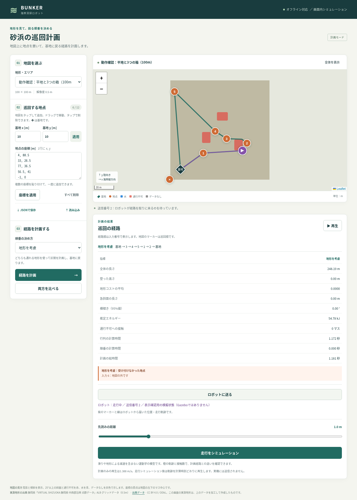
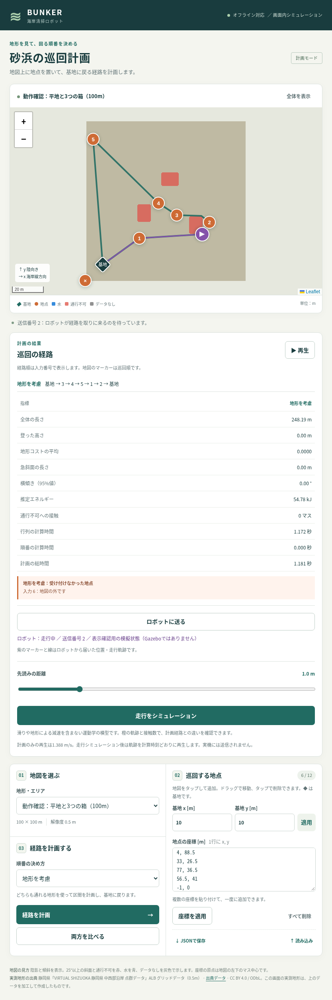

# タスク012 ROS2 Jazzy・Gazebo BUNKER 実装報告

## 実装と検証の状態

最新の `realtime-map`（`363f0b6`）から `codex/ros2-gazebo-bunker` を作成しました。
ROS非依存の追従・記録・解析、2つのament_pythonパッケージ、BUNKER SDF、起動・bridge設定、Web送受信と表示、
worldの衝突位置修正、Docker用一括検査スクリプトを実装しました。
`conference/tests/test_*.py` の全12モジュールが終了コード0です。

**物理のあるGazebo走行とcolconビルドは未確認です。** 公式イメージの取得と依存・バージョンの確認は成功しましたが、
Dockerのvfs方式によるコンテナ展開が32GBのファイルシステム上限に達しました。
継続実行用コンテナは `no space left on device` で作成できず、指示書が許可する代替としてROSなしの検査と、Ubuntuでの実行手順・チェックリストを用意しました。
物理検査の測定値は作成せず、`gz_checks/results/environment.json` に `physical_checks_executed=false`・`measurements=null` と記録しています。
ここに掲載する模型の解析表は **robot_simから作ったsynthetic fixtureの検証値であり、Gazeboの実験値ではありません**。

## 実装したもの

- `tapp/follower.py`：`MissionFollower.step` は既存 `PurePursuit` をそのまま呼び、完了と立ち往生の終端状態を管理します。
  既定10秒の停止監視は引数で変更でき、0.1mの移動、またはその場旋回時の0.1radの変化で監視時計を更新します。
  `log_row` はworld位置・yawとIMU roll／pitchをCSVの共通フィールドへ変換します。
- `tapp/run_log.py`：`RunLog`。走行ごとにAsia/Tokyoの日時と地図名でフォルダを作り、`trajectory.csv` と
  地図・地点・経路・設定・終了状態を含む `mission.json` を保存します。既定は `~/thesis_runs/` です。
- `ros2_jazzy/src/thesis_bunker_gz/`：新規模型、launch、bridge YAML、ament_pythonのメタデータ。
  `model.py:make_model` が同じ模型を生成し、外部 `lab_mesh_dir` 指定時だけ見た目のSTL URIを加えます。研究室メッシュはコピーしていません。
  `sim.launch.py` は地図の基地・標高を読み、一時worldへ模型を埋め込んでGazebo・bridge・追従を起動します。
  `webui` が空ならHTTP橋渡しは起動しません。別の地図に対応するworldがなければ生成方法を示して停止します。
- `ros2_jazzy/src/thesis_bunker_mission/`：`path_follower` と `webui_bridge`。
  前者はworld真値とIMUを受けて共通追従クラス・記録器を呼びます。完了状態を保持し、位置受信停止時や時刻逆行時には停止します。
  後者は標準ライブラリのurllibだけでWeb APIを呼び、HTTP処理を別スレッドに分けています。異なる地図の指示を拒否します。
  経路とメタデータを原子的に渡すため `/mission/command` のJSONを使い、同じ経路を `/mission/path` のnav_msgs/Pathでも配信します。
- `webui/robot_api.py`：番号付きの最新ミッション1件をメモリに保持し、afterによる取得と204、状態受信と鮮度を実装。
  不正な地図・空経路は422。サーバーにROSの依存は追加していません。サーバー再起動時には橋渡しも再起動する単純な仕様です。
- `webui/static/`：計画の「ロボットに送る」、紫の位置マーカーと走行線、状態・送信番号、3秒の未接続表示。
  計画で受付外になった入力地点は送信メタデータから除外し、安全な残りの経路を送れます。
- `webui/mock_robot.py`：表示用の模擬状態を明記して送信するスクリプト。
  `check_ros2_gz.py` は実際に5地点を計画し、送信・受付外地点の除外・模擬位置表示・通信断とPC／タブレット幅の表示を検証します。
- `experiments/gz_run_report.py`：CSVの横ずれ・所要時間・接触・完走、実際のroll／pitch絶対値の95%値と地図の方向勾配による95%値を比較します。
  同じ開始姿勢・経路を既存 `robot_sim.simulate` でも実行し、JSON・CSV・経路図・姿勢時系列・表示ログを出力します。
  実際の姿勢は時間サンプル、地図の予測は既存evaluateと同じ0.1m弧長サンプルで、重みの違いをREADMEに記載しました。
- `data_prep/export_gazebo.py` と再生成world：heightmap.posを見た目・衝突とも0にし、同じ平行移動をterrainモデルのposeへ移しました。
  Sensors／Imu systemを追加しています。PNGと障害物の箱はバイト列／XMLで保持を検査しました。
- `tests/test_mapfiles_sim.py`：許可された高さ復元検査だけを修正しました。heightmap.posとモデルposeを足して同じ有効位置を検査し、
  元の地図幅・高さ復元誤差の検査を維持しました。pos=0、モデル回転=0の検査も追加しています。
- `tests/test_ros2_gz.py`：模型・パッケージ・追従のビット単位の一致・停止監視・解析・API・worldの変換をROSなしで確認します。
  平地の記録に加え、解析用の既知勾配平面で地図のroll／pitch計算を検査しています。
- `ros2_jazzy/gz_checks/`：公式イメージ内でビルドして全worldの20地点落球、基地待機、前進・旋回、5地点巡回、記録解析を行うスクリプト。
  初回測定の精度や比に合格閾値を設けません。地図より1m以上下への落下は失敗にし、エラーはJSONへ記録します。
  Docker／ビルド／検査コマンドの異常終了もlauncher_failure.jsonで記録します。今回この物理検査スクリプト自体は未実行です。
- `ros2_jazzy/README_ja.md`：Ubuntu 24.04／Jazzy／Harmonicの導入・ビルド・起動、Macとの接続、値の出典・仮定、利用者の検査一覧、切り分け方法。

## 車体・クローラー・摩擦の値と出典

車体箱は指示書が引用するAgileXの外形近似1.023×0.778×0.410m、質量は `Robot.mass_kg` の150kgです。
慣性は一様な箱の式で計算しました。左右の中心間隔0.699mは、指示書にある研究室URDFのy=±0.3495mを使用しています。
出典は https://global.agilex.ai/products/bunker と https://github.com/hayashilab/bunker_ros2 の
`bunker_description/urdf/bunker.xacro`（値は指示書012に記載）です。研究室のコード・STLを取り込んでいません。

左右4輪ずつの円柱、半径0.12m、幅0.08m、各1kg、車輪x=−0.36,−0.12,0.12,0.36m、車体中心z=0.35mは近似の仮定です。
模型SDFから計算した全質量は158kgで、車輪を含む実機全質量を厳密に再現するものではありません。
車体箱は公開外形を用いた近似で、車輪との合成外形も実機と一致するとはしていません。
摩擦mu=1.0、mu2=0.1、fdir1=(1,0,0)、関節減衰0.05、外部メッシュscale=0.001は仮定です。
IMU 50Hz、位置20Hz、制御20Hz、理想関節速度駆動も設定上の仮定です。走行結果による合わせ込みはしていません。

指定どおりDiffDriveを選びました。左右複数関節をまとめて速度駆動でき、TrackedVehicleより構成が単純だからです。
左右の逆転と小さい横摩擦でその場旋回する想定ですが、実際の旋回比・滑り・斜面の安定性は未確認です。

## 変更ファイル

- `conference/data_prep/export_gazebo.py`
- `conference/experiments/gz_run_report.py`
- `conference/gazebo_worlds/flat_test/README_ja.md`
- `conference/gazebo_worlds/flat_test/world.sdf`
- `conference/gazebo_worlds/real_08OB87_-0206/README_ja.md`
- `conference/gazebo_worlds/real_08OB87_-0206/world.sdf`
- `conference/results/ros2_gz/baseline_sha256.json`
- `conference/results/ros2_gz/browser_log.txt`
- `conference/results/ros2_gz/model_parameters.json`
- `conference/results/ros2_gz/synthetic_fixture/mission.json`
- `conference/results/ros2_gz/synthetic_fixture/trajectory.csv`
- `conference/results/ros2_gz/synthetic_report/attitude.png`
- `conference/results/ros2_gz/synthetic_report/paths.png`
- `conference/results/ros2_gz/synthetic_report/report_log.txt`
- `conference/results/ros2_gz/synthetic_report/summary.csv`
- `conference/results/ros2_gz/synthetic_report/summary.json`
- `conference/results/ros2_gz/synthetic_report_log.txt`
- `conference/results/ros2_gz/tests_log.txt`
- `conference/results/ros2_gz/verification.json`
- `conference/results/ros2_gz/world_export_log.txt`
- `conference/ros2_jazzy/README_ja.md`
- `conference/ros2_jazzy/REPORT_ja.md`
- `conference/ros2_jazzy/gz_checks/baseline_worlds.json`
- `conference/ros2_jazzy/gz_checks/checks.py`
- `conference/ros2_jazzy/gz_checks/results/docker_probe_log.txt`
- `conference/ros2_jazzy/gz_checks/results/environment.json`
- `conference/ros2_jazzy/gz_checks/run_gz_checks.sh`
- `conference/ros2_jazzy/src/thesis_bunker_gz/config/bridge.yaml`
- `conference/ros2_jazzy/src/thesis_bunker_gz/launch/sim.launch.py`
- `conference/ros2_jazzy/src/thesis_bunker_gz/models/bunker/model.config`
- `conference/ros2_jazzy/src/thesis_bunker_gz/models/bunker/model.sdf`
- `conference/ros2_jazzy/src/thesis_bunker_gz/package.xml`
- `conference/ros2_jazzy/src/thesis_bunker_gz/resource/thesis_bunker_gz`
- `conference/ros2_jazzy/src/thesis_bunker_gz/setup.cfg`
- `conference/ros2_jazzy/src/thesis_bunker_gz/setup.py`
- `conference/ros2_jazzy/src/thesis_bunker_gz/thesis_bunker_gz/__init__.py`
- `conference/ros2_jazzy/src/thesis_bunker_gz/thesis_bunker_gz/model.py`
- `conference/ros2_jazzy/src/thesis_bunker_mission/package.xml`
- `conference/ros2_jazzy/src/thesis_bunker_mission/resource/thesis_bunker_mission`
- `conference/ros2_jazzy/src/thesis_bunker_mission/setup.cfg`
- `conference/ros2_jazzy/src/thesis_bunker_mission/setup.py`
- `conference/ros2_jazzy/src/thesis_bunker_mission/thesis_bunker_mission/__init__.py`
- `conference/ros2_jazzy/src/thesis_bunker_mission/thesis_bunker_mission/path_follower.py`
- `conference/ros2_jazzy/src/thesis_bunker_mission/thesis_bunker_mission/transport.py`
- `conference/ros2_jazzy/src/thesis_bunker_mission/thesis_bunker_mission/webui_bridge.py`
- `conference/tapp/follower.py`
- `conference/tapp/run_log.py`
- `conference/tests/test_mapfiles_sim.py`
- `conference/tests/test_ros2_gz.py`
- `conference/webui/README_ja.md`
- `conference/webui/check_ros2_gz.py`
- `conference/webui/mock_robot.py`
- `conference/webui/robot_api.py`
- `conference/webui/screenshots/ros2_robot_desktop.png`
- `conference/webui/screenshots/ros2_robot_ipad.png`
- `conference/webui/server.py`
- `conference/webui/static/app.js`
- `conference/webui/static/index.html`
- `conference/webui/static/style.css`

## 再現性

作業前の既存追跡ファイル406件をSHA-256で照合し、許可された既存変更11件以外の395件は一致しました。
既存の計画・地形・追従模型・データ・過去の結果は変更していません。STLの追加はありません。
`results/ros2_gz/baseline_sha256.json` と `verification.json` に照合元と環境を保存しています。

## 実行したコマンド

変更前：

```bash
cd conference
python3 -m tests.test_planners
```

Dockerでの依存確認（成功）と継続コンテナ（容量不足）：

```bash
docker pull osrf/ros:jazzy-desktop-full
docker run --rm osrf/ros:jazzy-desktop-full bash -lc 'source /opt/ros/jazzy/setup.bash; python3 - <<"PY"
import importlib.util
for name in ("rclpy","numpy","scipy","matplotlib","fastapi"):
    print(name, bool(importlib.util.find_spec(name)))
PY
command -v colcon
gz sim --versions'
docker run -d --name thesis012-dev --network host -v /workspace/thesis_Bunker/conference:/conference -w /conference osrf/ros:jazzy-desktop-full sleep infinity
```

今回作成した確認用コンテナと取得イメージは容量回復のため削除しました。物理測定を行ったとは扱っていません。

worldの再生成：

```bash
cd conference
python3 data_prep/export_gazebo.py maps/flat_test_100m.npz gazebo_worlds/flat_test
python3 data_prep/export_gazebo.py maps/real_08OB87_-0206_200m_0.npz gazebo_worlds/real_08OB87_-0206
```

既存全11モジュールと新規モジュール（別プロセス）を実行：

```bash
cd conference
OPENBLAS_NUM_THREADS=1 MPLCONFIGDIR=/tmp/ros2-mpl XDG_CACHE_HOME=/tmp/ros2-cache python3 - <<'PY'
from pathlib import Path
import subprocess, sys
failed = []
for p in sorted(Path('tests').glob('test_*.py')):
    if p.stem == 'test_ros2_gz':
        continue
    print('$ python3 -m tests.' + p.stem, flush=True)
    result = subprocess.run([sys.executable, '-m', 'tests.' + p.stem])
    print('exit code:', result.returncode, flush=True)
    if result.returncode:
        failed.append(p.stem)
print('Failed modules:', failed, flush=True)
sys.exit(bool(failed))
PY
OPENBLAS_NUM_THREADS=1 MPLCONFIGDIR=/tmp/ros2-mpl XDG_CACHE_HOME=/tmp/ros2-cache python3 -m tests.test_ros2_gz
```

ブラウザとCSV解析CLI：

```bash
cd conference
OPENBLAS_NUM_THREADS=1 python3 -m webui.server --host 0.0.0.0 --port 8080
# 別ターミナル
cd conference
OPENBLAS_NUM_THREADS=1 python3 -m webui.check_ros2_gz
OPENBLAS_NUM_THREADS=1 MPLCONFIGDIR=/tmp/ros2-mpl XDG_CACHE_HOME=/tmp/ros2-cache python3 experiments/gz_run_report.py results/ros2_gz/synthetic_fixture --output results/ros2_gz/synthetic_report
```

synthetic_fixtureは既存robot_simから作成した記録です。CSVの速度指令は同じMissionFollowerをその軌跡に適用して記録し、
roll・pitchは運動学模型が持たない物理姿勢のため0とし、`data_source=synthetic_robot_sim` を明示しました。Gazeboの測定値ではありません。
両パッケージで `python3 setup.py --name` が成功しました。Python構文、`bash -n`、`node --check`、差分空白検査も実施しました。

## テスト出力全文

```text
変更前
$ cd conference && python3 -m tests.test_planners
all planner tests passed
roll-aware tests passed
exit code: 0

変更後の既存全11モジュール
$ python3 -m tests.test_beach_terrain
beach determinism, shapes, finite values, water/wet and unchanged rolling passed
averaged sea/wet/dry/inland profiles and foreshore slopes passed (validation seeds)
scarp 45-degree coverage passed: [np.float64(0.465), np.float64(0.615), np.float64(0.0), np.float64(0.16), np.float64(0.555)]
beach scenarios, delegated planner equality and exact smoothing passed (15 scenarios)
exact beach online safety passed (9 trajectories)
all beach-terrain tests passed
exit code: 0
$ python3 -m tests.test_collision
segment_cells passed (2000 seeded segments vs exhaustive SAT, reversal and boundary cases)
corner-grazing reproduction and exact rejection passed
legacy online and smoothing regressions passed
exact online safety passed (41 trajectories, A* and D* Lite)
all collision tests passed
exit code: 0
$ python3 -m tests.test_dstar
static agreement passed (20 random grids, tolerance 1e-9)
dynamic agreement passed (5 seeds x 20 updates, tolerance 1e-9)
corner constraints, cost decreases, unreachable/reopened routes and ties passed
task 001 regression passed (ridge soft and hills hard, search omitted)
D* Lite safety passed (20 trajectories, normal and every-step replanning)
error handling and fixed/adaptive-with-map prior handling passed
all D* Lite tests passed
exit code: 0
$ python3 -m tests.test_mapfiles_sim
/opt/codex/runtimes/codex-primary-runtime/dependencies/python/lib/python3.12/site-packages/fastapi/testclient.py:1: StarletteDeprecationWarning: Using `httpx` with `starlette.testclient` is deprecated; install `httpx2` instead.
  from starlette.testclient import TestClient as TestClient  # noqa
maps: 5 lossless scenario round trips, float32+residual, NaN, all 23 files and all 17 legacy IDs passed
straight completed True max_deviation_m 3.552713678800501e-15 elapsed_s 19.700000000000003
right_angle completed True max_deviation_m 0.20226302369017546 elapsed_s 39.650000000000006
closed completed True max_deviation_m 0.3173559828528229 elapsed_s 68.35000000000001
controller: reverse-heading spin then advance, curvature-preserving saturation, timeout passed
tour map=flat_test_100m.npz elapsed_s=248.15 deviation_mean_m=0.006614475997696592 deviation_max_m=0.33848962758007467 path_lethal_cells=0 out_of_bounds_samples=0 completed=True
contact_cells_xy_m []
tour map=beach_gentle_200m_100.npz elapsed_s=418.45000000000005 deviation_mean_m=0.01568040573287969 deviation_max_m=0.20112452978749665 path_lethal_cells=0 out_of_bounds_samples=0 completed=True
contact_cells_xy_m []
gazebo flat_test_100m.npz pixels 257 size_m 100.0 max_error_m 0.0 boxes 3
gazebo real_08OB87_-0206_200m_0.npz pixels 2049 size_m 200.0 max_error_m 0.06374200885325632 boxes 0
API: 40 maps, file metadata/PNG, five-point planning/simulation, 404/422, immediate 409 and guard recovery passed
all mapfiles/simulation tests passed
exit code: 0
$ python3 -m tests.test_mission
/opt/codex/runtimes/codex-primary-runtime/dependencies/python/lib/python3.12/site-packages/fastapi/testclient.py:1: StarletteDeprecationWarning: Using `httpx` with `starlette.testclient` is deprecated; install `httpx2` instead.
  from starlette.testclient import TestClient as TestClient  # noqa
maps: 5 synthetic + 12 validation, cache, PNG dimensions/orientation passed
parity: 5-point terrain order/cost/path and Euclidean order/physical legs passed
validation: outside, water, blocked, unreachable, counts, rounding, duplicate/invalid base passed
safety: synthetic/beach_gentle/200/100, 5 points, terrain/euclid contact=0
safety: synthetic/beach_steep/200/100, 5 points, terrain/euclid contact=0
safety: synthetic/beach_scarp/200/100, 5 points, terrain/euclid contact=0
safety: real/08OB87_-0206/200, 5 points, terrain/euclid contact=0
safety: real/08OB88_01332/200, 5 points, terrain/euclid contact=0
API: maps/info/PNG/plan/static, 404/422, responsive worker, immediate 409 and guard recovery passed
all mission tests passed
exit code: 0
$ python3 -m tests.test_natural_terrain
natural generation determinism, distinct seeds, shape and finite values passed
pre-erosion radial spectrum passed: [-3.5227452123825955, -3.4854938900090673, -3.5147015961346426, -3.469782545726739, -3.4636674128050786]
rock area law: 0.4 0.02703765778384137 0.02660688949938067
rock area law: 0.6 0.014010959187524073 0.013724330217025335
rock area law: 1.0 0.003425544099666588 0.003651617375374042
natural scenarios and exact online safety passed (15 trajectories)
experiment oracle contact audit passed (both reference planners)
all natural-terrain tests passed
exit code: 0
$ python3 -m tests.test_online
regression passed (ridge/100 m, seeds 0 and 7)
perfect prior passed (all terrain kinds/50 m/seed 0)
coarse prior passed (shape, no rocks, partial blocks, noise, robot/weights, edges)
prior policies passed (hard/soft/ignore, sensing overrides, cell-specific triggers)
safety passed (60 trajectories: five online variants and constrained oracle)
all online tests passed
exit code: 0
$ python3 -m tests.test_planners
all planner tests passed
roll-aware tests passed
exit code: 0
$ python3 -m tests.test_real_beach
all 60 patches loaded: shapes, 12/48 split, nearest-data fill passed
all 60 patches satisfy sea-to-land orientation
08OB86_00294: 100/200m crops, deterministic clean/debris scenarios, reachability and forbidden masks passed
08OB86_-0205: 100/200m crops, deterministic clean/debris scenarios, reachability and forbidden masks passed
08OB87_-0706: 100/200m crops, deterministic clean/debris scenarios, reachability and forbidden masks passed
08OB88_-1417: 100/200m crops, deterministic clean/debris scenarios, reachability and forbidden masks passed
08OB88_-0167: 100/200m crops, deterministic clean/debris scenarios, reachability and forbidden masks passed
08OB86_00294: exact offline and coarse R5 c10 online safety passed, clean/debris
08OB86_-0205: exact offline and coarse R5 c10 online safety passed, clean/debris
08OB87_-0706: exact offline and coarse R5 c10 online safety passed, clean/debris
08OB88_-1417: exact offline and coarse R5 c10 online safety passed, clean/debris
08OB88_-0167: exact offline and coarse R5 c10 online safety passed, clean/debris
real-beach test groups failed: 0
all real-beach tests passed
exit code: 0
$ python3 -m tests.test_risk_prior
coarse elevation/refactor passed (16 terrain/cell/noise combinations)
calibration passed (all-cell counts/means, deterministic pooling, JSON, test-seed rejection)
empty-bin fallback and boundary assignment passed
risk cost passed (expected means, lambda monotonicity/clipping, noise, unchanged lethal mask)
risk-prior safety passed (40 trajectories, 40 successful; 20 m cells, R=5/15 m, lambda=0/1)
all risk-prior tests passed
exit code: 0
$ python3 -m tests.test_tour
kappa=0 agrees with legacy A* (20 random 25x25 grids)
directed A*/Dijkstra agree with all-simple-path exhaustive oracle (10 grids); unreachable/corners/budget passed
uphill/downhill identity, segment units and nonincreasing exact smoothing passed
Held-Karp matches all permutations (30 asymmetric matrices at each of 2..8 destinations); ties/closure passed
beach_gentle: reproducible reachable separated waypoints; all directed legs safe; matrix agrees with individual A*/Dijkstra planning (kappa=0 and physical)
beach_steep: reproducible reachable separated waypoints; all directed legs safe; matrix agrees with individual A*/Dijkstra planning (kappa=0 and physical)
beach_scarp: reproducible reachable separated waypoints; all directed legs safe; matrix agrees with individual A*/Dijkstra planning (kappa=0 and physical)
all multi-goal tour tests passed
exit code: 0
Failed modules: []

$ python3 -m tests.test_ros2_gz
/opt/codex/runtimes/codex-primary-runtime/dependencies/python/lib/python3.12/site-packages/fastapi/testclient.py:1: StarletteDeprecationWarning: Using `httpx` with `starlette.testclient` is deprecated; install `httpx2` instead.
  from starlette.testclient import TestClient as TestClient  # noqa
model: 150kg box inertia, 0.699m spacing, 4 wheels/side, DiffDrive joints, IMU, world pose and opt-in external visual passed
packages: ament_python metadata, resource markers, node entry points, launch/bridge configuration and Python syntax passed
follower: bit-identical kinematic trajectory, completion, stationary watchdog and CSV fields passed
data_source synthetic_robot_sim
source completed elapsed_s deviation_mean_m deviation_max_m lethal_cells
recorded True 34.2 0.02959598405434589 0.3173397734180379 0
kinematic True 34.2 0.02959598405434589 0.3173397734180379 0
attitude actual_p95_deg map_p95_deg
roll 0.0 0.0
pitch 0.0 0.0
data_source synthetic_robot_sim
source completed elapsed_s deviation_mean_m deviation_max_m lethal_cells
recorded True 7.7 0.0 0.0 0
kinematic True 7.7 0.0 0.0 0
attitude actual_p95_deg map_p95_deg
roll 0.0 11.309932474020224
pitch 0.0 5.710593137499648
report: synthetic robot_sim CSV deviation/contact/time parity, kinematic comparison and plots passed (not Gazebo measurements)
API: send/fetch/id/204, telemetry/freshness, invalid map/path 422 and bridge map rejection passed
worlds: original PNG hashes/obstacle XML preserved, effective terrain transforms unchanged, sensors and IMU added
all ROS-free ROS2/Gazebo tests passed
exit code: 0
```

## Docker依存確認と容量不足の実際の出力

```text
rclpy True
numpy True
scipy True
matplotlib True
fastapi False
/usr/bin/colcon
8.11.0
docker: Error response from daemon: mkdir /var/lib/docker/image/vfs/layerdb/mounts/8a755bd28a9ff9646f876ce6c032bd41a5f0dbc03060da524267f3a1a5189d1e: no space left on device

Run 'docker run --help' for more information
```

## 再生成worldの表示表

```text
map pixels side_m max_error_m quantization_bound_m obstacle_boxes
flat_test_100m.npz 257 100.0 0.0 7.629510948348211e-09 3
map pixels side_m max_error_m quantization_bound_m obstacle_boxes
real_08OB87_-0206_200m_0.npz 2049 200.0 0.06374200885325632 6.179867596959889e-05 0
```

## 記録解析CLIの表示表（synthetic fixture、物理測定ではない）

```text
data_source synthetic_robot_sim
source completed elapsed_s deviation_mean_m deviation_max_m lethal_cells
recorded True 34.2 0.02959598405434589 0.3173397734180379 0
kinematic True 34.2 0.02959598405434589 0.3173397734180379 0
attitude actual_p95_deg map_p95_deg
roll 0.0 0.0
pitch 0.0 0.0
```

## ブラウザ検証の出力（模擬状態の表示確認）

```text
live UI: real five-point planner, rejected point excluded from send, send/id, labelled mock telemetry, purple marker/trail, desktop/tablet layouts, stale disconnect passed
telemetry_source: mock_robot display test; not a Gazebo physical run
```

## Docker物理検査の結果

地形の高さの差、前進・旋回の比、物理追従の完走／ずれ／接触／実際の姿勢は、**今回測定していません**。
環境確認だけが成功し、継続コンテナの展開が容量不足で失敗しました。
`gz_checks/results/environment.json` にイメージのdigest、成功したprobeの出力、失敗メッセージ、未実行状態を保存しています。
`gz_checks/run_gz_checks.sh` と `checks.py` は提供していますが、実際のROS通信・colconビルド・物理との接続はUbuntu側での確認が必要です。
指示書に沿った利用者用チェックリストはREADMEにあります。初めての実測値で精度・速度比の閾値は決めていません。

## 画面（模擬状態による表示確認）

5地点の計画は実際にプランナーを実行したものです。紫のロボット位置と軌跡は、指示書の指定どおり表示確認用スクリプトで送った模擬状態です。
画面内にも「表示確認用の模擬状態（Gazeboではありません）」と表示しています。





## 未確認・制約

- Dockerの依存確認以外のROS実行、colconビルド、物理のあるGazebo検査は容量不足で未完了です。
- 外部研究室メッシュのスケール・原点・実際の描画、実機との形状一致は未検証です。STLのコピーや研究室リポジトリへの書込みはしていません。
- Safari／iPad実機は未検証です。画面はChromiumのPC幅とタブレット幅で確認しました。
- 単一ロボット、単一Webプロセス、最新指示1件のメモリ保持です。サーバー再起動後には橋渡しも再起動してください。
- 車輪で近似した理想DiffDriveであり、砂の沈下・クローラー形状・駆動トルク・実機の摩擦を同定したものではありません。
- ログの実際の姿勢と地図予測のサンプル重みの違い、停止時間、追従誤差による姿勢差は残ります。数値を一致させる補正はしていません。
