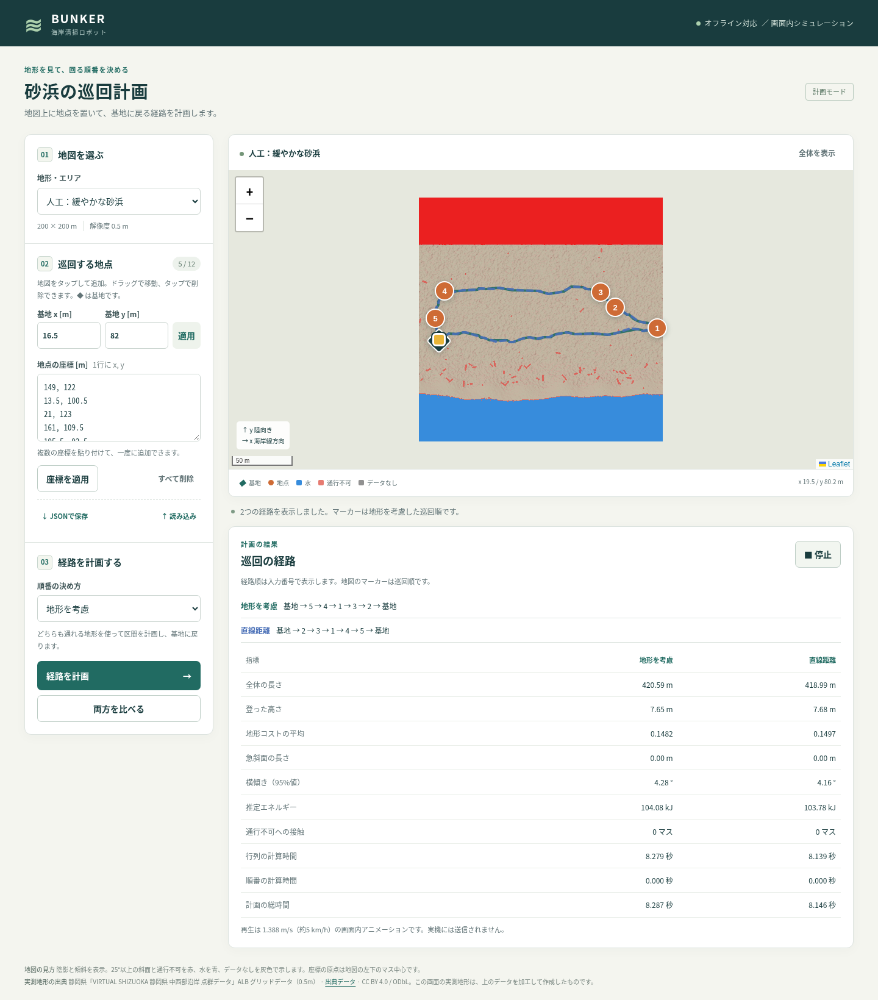
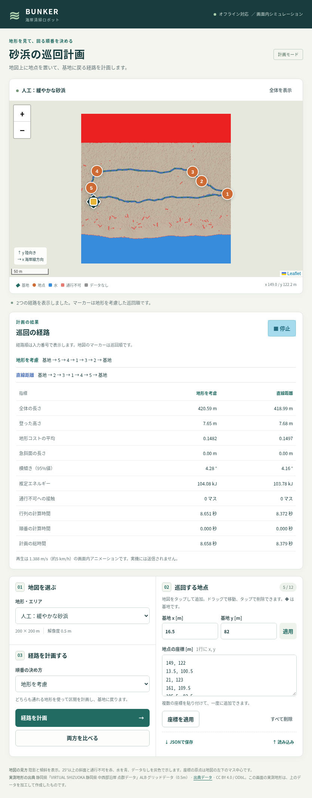

# タスク010 実装・検証報告

最新の `realtime-map`（`47e55f6cead1fc71d5bf6e6e288c35d27e659a34`）を取得して
`codex/web-ui` を作成し、既存ファイルを変更せずに実装しました。
`conference/tests/test_*.py` の全10モジュールが終了コード0です。

## 実装

- `tapp/mission.py`：`list_maps`・`load_map`・`render_map_png`・`plan_mission`。
  人工5種類（200m・検証シード100）と実測validation 12か所を一覧化し、同一IDのシナリオをキャッシュします。
  PNGはnumpyと標準ライブラリで符号化し、陰影・傾斜・水・データなし・通行不可を合成しています。
  計算部分はWebや描画ライブラリに依存しません。1マス1画素、画像のxを右、yを上に揃えています。
- `plan_mission` はPythonの `round(x/0.5)` で格子中心へ変換し、地図外・水・データなし・通行不可・到達不能を
  元の入力番号と理由付きで除外します。残った地点を既存の `cost_matrix`・`solve_tour` で巡回します。
  4近傍の連結成分は、既存グラフの「角を横切らない8近傍」と同じ到達性です。
  地形方式は `kappa=1/robot.rolling_coeff`、直線距離方式も同じ向き付き区間を使います。
  閉じた巡回経路・区間経路・区間長・物理コスト・既存 `evaluate` の全指標・接触数・計算時間を返します。
  exact LOSに加え、返却前に `path_lethal_cells == 0` を検査します。
- `webui/server.py`：指定の5エンドポイント、静的配信、`--host`・`--port` 起動引数。
  スラッシュを含む地図IDを受け付けます。地図生成・画像生成・計画は別スレッドで実行します。
  計画の排他ロックは非待機で取得し、競合は409。計算の終了・失敗時にはワーカーで解放します。
- `webui/static/`：日本語の地図選択・番号付き地点追加／ドラッグ／削除・基地の移動・座標入力・
  JSON保存／復元・単独計画・2方式の逐次比較・色別経路・結果表・1.388m/sの再生。
  編集時に古い結果を消し、計算中の編集を無効にします。ボタンと地点／基地のタップ領域は44px以上です。
  画面下に静岡県の出典・ライセンス・加工したデータであることを表示しています。
- `webui/static/vendor/leaflet/`：公式npm配布のLeaflet 1.9.4、画像・ソースマップ・BSD-2-Clauseライセンス。
  同梱した配布ファイルはtarballとバイト単位で一致します。CDNや外部地図タイルを読み込みません。
- `tests/test_mission.py`：地図一覧・キャッシュ・PNG寸法と向き、5地点での既存コードとの順番／コスト／経路／評価値一致、
  不正地点・到達性・0／13地点・丸め・重複地点・無効基地、人工3種類＋実測2か所の両方式の安全性、
  TestClientによるAPI・404／422・計算中の応答・即時409・エラー後のロック復旧を確認します。
- `webui/check_browser.py`：実際のサーバー／プランナーを使う任意のPlaywright検証です。
  PC幅とタッチ端末幅で地点編集・JSON保存と復元・計画・比較・再生・縦横のレイアウトを操作し、
  スクリーンショット、実際のAPI応答、CSVと標準出力ログを保存します。実行時の外部アセット要求とページエラーも検査します。
- `webui/README_ja.md`：インストール、起動、iPad接続とIP確認、操作、座標とコストの定義、API、出典を記載しています。

## 単純な方を選んだ仕様

- 実測地図も検証シード100、漂着物追加なしを使用します。
- 座標は最初の格子中心を(0,0)とするローカルなメートル座標です。指定の丸め式に従い、格子中心の範囲0〜199.5mだけを受け付けます。
  元データREADMEのx=−100〜100m、y=−50〜150mとは原点だけが異なり、軸方向は同じです。
  画像は中心から半マス分外側（−0.25〜199.75m）に配置し、画素とマーカーを一致させます。
- 基地が無効な場合は理由付きの空計画、全地点が受付外の場合は基地だけを返します。重複地点・基地と同じ地点は受け付けます。
  入力地点は1始まり、基地は0。`order` に最後の基地を重ねず、`path` と `legs` は復路を含めます。
- 比較は2方式を順に計算し、マーカー／再生は地形方式を使います。経路順の欄は元の入力番号を表示します。
- PNGはmatplotlibを使わず標準PNG形式で直接作成しました。水・データなしを最後に着色し、安全マスク自体は変更しません。
- 全体の指標は既存評価器をそのまま使います。区間長は折れ線長、全体の長さは既存の0.1m再サンプリング評価なので、
  折れ曲がりでわずかに異なることがあります。既存評価器を変更して揃えることはしていません。

## 変更ファイル（すべて追加）

- `conference/results/web_ui/baseline_sha256.json`
- `conference/results/web_ui/browser_checks_log.txt`
- `conference/results/web_ui/browser_input.json`
- `conference/results/web_ui/browser_log.txt`
- `conference/results/web_ui/browser_plan_results.json`
- `conference/results/web_ui/browser_summary.csv`
- `conference/results/web_ui/tests_log.txt`
- `conference/results/web_ui/verification.json`
- `conference/tapp/mission.py`
- `conference/tests/test_mission.py`
- `conference/webui/README_ja.md`
- `conference/webui/REPORT_ja.md`
- `conference/webui/__init__.py`
- `conference/webui/check_browser.py`
- `conference/webui/screenshots/desktop.png`
- `conference/webui/screenshots/ipad.png`
- `conference/webui/server.py`
- `conference/webui/static/app.js`
- `conference/webui/static/index.html`
- `conference/webui/static/style.css`
- `conference/webui/static/vendor/leaflet/LICENSE`
- `conference/webui/static/vendor/leaflet/VENDOR_ja.md`
- `conference/webui/static/vendor/leaflet/images/layers-2x.png`
- `conference/webui/static/vendor/leaflet/images/layers.png`
- `conference/webui/static/vendor/leaflet/images/marker-icon-2x.png`
- `conference/webui/static/vendor/leaflet/images/marker-icon.png`
- `conference/webui/static/vendor/leaflet/images/marker-shadow.png`
- `conference/webui/static/vendor/leaflet/leaflet.css`
- `conference/webui/static/vendor/leaflet/leaflet.js`
- `conference/webui/static/vendor/leaflet/leaflet.js.map`

## 実行コマンド

変更前：

```bash
cd conference
python3 -m tests.test_planners
```

変更後の既存全モジュール（途中の失敗でも残りを実行するためループを使用）：

```bash
cd conference
OPENBLAS_NUM_THREADS=1 python3 - <<'PY'
from pathlib import Path
import subprocess, sys
failed = []
for f in sorted(Path('tests').glob('test_*.py')):
    if f.stem == 'test_mission':
        continue
    print('$ python3 -m tests.' + f.stem, flush=True)
    result = subprocess.run([sys.executable, '-m', 'tests.' + f.stem])
    print('exit code:', result.returncode, flush=True)
    if result.returncode:
        failed.append(f.stem)
print('Failed modules:', failed, flush=True)
sys.exit(bool(failed))
PY
```

新規モジュールも別プロセスで実行（全10モジュールを網羅）：

```bash
cd conference
OPENBLAS_NUM_THREADS=1 python3 -m tests.test_mission
```

実サーバー起動とブラウザ検証（別ターミナルで実行）：

```bash
cd conference
OPENBLAS_NUM_THREADS=1 python3 -m webui.server --host 0.0.0.0 --port 8080
# 別ターミナル
cd conference
OPENBLAS_NUM_THREADS=1 python3 -m webui.check_browser
```

追加の構文確認：

```bash
python3 -m py_compile conference/tapp/mission.py conference/webui/server.py conference/webui/check_browser.py conference/tests/test_mission.py
node --check conference/webui/static/app.js
```

## テスト出力の全文

以下は `conference/results/web_ui/tests_log.txt` の内容そのままです。

```text
変更前
$ cd conference && python3 -m tests.test_planners
all planner tests passed
roll-aware tests passed
exit code: 0

変更後（conference/ で実行、OPENBLAS_NUM_THREADS=1）
$ python3 -m tests.test_beach_terrain
beach determinism, shapes, finite values, water/wet and unchanged rolling passed
averaged sea/wet/dry/inland profiles and foreshore slopes passed (validation seeds)
scarp 45-degree coverage passed: [np.float64(0.465), np.float64(0.615), np.float64(0.0), np.float64(0.16), np.float64(0.555)]
beach scenarios, delegated planner equality and exact smoothing passed (15 scenarios)
exact beach online safety passed (9 trajectories)
all beach-terrain tests passed
exit code: 0
$ python3 -m tests.test_collision
segment_cells passed (2000 seeded segments vs exhaustive SAT, reversal and boundary cases)
corner-grazing reproduction and exact rejection passed
legacy online and smoothing regressions passed
exact online safety passed (41 trajectories, A* and D* Lite)
all collision tests passed
exit code: 0
$ python3 -m tests.test_dstar
static agreement passed (20 random grids, tolerance 1e-9)
dynamic agreement passed (5 seeds x 20 updates, tolerance 1e-9)
corner constraints, cost decreases, unreachable/reopened routes and ties passed
task 001 regression passed (ridge soft and hills hard, search omitted)
D* Lite safety passed (20 trajectories, normal and every-step replanning)
error handling and fixed/adaptive-with-map prior handling passed
all D* Lite tests passed
exit code: 0
$ python3 -m tests.test_natural_terrain
natural generation determinism, distinct seeds, shape and finite values passed
pre-erosion radial spectrum passed: [-3.5227452123825955, -3.4854938900090673, -3.5147015961346426, -3.469782545726739, -3.4636674128050786]
rock area law: 0.4 0.02703765778384137 0.02660688949938067
rock area law: 0.6 0.014010959187524073 0.013724330217025335
rock area law: 1.0 0.003425544099666588 0.003651617375374042
natural scenarios and exact online safety passed (15 trajectories)
mkdir -p failed for path /home/agent/.config/matplotlib: [Errno 30] Read-only file system: '/home/agent/.config/matplotlib'
Matplotlib created a temporary cache directory at /tmp/matplotlib-el4i8u21 because there was an issue with the default path (/home/agent/.config/matplotlib); it is highly recommended to set the MPLCONFIGDIR environment variable to a writable directory, in particular to speed up the import of Matplotlib and to better support multiprocessing.
Fontconfig error: No writable cache directories
experiment oracle contact audit passed (both reference planners)
all natural-terrain tests passed
exit code: 0
$ python3 -m tests.test_online
regression passed (ridge/100 m, seeds 0 and 7)
perfect prior passed (all terrain kinds/50 m/seed 0)
coarse prior passed (shape, no rocks, partial blocks, noise, robot/weights, edges)
prior policies passed (hard/soft/ignore, sensing overrides, cell-specific triggers)
safety passed (60 trajectories: five online variants and constrained oracle)
all online tests passed
exit code: 0
$ python3 -m tests.test_planners
all planner tests passed
roll-aware tests passed
exit code: 0
$ python3 -m tests.test_real_beach
all 60 patches loaded: shapes, 12/48 split, nearest-data fill passed
all 60 patches satisfy sea-to-land orientation
08OB86_00294: 100/200m crops, deterministic clean/debris scenarios, reachability and forbidden masks passed
08OB86_-0205: 100/200m crops, deterministic clean/debris scenarios, reachability and forbidden masks passed
08OB87_-0706: 100/200m crops, deterministic clean/debris scenarios, reachability and forbidden masks passed
08OB88_-1417: 100/200m crops, deterministic clean/debris scenarios, reachability and forbidden masks passed
08OB88_-0167: 100/200m crops, deterministic clean/debris scenarios, reachability and forbidden masks passed
08OB86_00294: exact offline and coarse R5 c10 online safety passed, clean/debris
08OB86_-0205: exact offline and coarse R5 c10 online safety passed, clean/debris
08OB87_-0706: exact offline and coarse R5 c10 online safety passed, clean/debris
08OB88_-1417: exact offline and coarse R5 c10 online safety passed, clean/debris
08OB88_-0167: exact offline and coarse R5 c10 online safety passed, clean/debris
real-beach test groups failed: 0
all real-beach tests passed
exit code: 0
$ python3 -m tests.test_risk_prior
coarse elevation/refactor passed (16 terrain/cell/noise combinations)
calibration passed (all-cell counts/means, deterministic pooling, JSON, test-seed rejection)
empty-bin fallback and boundary assignment passed
risk cost passed (expected means, lambda monotonicity/clipping, noise, unchanged lethal mask)
risk-prior safety passed (40 trajectories, 40 successful; 20 m cells, R=5/15 m, lambda=0/1)
all risk-prior tests passed
exit code: 0
$ python3 -m tests.test_tour
kappa=0 agrees with legacy A* (20 random 25x25 grids)
directed A*/Dijkstra agree with all-simple-path exhaustive oracle (10 grids); unreachable/corners/budget passed
uphill/downhill identity, segment units and nonincreasing exact smoothing passed
Held-Karp matches all permutations (30 asymmetric matrices at each of 2..8 destinations); ties/closure passed
beach_gentle: reproducible reachable separated waypoints; all directed legs safe; matrix agrees with individual A*/Dijkstra planning (kappa=0 and physical)
beach_steep: reproducible reachable separated waypoints; all directed legs safe; matrix agrees with individual A*/Dijkstra planning (kappa=0 and physical)
beach_scarp: reproducible reachable separated waypoints; all directed legs safe; matrix agrees with individual A*/Dijkstra planning (kappa=0 and physical)
all multi-goal tour tests passed
exit code: 0
Failed modules: []

$ python3 -m tests.test_mission
/opt/codex/runtimes/codex-primary-runtime/dependencies/python/lib/python3.12/site-packages/fastapi/testclient.py:1: StarletteDeprecationWarning: Using `httpx` with `starlette.testclient` is deprecated; install `httpx2` instead.
  from starlette.testclient import TestClient as TestClient  # noqa
maps: 5 synthetic + 12 validation, cache, PNG dimensions/orientation passed
parity: 5-point terrain order/cost/path and Euclidean order/physical legs passed
validation: outside, water, blocked, unreachable, counts, rounding, duplicate/invalid base passed
safety: synthetic/beach_gentle/200/100, 5 points, terrain/euclid contact=0
safety: synthetic/beach_steep/200/100, 5 points, terrain/euclid contact=0
safety: synthetic/beach_scarp/200/100, 5 points, terrain/euclid contact=0
safety: real/08OB87_-0206/200, 5 points, terrain/euclid contact=0
safety: real/08OB88_01332/200, 5 points, terrain/euclid contact=0
API: maps/info/PNG/plan/static, 404/422, responsive worker, immediate 409 and guard recovery passed
all mission tests passed
exit code: 0
```

## ブラウザ検証と実際の計画の集計出力

以下は `python3 -m webui.check_browser` の標準出力全文です。
5回のAPI応答（PCの単独計画、PCの比較2方式、タッチ端末幅の比較2方式）から印字しています。
すべて同一の検証地図・シード100の5地点で、数値を補完・手入力していません。
`browser_input.json` に入力、`browser_plan_results.json` に経路を含む実際のJSON応答、`browser_summary.csv` に集計を保存しました。
繰り返しの処理時間は実行時の測定値で、速度比較実験ではありません。追加の研究実験・パラメータ調整は実施していません。

```text
desktop 1440px: initial map, 17 choices and no horizontal overflow passed
desktop: map click, numbered marker, drag and popup deletion passed
desktop: base drag/direct input and pasted five-point coordinates passed
desktop: JSON browser download, clear and file import round-trip passed
desktop: live terrain plan, responsive API while busy and results table passed
desktop: sequential comparison, two overlaid routes and side-by-side metrics passed
desktop: playback observed 1.074393m in 0.803400s, consistent with 1.388m/s
tablet 834x1112: touch addition, JSON import, real comparison/playback, >=44px buttons and no horizontal overflow passed (Chromium touch emulation)
tablet 1112x834: landscape reflow and fit map passed (Chromium touch emulation)
real validation map: image/selection, reset points and Shizuoka attribution passed
browser console: no page errors; runtime network: no external asset requests
method points length_xy_m climb_m mean_cost energy_kj matrix_s solve_s lethal_cells
terrain 5 420.58536002380254 7.645805434245405 0.14820350457915832 104.08450628774592 8.274970651007607 0.00024937099078670144 0
terrain 5 420.58536002380254 7.645805434245405 0.14820350457915832 104.08450628774592 8.279307296994375 0.0002115909883286804 0
euclid 5 418.9902256815595 7.677065554892854 0.14972338029314744 103.77841952758705 8.13907878799364 0.0002292989956913516 0
terrain 5 420.58536002380254 7.645805434245405 0.14820350457915832 104.08450628774592 8.65072353099822 0.00020631200459320098 0
euclid 5 418.9902256815595 7.677065554892854 0.14972338029314744 103.77841952758705 8.372395162004977 0.00019969200366176665 0
```

## 画面

PC幅1440px（実際の比較・再生中）：



iPad相当幅834px（Chromiumのタッチエミュレーション。実際の比較・再生中）：



## 再現性・環境・未確認のこと

- 作業開始時の既存 `conference/` 追跡ファイル320件をSHA-256で照合し、すべて一致しました。マニフェストは `results/web_ui/baseline_sha256.json`、環境は `verification.json` に記録しています。既存のコード・データ・結果・テストは変更していません。
- 全10テストモジュールは成功しました。既存の自然地形テストからmatplotlib／fontconfigの書込み不可キャッシュ警告、
  TestClientからhttpx利用に関する非推奨警告が出ています。いずれも出力を省略せず保存し、テスト自体は終了コード0です。
- ChromiumでPC幅1440px、タッチ相当幅834×1112pxと1112×834pxを検証しました。Safari／iPad実機では未検証です。
  WebKitを `PLAYWRIGHT_BROWSERS_PATH=/tmp/web-ui-browsers python3 -m playwright install webkit` で取得しようとしましたが、
  配布元がHTTP 403 `Domain forbidden`を返しました。Safari互換性の実機確認を完了したとは報告しません。
- 再生はローカル平面上のアニメーションです。実機制御・GPS・ROS2・Unity・ログイン・複数人の同時利用は対象外です。
  計画の排他は単一サーバープロセス内です。READMEのコマンドで単一プロセス起動してください。
- エネルギーは既存モデルの推定kJ、地形コストは既存の重みでの評価です。実機の消費量や砂の通行性能を保証するものではありません。
  この検証入力では地形方式が直線距離方式より常に短い・省エネルギーであるとは主張しません。

実測地形の出典は既存データREADMEに従います：

- 出典：静岡県「VIRTUAL SHIZUOKA 静岡県 中西部沿岸 点群データ」ALB グリッドデータ（0.5m）
  https://www.geospatial.jp/ckan/dataset/shizuoka-2025-pointcloud-alb
- ライセンス：CC BY 4.0 / ODbL。**このフォルダのデータは、上のデータを加工して作成したものです**
  （論文や発表で使うときは、この出典を書くこと）。
- 元データの座標：日本測地系2024・平面直角座標系第8系、高さは東京湾平均海面（T.P.）。
