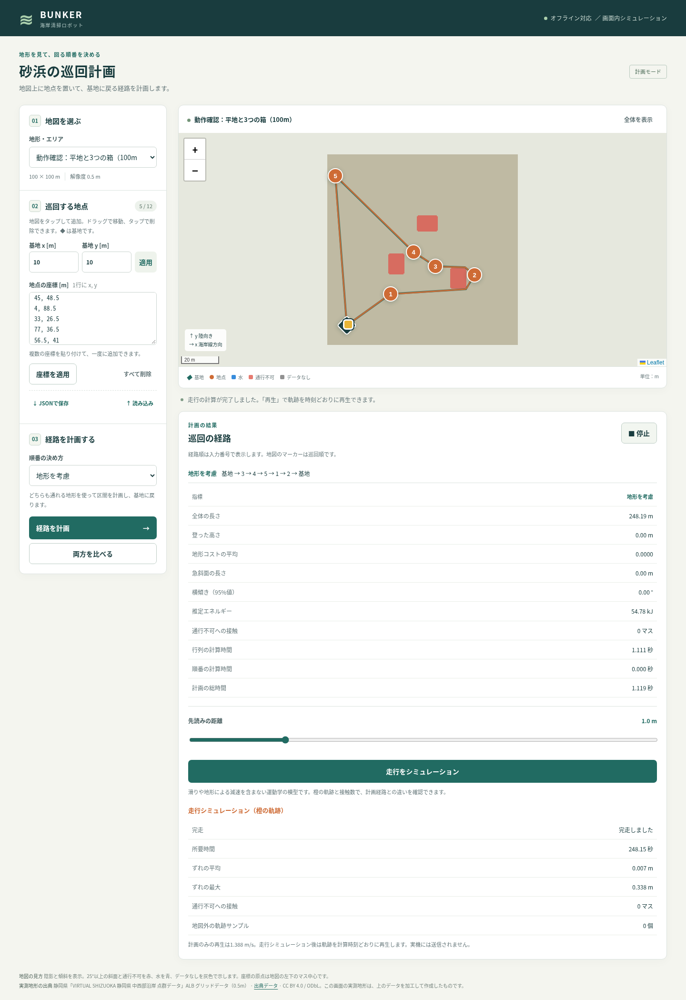
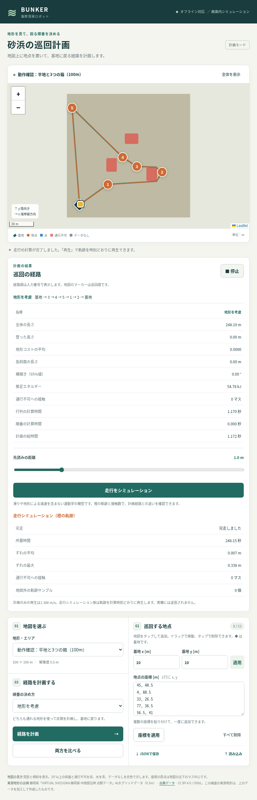

# タスク011 地図ファイル・経路追従模型・Gazebo地形の実装報告

## 状態と未達の条件

最新の `realtime-map`（`ace93a9a16dbb7fca581995c3bf3366709c8a7cd`）を取得して `codex/mapfiles-sim` を作成しました。
指定された地図ファイル、Pure Pursuit、運動学模型、Web画面、Gazebo書き出しを実装しています。
全11テストモジュールを実行し、新規テストを含む10モジュールは終了コード0、既存 `tests.test_mission` だけが失敗しました。
**全テスト合格の条件は未達です。**

指示書011は地図ファイルを既存17枚に追加することを要求していますが、既存 `tests/test_mission.py` の
`test_maps` は一覧が17件ちょうどであること、`test_api` もAPIの一覧が17件ちょうどであることを要求しています。
現在の一覧は従来17件＋ファイル23件です。指示書で変更できる既存ファイルは `tapp/mission.py` と `webui/` に限られるため、
既存テストは変更・削除・弱体化していません。一覧の件数を偽ったり、テスト時だけファイルを隠したりもしていません。
同じ既存テストの数値一致・地点検査・安全性関数は無変更で個別に実行し、合格しました。API関数の件数検査も別途実行して失敗を記録しています。

## 実装したファイルと関数

- `tapp/mapfile.py`：`save_map`・`load_map_file`・`scenario_to_mapfile`。
  float32標高、膨張前の障害物／水／データなしのboolマスク、0.5m解像度、メートル座標の基地、名前・種類・出典・帰属表示、形式版1をNPZに保存します。
  NaNは最近傍標高で埋め、既存 `TraversabilityMap` をそのまま呼びます。膨張後のマスクを再膨張しません。
  **float32だけでは元のfloat64地形のコストが完全一致しないため**、必要な場合だけ `elev_residual` に元標高との差をfloat64で保存し、
  読込時に加えて元の標高を復元します。`elev` 自体のdtypeは指定どおりfloat32です。コストやlethalの派生配列は保存していません。
- `data_prep/export_maps.py`：`export_maps`。
  `flat_test`、人工5種類×100／200m・シード100、実測validation 12か所・200m・シード0を生成します。
  書き出した全人工／実測ファイルで、元と `cost`・`lethal` が完全一致することを実行時にも検査します。
  `maps/README_ja.md` に各地図・形式・座標・出典を記載しました。
- `tapp/mission.py`：`_file_maps` とファイル読込を追加。既存の17 ID・順序を先頭に保持し、`file/<ファイル名>` を追加します。
  従来の計画・描画・座標変換関数は構文木単位で変更していないことも確認しました。
- `tapp/pure_pursuit.py`：`PurePursuit.command`。
  先読み目標から曲率を求め、角速度の上限時には並進速度も同じ比率で下げます。90°を超える向きのずれではその場旋回します。
  経路に沿った進捗を単調に更新し、閉じた巡回の基地を開始直後にゴールと誤認しません。隣接する重複点も扱います。
- `tapp/robot_sim.py`：`initial_pose`・`simulate`。
  APIの初期方向は最初の長さのある経路区間から設定します。`simulate` に直接渡した開始姿勢はそのまま使います。
  Euler積分のその場旋回可能な車両模型です。軌跡は `[t,x,y,yaw]`。時間、ずれの平均／最大、完走、通行不可との接触数とマス一覧、地図外サンプル数を返します。
  ずれは経路の折れ線への最短距離を各時間サンプルで評価した値です。滑り、傾斜による速度変化、衝突応答・衝突回避は入れていません。
- `webui/server.py`：`POST /api/simulate` を追加。先読み0.5〜3.0mを検査し、別スレッドで実行します。
  計画と走行の計算は同じ非待機ロックを使い、競合は409、入力不正は422、地図不明は404を返します。
- `webui/static/`：ファイル地図の寸法・帰属表示、先読みスライダー、走行ボタン、橙の追従軌跡、完走／時間／ずれ／接触数の表。
  シミュレーション後の再生は軌跡のタイムスタンプで補間し、以前の一定速度再生と区別しています。
  地点編集・先読み変更時は古い走行結果を消します。`webui/README_ja.md` に操作とAPIを追記しました。
- `data_prep/export_gazebo.py`：`export_gazebo`・`png16`。
  16bitグレースケールPNG、SDF 1.9のheightmap、太陽、摩擦、見た目だけのz=0水面、障害物の連結成分ごとの衝突箱を出力します。
  `gazebo_worlds/` に `flat_test` と実測1か所の成果物・起動READMEを保存しています。
- `tests/test_mapfiles_sim.py`：完全一致往復、全23地図読込、直線・直角・閉経路・逆向き旋回・角速度制限、5地点巡回走行、PNG／SDF／高さ復元、APIと排他制御のテストです。
- `webui/check_mapfiles_sim.py`：実サーバーでPC／タッチ端末幅のファイル選択→5地点計画→走行→再生を行う任意のPlaywright検証です。
  先読みの最小・最大、軌跡の重ね合わせ、時刻補間、先読み変更による結果消去、縦横レイアウト、外部アセット要求とページエラーを確認します。
  スクリーンショットは実際に計算した結果です。計画・走行の応答はモックしていません。

## 変更ファイル

- `conference/data_prep/export_gazebo.py`
- `conference/data_prep/export_maps.py`
- `conference/gazebo_worlds/flat_test/README_ja.md`
- `conference/gazebo_worlds/flat_test/heightmap.png`
- `conference/gazebo_worlds/flat_test/world.sdf`
- `conference/gazebo_worlds/real_08OB87_-0206/README_ja.md`
- `conference/gazebo_worlds/real_08OB87_-0206/heightmap.png`
- `conference/gazebo_worlds/real_08OB87_-0206/world.sdf`
- `conference/maps/README_ja.md`
- `conference/maps/beach_gentle_100m_100.npz`
- `conference/maps/beach_gentle_200m_100.npz`
- `conference/maps/beach_scarp_100m_100.npz`
- `conference/maps/beach_scarp_200m_100.npz`
- `conference/maps/beach_steep_100m_100.npz`
- `conference/maps/beach_steep_200m_100.npz`
- `conference/maps/flat_test_100m.npz`
- `conference/maps/hills_100m_100.npz`
- `conference/maps/hills_200m_100.npz`
- `conference/maps/real_08OB87_-0206_200m_0.npz`
- `conference/maps/real_08OB88_01332_200m_0.npz`
- `conference/maps/real_08OB89_-1597_200m_0.npz`
- `conference/maps/real_08OC90_00270_200m_0.npz`
- `conference/maps/real_08OC91_00811_200m_0.npz`
- `conference/maps/real_08OC93_-1519_200m_0.npz`
- `conference/maps/real_08OC95_-0321_200m_0.npz`
- `conference/maps/real_08OC96_-0676_200m_0.npz`
- `conference/maps/real_08OC97_-0077_200m_0.npz`
- `conference/maps/real_08OC98_-1101_200m_0.npz`
- `conference/maps/real_08OC98_01898_200m_0.npz`
- `conference/maps/real_08OC99_00983_200m_0.npz`
- `conference/maps/rolling_100m_100.npz`
- `conference/maps/rolling_200m_100.npz`
- `conference/results/mapfiles_sim/baseline_sha256.json`
- `conference/results/mapfiles_sim/beach_gentle_200m_100_tracking.npz`
- `conference/results/mapfiles_sim/browser_input.json`
- `conference/results/mapfiles_sim/browser_log.txt`
- `conference/results/mapfiles_sim/browser_summary.csv`
- `conference/results/mapfiles_sim/export_gazebo_log.txt`
- `conference/results/mapfiles_sim/export_maps_log.txt`
- `conference/results/mapfiles_sim/flat_test_100m_tracking.npz`
- `conference/results/mapfiles_sim/legacy_api_failure_log.txt`
- `conference/results/mapfiles_sim/legacy_parity_log.txt`
- `conference/results/mapfiles_sim/tests_log.txt`
- `conference/results/mapfiles_sim/tour_audit.json`
- `conference/results/mapfiles_sim/tour_summary.csv`
- `conference/results/mapfiles_sim/verification.json`
- `conference/tapp/mapfile.py`
- `conference/tapp/mission.py`
- `conference/tapp/pure_pursuit.py`
- `conference/tapp/robot_sim.py`
- `conference/tests/test_mapfiles_sim.py`
- `conference/webui/README_ja.md`
- `conference/webui/REPORT_mapfiles_sim_ja.md`
- `conference/webui/check_mapfiles_sim.py`
- `conference/webui/screenshots/mapfiles_sim_desktop.png`
- `conference/webui/screenshots/mapfiles_sim_ipad.png`
- `conference/webui/server.py`
- `conference/webui/static/app.js`
- `conference/webui/static/index.html`
- `conference/webui/static/style.css`

## 再現性と容量

既存追跡ファイル351件を作業前のSHA-256と照合しました。変更は許可範囲の既存6ファイルのみで、残り345件はすべて一致しています。
既存のデータ・研究結果・保護された計算コード・テストは変更していません。地図フォルダはREADME込みで12643079 bytes（15 MB未満）、Gazebo出力は4214298 bytes（5 MB未満）です。
`results/mapfiles_sim/baseline_sha256.json` と `verification.json` に照合元と環境を保存しました。
計画の重み・地形閾値は変更せず、検証シード100を使用しています。実測ファイルの生成シード0は指示書の指定です。

## 実行したコマンド

変更前：

```bash
cd conference
python3 -m tests.test_planners
```

地図とGazeboの書き出し：

```bash
cd conference
OPENBLAS_NUM_THREADS=1 python3 data_prep/export_maps.py
python3 data_prep/export_gazebo.py maps/flat_test_100m.npz gazebo_worlds/flat_test
python3 data_prep/export_gazebo.py maps/real_08OB87_-0206_200m_0.npz gazebo_worlds/real_08OB87_-0206
```

既存全モジュールを実行（失敗後も残りを実行するループ）：

```bash
cd conference
OPENBLAS_NUM_THREADS=1 MPLCONFIGDIR=/tmp/mapfiles-mpl XDG_CACHE_HOME=/tmp/mapfiles-cache python3 - <<'PY'
from pathlib import Path
import subprocess, sys
failed = []
for p in sorted(Path('tests').glob('test_*.py')):
    if p.stem == 'test_mapfiles_sim':
        continue
    print('$ python3 -m tests.' + p.stem, flush=True)
    result = subprocess.run([sys.executable, '-m', 'tests.' + p.stem])
    print('exit code:', result.returncode, flush=True)
    if result.returncode:
        failed.append(p.stem)
print('Failed modules:', failed, flush=True)
sys.exit(bool(failed))
PY
OPENBLAS_NUM_THREADS=1 python3 -m tests.test_mapfiles_sim
```

新規モジュールは別プロセスで実行し、全11モジュールを網羅しています。無変更の従来計画の確認も追加で実行：

```bash
cd conference
OPENBLAS_NUM_THREADS=1 python3 - <<'PY'
from tests.test_mission import test_parity, test_validation, test_safety
for check in (test_parity, test_validation, test_safety):
    check()
print('legacy mission numerical parity/validation/safety groups passed unchanged')
PY
OPENBLAS_NUM_THREADS=1 python3 - <<'PY'
from tests.test_mission import test_api
test_api()
PY
```

ブラウザ確認（別ターミナルで実行）：

```bash
cd conference
OPENBLAS_NUM_THREADS=1 python3 -m webui.server --host 0.0.0.0 --port 8080
# 別ターミナル
cd conference
OPENBLAS_NUM_THREADS=1 python3 -m webui.check_mapfiles_sim
```

追加で新規／変更Pythonの `py_compile`、`node --check conference/webui/static/app.js`、差分の空白検査を実施しました。

## テスト出力の全文

`results/mapfiles_sim/tests_log.txt` の内容そのまま：

```text
変更前
$ cd conference && python3 -m tests.test_planners
all planner tests passed
roll-aware tests passed
exit code: 0

変更後の既存全10モジュール
$ python3 -m tests.test_beach_terrain
beach determinism, shapes, finite values, water/wet and unchanged rolling passed
averaged sea/wet/dry/inland profiles and foreshore slopes passed (validation seeds)
scarp 45-degree coverage passed: [np.float64(0.465), np.float64(0.615), np.float64(0.0), np.float64(0.16), np.float64(0.555)]
beach scenarios, delegated planner equality and exact smoothing passed (15 scenarios)
exact beach online safety passed (9 trajectories)
all beach-terrain tests passed
exit code: 0
$ python3 -m tests.test_collision
segment_cells passed (2000 seeded segments vs exhaustive SAT, reversal and boundary cases)
corner-grazing reproduction and exact rejection passed
legacy online and smoothing regressions passed
exact online safety passed (41 trajectories, A* and D* Lite)
all collision tests passed
exit code: 0
$ python3 -m tests.test_dstar
static agreement passed (20 random grids, tolerance 1e-9)
dynamic agreement passed (5 seeds x 20 updates, tolerance 1e-9)
corner constraints, cost decreases, unreachable/reopened routes and ties passed
task 001 regression passed (ridge soft and hills hard, search omitted)
D* Lite safety passed (20 trajectories, normal and every-step replanning)
error handling and fixed/adaptive-with-map prior handling passed
all D* Lite tests passed
exit code: 0
$ python3 -m tests.test_mission
/opt/codex/runtimes/codex-primary-runtime/dependencies/python/lib/python3.12/site-packages/fastapi/testclient.py:1: StarletteDeprecationWarning: Using `httpx` with `starlette.testclient` is deprecated; install `httpx2` instead.
  from starlette.testclient import TestClient as TestClient  # noqa
Traceback (most recent call last):
  File "<frozen runpy>", line 198, in _run_module_as_main
  File "<frozen runpy>", line 88, in _run_code
  File "/workspace/thesis_Bunker/conference/tests/test_mission.py", line 275, in <module>
    check()
  File "/workspace/thesis_Bunker/conference/tests/test_mission.py", line 40, in test_maps
    assert len(maps) == 17 and {row["id"] for row in maps} == expected
           ^^^^^^^^^^^^^^^^^^^^^^^^^^^^^^^^^^^^^^^^^^^^^^^^^^^^^^^^^^^
AssertionError
exit code: 1
$ python3 -m tests.test_natural_terrain
natural generation determinism, distinct seeds, shape and finite values passed
pre-erosion radial spectrum passed: [-3.5227452123825955, -3.4854938900090673, -3.5147015961346426, -3.469782545726739, -3.4636674128050786]
rock area law: 0.4 0.02703765778384137 0.02660688949938067
rock area law: 0.6 0.014010959187524073 0.013724330217025335
rock area law: 1.0 0.003425544099666588 0.003651617375374042
natural scenarios and exact online safety passed (15 trajectories)
experiment oracle contact audit passed (both reference planners)
all natural-terrain tests passed
exit code: 0
$ python3 -m tests.test_online
regression passed (ridge/100 m, seeds 0 and 7)
perfect prior passed (all terrain kinds/50 m/seed 0)
coarse prior passed (shape, no rocks, partial blocks, noise, robot/weights, edges)
prior policies passed (hard/soft/ignore, sensing overrides, cell-specific triggers)
safety passed (60 trajectories: five online variants and constrained oracle)
all online tests passed
exit code: 0
$ python3 -m tests.test_planners
all planner tests passed
roll-aware tests passed
exit code: 0
$ python3 -m tests.test_real_beach
all 60 patches loaded: shapes, 12/48 split, nearest-data fill passed
all 60 patches satisfy sea-to-land orientation
08OB86_00294: 100/200m crops, deterministic clean/debris scenarios, reachability and forbidden masks passed
08OB86_-0205: 100/200m crops, deterministic clean/debris scenarios, reachability and forbidden masks passed
08OB87_-0706: 100/200m crops, deterministic clean/debris scenarios, reachability and forbidden masks passed
08OB88_-1417: 100/200m crops, deterministic clean/debris scenarios, reachability and forbidden masks passed
08OB88_-0167: 100/200m crops, deterministic clean/debris scenarios, reachability and forbidden masks passed
08OB86_00294: exact offline and coarse R5 c10 online safety passed, clean/debris
08OB86_-0205: exact offline and coarse R5 c10 online safety passed, clean/debris
08OB87_-0706: exact offline and coarse R5 c10 online safety passed, clean/debris
08OB88_-1417: exact offline and coarse R5 c10 online safety passed, clean/debris
08OB88_-0167: exact offline and coarse R5 c10 online safety passed, clean/debris
real-beach test groups failed: 0
all real-beach tests passed
exit code: 0
$ python3 -m tests.test_risk_prior
coarse elevation/refactor passed (16 terrain/cell/noise combinations)
calibration passed (all-cell counts/means, deterministic pooling, JSON, test-seed rejection)
empty-bin fallback and boundary assignment passed
risk cost passed (expected means, lambda monotonicity/clipping, noise, unchanged lethal mask)
risk-prior safety passed (40 trajectories, 40 successful; 20 m cells, R=5/15 m, lambda=0/1)
all risk-prior tests passed
exit code: 0
$ python3 -m tests.test_tour
kappa=0 agrees with legacy A* (20 random 25x25 grids)
directed A*/Dijkstra agree with all-simple-path exhaustive oracle (10 grids); unreachable/corners/budget passed
uphill/downhill identity, segment units and nonincreasing exact smoothing passed
Held-Karp matches all permutations (30 asymmetric matrices at each of 2..8 destinations); ties/closure passed
beach_gentle: reproducible reachable separated waypoints; all directed legs safe; matrix agrees with individual A*/Dijkstra planning (kappa=0 and physical)
beach_steep: reproducible reachable separated waypoints; all directed legs safe; matrix agrees with individual A*/Dijkstra planning (kappa=0 and physical)
beach_scarp: reproducible reachable separated waypoints; all directed legs safe; matrix agrees with individual A*/Dijkstra planning (kappa=0 and physical)
all multi-goal tour tests passed
exit code: 0
Failed modules: ['test_mission']

$ python3 -m tests.test_mapfiles_sim
/opt/codex/runtimes/codex-primary-runtime/dependencies/python/lib/python3.12/site-packages/fastapi/testclient.py:1: StarletteDeprecationWarning: Using `httpx` with `starlette.testclient` is deprecated; install `httpx2` instead.
  from starlette.testclient import TestClient as TestClient  # noqa
maps: 5 lossless scenario round trips, float32+residual, NaN, all 23 files and all 17 legacy IDs passed
straight completed True max_deviation_m 3.552713678800501e-15 elapsed_s 19.700000000000003
right_angle completed True max_deviation_m 0.20226302369017546 elapsed_s 39.650000000000006
closed completed True max_deviation_m 0.3173559828528229 elapsed_s 68.35000000000001
controller: reverse-heading spin then advance, curvature-preserving saturation, timeout passed
tour map=flat_test_100m.npz elapsed_s=248.15 deviation_mean_m=0.006614475997696592 deviation_max_m=0.33848962758007467 path_lethal_cells=0 out_of_bounds_samples=0 completed=True
contact_cells_xy_m []
tour map=beach_gentle_200m_100.npz elapsed_s=418.45000000000005 deviation_mean_m=0.01568040573287969 deviation_max_m=0.20112452978749665 path_lethal_cells=0 out_of_bounds_samples=0 completed=True
contact_cells_xy_m []
gazebo flat_test_100m.npz pixels 257 size_m 100.0 max_error_m 0.0 boxes 3
gazebo real_08OB87_-0206_200m_0.npz pixels 2049 size_m 200.0 max_error_m 0.06374200885325632 boxes 0
API: 40 maps, file metadata/PNG, five-point planning/simulation, 404/422, immediate 409 and guard recovery passed
all mapfiles/simulation tests passed
exit code: 0
```

## 無変更の従来計画・検査・安全性の追加実行

```text
/opt/codex/runtimes/codex-primary-runtime/dependencies/python/lib/python3.12/site-packages/fastapi/testclient.py:1: StarletteDeprecationWarning: Using `httpx` with `starlette.testclient` is deprecated; install `httpx2` instead.
  from starlette.testclient import TestClient as TestClient  # noqa
parity: 5-point terrain order/cost/path and Euclidean order/physical legs passed
validation: outside, water, blocked, unreachable, counts, rounding, duplicate/invalid base passed
safety: synthetic/beach_gentle/200/100, 5 points, terrain/euclid contact=0
safety: synthetic/beach_steep/200/100, 5 points, terrain/euclid contact=0
safety: synthetic/beach_scarp/200/100, 5 points, terrain/euclid contact=0
safety: real/08OB87_-0206/200, 5 points, terrain/euclid contact=0
safety: real/08OB88_01332/200, 5 points, terrain/euclid contact=0
legacy mission numerical parity/validation/safety groups passed unchanged
```

## 従来APIの固定17件検査の単独実行（失敗）

```text
/opt/codex/runtimes/codex-primary-runtime/dependencies/python/lib/python3.12/site-packages/fastapi/testclient.py:1: StarletteDeprecationWarning: Using `httpx` with `starlette.testclient` is deprecated; install `httpx2` instead.
  from starlette.testclient import TestClient as TestClient  # noqa
Traceback (most recent call last):
  File "<stdin>", line 2, in <module>
  File "/workspace/thesis_Bunker/conference/tests/test_mission.py", line 198, in test_api
    assert maps.status_code == 200 and len(maps.json()) == 17
           ^^^^^^^^^^^^^^^^^^^^^^^^^^^^^^^^^^^^^^^^^^^^^^^^^^
AssertionError
```

## 地図書き出しの標準出力

```text
filename bytes shape
beach_gentle_100m_100.npz 350414 (200, 200)
beach_gentle_200m_100.npz 1387328 (400, 400)
beach_scarp_100m_100.npz 345052 (200, 200)
beach_scarp_200m_100.npz 1385591 (400, 400)
beach_steep_100m_100.npz 343970 (200, 200)
beach_steep_200m_100.npz 1366333 (400, 400)
flat_test_100m.npz 2679 (200, 200)
hills_100m_100.npz 336678 (200, 200)
hills_200m_100.npz 1344189 (400, 400)
real_08OB87_-0206_200m_0.npz 289106 (400, 400)
real_08OB88_01332_200m_0.npz 330826 (400, 400)
real_08OB89_-1597_200m_0.npz 342021 (400, 400)
real_08OC90_00270_200m_0.npz 314247 (400, 400)
real_08OC91_00811_200m_0.npz 329359 (400, 400)
real_08OC93_-1519_200m_0.npz 283523 (400, 400)
real_08OC95_-0321_200m_0.npz 373060 (400, 400)
real_08OC96_-0676_200m_0.npz 424352 (400, 400)
real_08OC97_-0077_200m_0.npz 403776 (400, 400)
real_08OC98_-1101_200m_0.npz 292594 (400, 400)
real_08OC98_01898_200m_0.npz 337849 (400, 400)
real_08OC99_00983_200m_0.npz 369582 (400, 400)
rolling_100m_100.npz 338249 (200, 200)
rolling_200m_100.npz 1348342 (400, 400)
map_count 23 total_bytes 12639120
```

## Gazebo書き出しの標準出力

```text
map pixels side_m max_error_m quantization_bound_m obstacle_boxes
flat_test_100m.npz 257 100.0 0.0 7.629510948348211e-09 3
map pixels side_m max_error_m quantization_bound_m obstacle_boxes
real_08OB87_-0206_200m_0.npz 2049 200.0 0.06374200885325632 6.179867596959889e-05 0
```

## ブラウザ検証の標準出力

```text
view completed elapsed_s deviation_mean_m deviation_max_m path_lethal_cells playback_error_m
desktop True 248.15 0.006614475997696592 0.33848962758007467 0 0.017200000002979738
ipad True 248.15 0.006614475997696592 0.33848962758007467 0 0.015399999991059945
file map, five-point plan, lookahead range, simulation, orange trace, timed playback, desktop/tablet reflow passed
no page errors or external asset requests; Chromium touch emulation, Safari not verified
```

## 巡回走行の接触と制約

今回の固定5地点・先読み1.0mでの `flat_test` と人工砂浜の巡回はどちらも完走し、通行不可に触れたマスは0でした。
接触した場所はありません。実際のマス一覧（空配列）はテスト出力と `tour_audit.json` に記録しています。
この2例での接触0は、Pure Pursuitの一般的な安全性保証ではありません。
先読み目標へ向かうため、折れ曲がりを内側に切る性質があります。上限速度や先読みを調整して接触を消す実験はしていません。
軌跡と計画は `*_tracking.npz`、集計は `tour_summary.csv` に保存しています。

## Gazebo変換で行った処理と誤差

- 正方形の最小の2^n+1画素から開始し、16bit量子化後の画像を元の格子中心へ戻して最大誤差を実測します。
  最大誤差が0.1mを超える場合は次の2^n+1へ増やします。2049画素でも達成できない場合は例外にし、値を補完しません。
- `flat_test` は257×257画素、実測地形は2049×2049画素で基準を満たしました。最大誤差は上の標準出力の値です。
  量子化誤差の上限と、補間・量子化を合わせた元格子での最大誤差は区別して記録しています。
- マス中心がi×0.5mにあるため、物理的な範囲は−0.25〜side_m−0.25mです。
  半マス分を最近傍値で延長して双線形補間し、PNGはx右向き・y上向きになるよう転置・上下反転します。
  `<size>` は実際の地図幅、`<pos>` のx・yは中央格子位置、zは最小標高です。高さの幅をsize.zへ分けます。
- NaNは同じ地図ローダーの最近傍埋めを使用します。データなしを地面として走行可能と解釈するものではありません。
- 岩・漂着物・箱は膨張前の障害物マスクの4近傍連結成分の外接箱にします。
  高さは最小標高より0.1m下〜最大標高より0.5m上の仮定です。非矩形部分の穴も覆うため、元の形状より保守的になります。
  摩擦係数1.0も模型の仮定値で、測定値ではありません。水面は見た目だけです。
- Gazeboは指示書どおり実行していません。PNG形式・寸法・ビット深度・XML・寸法・標高復元誤差の検証に限定しています。
  Ubuntu 24.04／Gazebo Harmonicでの `gz sim world.sdf` の手順は各出力READMEにあります。

## 画面

PC幅（実際の計画・走行・再生中）：



iPad相当幅（Chromiumのタッチエミュレーション）：



## できなかったこと・今後必要な確認

- 指示書の地図追加と、変更禁止の既存テストの17件固定が衝突するため、全テスト合格は達成できていません。
  既存テストの固定件数2か所を「従来の17件を保持する」という検査に更新するには、変更許可が必要です。
  更新する場合も、新規テストで追加23ファイルとAPI全40件を検査する構成は維持します。
- Safari実機・iPad実機では未検証です。PC幅とタッチ端末幅はChromiumで検証しています。
- Gazeboでの実走行、ROS2、BUNKERの3Dモデル、滑り・傾斜・接触の物理は対象外です。
- 既存の `webui/check_browser.py` はタスク010の17件前提の記録用スクリプトとして保持しました。
  現在の画面確認には、新しい `webui/check_mapfiles_sim.py` を使います。過去の結果フォルダは書き換えていません。

## 地図の出典

- 出典：静岡県「VIRTUAL SHIZUOKA 静岡県 中西部沿岸 点群データ」ALB グリッドデータ（0.5m）
  https://www.geospatial.jp/ckan/dataset/shizuoka-2025-pointcloud-alb
- ライセンス：CC BY 4.0 / ODbL。**このフォルダのデータは、上のデータを加工して作成したものです**
  （論文や発表で使うときは、この出典を書くこと）。
- 元データの座標：日本測地系2024・平面直角座標系第8系、高さは東京湾平均海面（T.P.）。

## PR作成の制約

`codex/mapfiles-sim` はoriginへpush済みです。上記のテスト全文・実測値・2枚の画面画像を含む日本語本文で、
`realtime-map` 向けのドラフトPRを作成しようとしましたが、`gh pr create` のGraphQLとRESTの `POST /repos/tako-1012/thesis_Bunker/pulls` が
ともに `Forbidden` を返しました。PRは未作成であり、PR作成の完了条件も未達です。
[PR作成画面](https://github.com/tako-1012/thesis_Bunker/compare/realtime-map...codex/mapfiles-sim?expand=1) で差分を確認できます。
